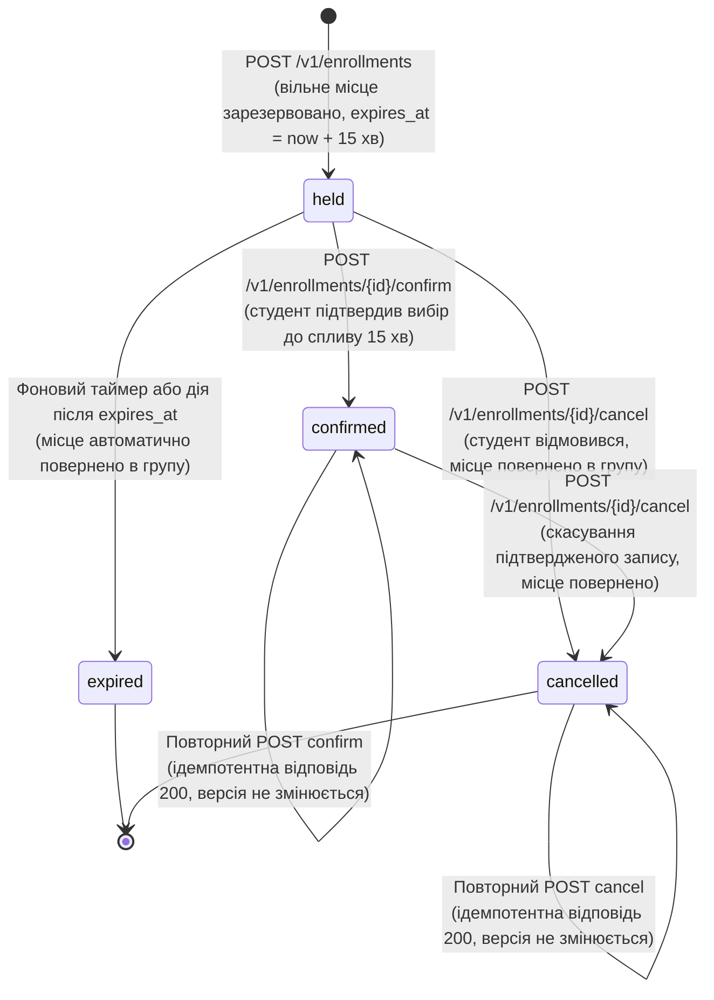
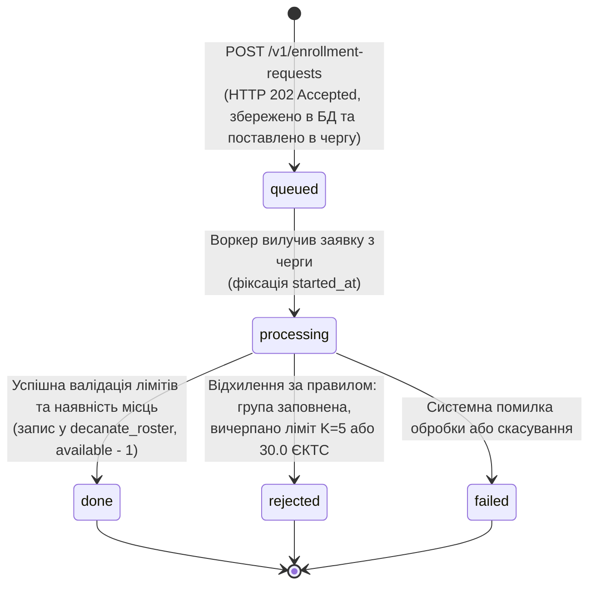
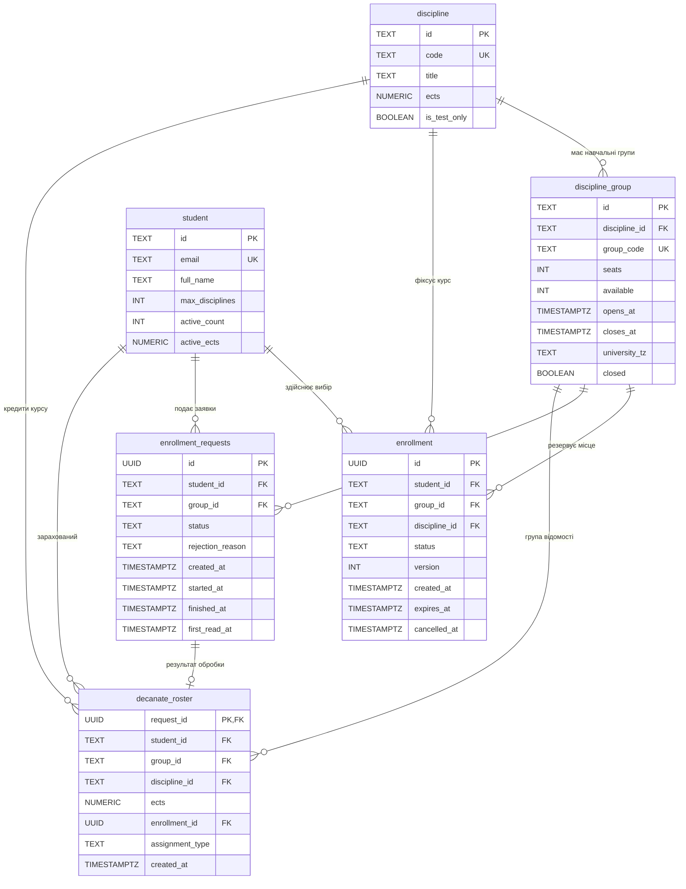
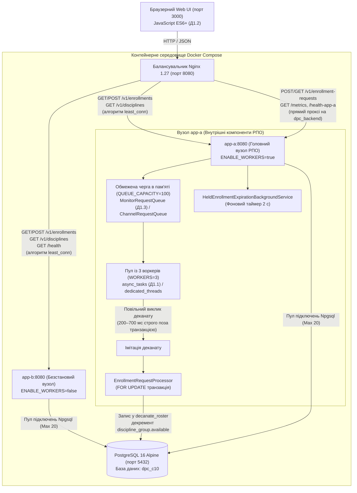

# Спільний навчальний проєкт за темою С10: «Запис на вибіркові дисципліни»
## Лабораторна робота №1: «Розробка базового сервісу та паралельна обробка запитів»

---

## 1. Курс і тема

- **Назви навчальних курсів**:
  1. **«Обмін даними у Web-застосунках»** (обов'язкові пункти ядра **О1.1–О1.4, О1.7**, інфраструктурні пункти **О1.5, О1.6** та додаткові бонуси **Д1.1, Д1.2, Д1.3, Д1.4, Д1.5**).
  2. **«Розподілені та паралельні обчислення» (РПО)** (обов'язкові пункти **О1.1–О1.5** та додаткові бонуси **Д1.1, Д1.2, Д1.3, Д1.4**).
- **Ідентифікатор і назва теми**: **С10. Запис на вибіркові дисципліни** (каталог вибіркових курсів, формування навчальних груп, контроль лімітів кредитів ЄКТС та кількості дисциплін, ведення відомостей деканату).
- **Склад команди**:
  - **Зінківський Тимур Євгенійович**, студент групи **ІТІНФ-23-2**.
  - **Формат роботи**: Проєкт виконується **індивідуально (в соло)** з офіційного дозволу та погодження викладача.
- **Технологічний стек**:
  - Бекенд: `.NET 8.0 SDK / ASP.NET Core Kestrel` (C# 12, Minimal API, чистий ADO.NET через `Npgsql 8.0` без сторонніх ORM).
  - База даних: `PostgreSQL 16 Alpine` (реляційна схема 3НФ, версіоновані міграції SQL з контролем контрольних сум SHA-256).
  - Балансування та мережа: `Nginx 1.27 Alpine` (алгоритм балансування `least_conn`, проксі для Web API, виділений маршрут `/health-app-a` та черга РПО).
  - Клієнт: `JavaScript ES6+ / HTML5 / CSS3` (без сторонніх бібліотек чи фреймворків, порт 3000).
  - Тестування та перевірка: `Spectral CLI 6.11` (OpenAPI 3.1), `xUnit` (85 тестових випадків у 6 тестових класах: 22 випадки доменних правил і черг, 9 сценаріїв статус-кодів 400/404/409/422, 11 тестів атомарної фіксації t4 first_read_at та детермінованої синхронізації COMMIT/FinishProcessingTimestamp, 8 тестів відновлення queued/processing при перезапуску, 12 наскрізних E2E HTTP-тестів, 23 тести суворої ізоляції, перевірки прав SQLSTATE 42501/28P01 та безпеки тестового середовища; мінімальний поріг verify_all.ps1 — 85 тестів), `PowerShell 7+ / Bash` (скрипти комплексної автоматизованої атестації).

---

## 2. Проєкт

### 2.1 Призначення платформи
Платформа призначена для обслуговування кампанії вибору навчальних дисциплін студентами університету. У момент відкриття реєстрації сервіс витримує пікове навантаження (сотні запитів за хвилину), забезпечує строге збереження місткості академічних груп, запобігає переповненню та формує офіційні відомості деканату для навчального відділу.

### 2.2 Спільний ресурс та головний інваріант
- **Спільний ресурс**: Таблиця `discipline_group` та SQL-представлення `group_seats`.
- **Головний інваріант (Invariant)**:
  Для будь-якої навчальної групи кількість фактично зайнятих місць ніколи не перевищує ліміт місць, а залишок доступних місць є строго невід'ємним:
  $$\text{taken} \le \text{seats}, \quad \text{available} \ge 0$$
  де у нормальному (SAFE) режимі діє точне співвідношення $\text{available} = \text{seats} - \text{taken}$.
  
  *Примітка щодо формули обчислення поля `taken` у представленні `group_seats`:*
  $$\text{taken} = \max(\text{seats} - \text{available},\; \text{roster\_count})$$
  Ця формула описує динамічне обчислюване поле представлення, створене спеціально для запобігання приховуванню збоїв: у разі конкурентного переповнення або втраченого оновлення (Lost Update / TOCTOU в UNSAFE-режимі без блокування `FOR UPDATE`, коли паралельні транзакції читають одне й те саме застаріле значення `available`, одночасно проходять бізнес-перевірку та перезаписують лічильник), поле `taken` спирається на фактичну кількість внесених студентів $\text{roster\_count}$, явно демонструючи порушення інваріанта $\text{taken} \le \text{seats}$.
  - `seats` — загальна затверджена місткість академічної групи;
  - `available` — кількість фактично доступних вільних місць у групі;
  - `taken` — кількість зайнятих місць;
  - `roster_count` — фактична кількість студентів, внесених до відомості деканату (`decanate_roster`).

### 2.3 Зміст і призначення чисельного розрахунку (перспектива ЛР2)
Обчислювальна модель прогнозування навантаження базується на функції інтенсивності вхідного потоку заявок від студентів з моменту відкриття кампанії вибору:
$$\lambda(t) = B + A e^{-t/\tau}, \quad t \in [0; T]$$
Первісна функції:
$$\Phi(t) = B t - A \tau e^{-t/\tau}$$
Інтеграл $I = \int_0^T \lambda(t)\,dt = \Phi(T) - \Phi(0)$ визначає сумарну кількість очікуваних запитів за перші $T$ хвилин і використовується для аналітичної оцінки навантаження та вибору статичних параметрів черги й пулу воркерів (конфігурація `QUEUE_CAPACITY` та `WORKERS`). В ЛР2 цей інтеграл обчислюється паралельними процесами методом трапецій/Сімпсона та Монте-Карло з порівнянням проти аналітичного еталону.

### 2.4 Пакетний звіт (перспектива ЛР4)
Пакетний звіт формується кластером Apache Spark на основі зрізу даних у форматі Parquet. Звіт розраховує підсумкову заповненість академічних груп за дисциплінами, кафедрами та факультетами. Для дослідження перекосу навантаження (Data Skew) закладено «гарячий ключ» — популярна вибіркова дисципліна, на яку припадає до 40% усіх поданих заяв.

### 2.5 Потік подій (перспектива ЛР5)
Джерелом потоку подій є топік Apache Kafka `enrollments`. Обробка здійснюється Spark Structured Streaming за схемою ковзного вікна тривалістю 1 хвилина з кроком 10 секунд за ключем `discipline_id`. Система агрегує темп успішних зарахувань та коректно враховує запізнілі події (наприклад, затримки мережі мобільних клієнтів тривалістю до 1 хвилини через Watermarking).

### 2.6 Життєвий цикл та діаграми станів

#### 2.6.1 Web-контур: Життєвий цикл запису (`enrollment`, О1.1 Web)



##### Таблиця переходів станів Web-запису:

| Початковий стан | Подія (HTTP-запит) | Кінцевий стан | Зміна версії | Вплив на `available` | Вплив на ліміти студента |
| :--- | :--- | :--- | :--- | :--- | :--- |
| *(новий)* | `POST /v1/enrollments` | `held` | $v = 1$ | `available = available - 1` | `active_count + 1`, `active_ects + ects` |
| `held` | `POST /v1/enrollments/{id}/confirm` | `confirmed` | $v = v + 1$ | Не змінюється (вже зарезервовано) | Не змінюється |
| `held` | `POST /v1/enrollments/{id}/cancel` | `cancelled` | $v = v + 1$ | `available = available + 1` | `active_count - 1`, `active_ects - ects` |
| `held` ($t > \text{expires\_at}$) | Фоновий таймер або дія після спливу часу | `expired` | $v = v + 1$ | `available = available + 1` (повернення) | `active_count - 1`, `active_ects - ects` |
| `confirmed` | `POST /v1/enrollments/{id}/cancel` | `cancelled` | $v = v + 1$ | `available = available + 1` (повернення) | `active_count - 1`, `active_ects - ects` |
| `confirmed` | `POST /v1/enrollments/{id}/confirm` | `confirmed` | Не змінюється | Не змінюється (ідемпотентно) | Не змінюється |
| `cancelled` | `POST /v1/enrollments/{id}/cancel` | `cancelled` | Не змінюється | Не змінюється (ідемпотентно) | Не змінюється |

#### 2.6.2 РПО-контур: Життєвий цикл заявки (`enrollment_requests`, О1.1 РПО)



#### 2.6.3 Чисельні параметри та припущення предметної області (О1.1 Web та О1.1 РПО)

| Параметр | Значення | Призначення та бізнес-правило | Де перевіряється |
| :--- | :--- | :--- | :--- |
| **$K$ (max_disciplines)** | **5** (налаштовується 1–10) | Максимальна кількість активних вибіркових дисциплін на одного студента | `EnrollmentPolicy.cs`, `student.max_disciplines` |
| **Max ECTS** | **30.0** кредитів ЄКТС | Граничний обсяг кредитів вибіркових дисциплін за семестр (`NUMERIC(3,1)`) | `EnrollmentDomainRules.cs`, `student.active_ects` |
| **Резервування (Hold)** | **15 хвилин** | Час утримання місця у стані `held` (`expires_at = created_at + 15 min`) | Web-контур `POST /v1/enrollments` |
| **DISC-WEB-01** | 25 місць (6.0 ЄКТС) | Основна навчальна група Web-програмування | Каталог курсів, Web API |
| **DISC-AI-02** | 25 місць (5.0 ЄКТС) | Група штучного інтелекту (ліниве прострочення `held -> expired`) | `verify_all.ps1` (Етап 10) |
| **DISC-SEC-03** | 15 місць (5.0 ЄКТС) | Група кібербезпеки | Каталог курсів |
| **DISC-DPC-01** | 30 місць (6.0 ЄКТС) | Головна група РПО для навантаження черги, закону Літтла та SIGTERM | `verify_all.ps1` (Етапи 3, 4, 6, 7, 8, 9) |
| **DISC-TEST-SAFE** | 5 місць (3.0 ЄКТС) | Тестова група конкурентного навантаження 20 запитами (SAFE vs UNSAFE) | `verify_all.ps1` (Етап 5) |
| **DISC-ONE-SEAT** | 1 місце (4.0 ЄКТС) | Група з єдиним місцем для перевірки відхилення `group_full` (409) | `verify_all.ps1` (Етап 10) |
| **DISC-WINDOW-TEST** | 20 місць (6.0 ЄКТС) | Група з закритим вікном для перевірки відхилення `enrollment_window_closed` (422) | `verify_all.ps1` (Етап 10) |

#### 2.6.4 Взаємодія контурів Web та РПО у спільній темі С10 (§1.10 РПО / §1.9 Web)
Згідно з карткою спільної теми C10 (розділ 6 методичних вказівок), контури Web та РПО гармонійно поєднані через спільні доменні сутності та ідентифікатори `student_id`, `group_id`, `request_id`:
1. **Первинний вибір та резервування місця через інтерактивний Web-контур**:
   - Студент обирає навчальну групу через браузерний клієнт (`POST /v1/enrollments`), сервіс атомарно резервує місце в групі `discipline_group` (`available - 1`) та створює запис у стані `held` на 15 хвилин.
   - Під час підтвердження вибору студентом (`POST /v1/enrollments/{id}/confirm`) запис переходить у стан `confirmed`, фіксуючи остаточне резервування місця в межах Web-контуру.
   - У разі скасування студентом (`POST /v1/enrollments/{id}/cancel`) або прострочення утримання (`expired`) зарезервоване місце негайно повертається до вільного вибору (`available + 1`).
   - Web-контур фокусується суто на інтерактивному виборі та управлінні доступними місцями, **не виконуючи прямих записів до таблиць контуру РПО (`decanate_roster` та `enrollment_requests`)**.
2. **Пакетний асинхронний прийом та формування відомості через контур РПО**:
   - Контур РПО реалізує надійну гібридну чергу: персистентна фіксація заявок у PostgreSQL (`enrollment_requests`, початковий статус `queued`), швидка буферизація в пам'яті через обмежену чергу `IBoundedRequestQueue` (`QUEUE_CAPACITY = 100`, негайна відповідь `202 Accepted`) та автоматичне відновлення після аварійного перезапуску (Restart Recovery).
   - Воркери РПО виконують симуляцію повільного виклику перевірки студента в системі деканату (200–700 мс) **поза критичною секцією БД**, після чого в транзакції атомарно декрементують `available` та формують офіційну відомість деканату `decanate_roster`.
   - Контур РПО відповідає за ведення офіційної відомості деканату `decanate_roster` (перерозподіл студентів за другим пріоритетом `second_choice` після закриття груп заплановано як планове розширення у ЛР2).
3. **Єдине джерело істини та захист від дублікатів**:
   - Стан місць для обох контурів узгоджено агрегується через спільне SQL-представлення `VIEW group_seats`, де зайняті місця `taken` обчислюються як `GREATEST(seats - available, roster_count)`.
   - Метод `HasActiveEnrollmentForDisciplineAsync` виконує об'єднану перевірку (`UNION ALL`) таблиць `enrollment` та `decanate_roster`, унеможливлюючи повторний запис на ту саму дисципліну через будь-який із каналів.
4. **Архітектурна перспектива асинхронної інтеграції (ЛР4)**:
   - Передача підтвердженого Web-вибору до контуру РПО для фіксації у відомості деканату архітектурно проєктується як подійна інтеграція (Event-Driven Integration) з публікацією доменної події `EnrollmentConfirmedEvent(enrollment_id, student_id, group_id, request_id)` через брокер повідомлень (Apache Kafka / RabbitMQ). Це гарантує низьку зв'язність сервісів, збереження наскрізного `request_id` та повну автономність обох контурів відповідно до методичних рекомендацій.

### 2.7 Реляційна схема бази даних та усвідомлена денормалізація (О1.2 Web)

> [!NOTE]
> **Усвідомлена денормалізація (Conscious Denormalization) та композитні зовнішні ключі (3НФ $\to$ BCNF)**:
> За канонічною 3НФ атрибут `discipline_id` у таблицях `enrollment` та `decanate_roster` є транзитивно залежним через `group_id -> discipline_group.discipline_id`. Проте рушій PostgreSQL не підтримує міжтабличні умови в обмеженнях цілісності `UNIQUE (...) WHERE ...`. Для апаратного забезпечення інваріанта «студент не може мати два активні записи на одну й ту саму дисципліну» створено частковий індекс:
> `CREATE UNIQUE INDEX idx_enrollment_active_student_discipline ON enrollment(student_id, discipline_id) WHERE status IN ('held', 'confirmed');`
> Щоб унеможливити будь-яку неузгодженість між групою та дисципліною, у міграції `005_composite_foreign_keys.sql` створено унікальний ключ `discipline_group(id, discipline_id)` та композитні зовнішні ключі:
> `FOREIGN KEY (group_id, discipline_id) REFERENCES discipline_group(id, discipline_id) ON DELETE CASCADE;`
> Це усуває аномалії вставки та оновлення і математично доводить збереження реляційної цілісності.



---

## 3. Архітектура

Архітектура системи відповідає вимогам інтеграції розділу §1.10 (РПО) та §1.9 (Web), поєднуючи синхронний клієнтський Web-інтерфейс та асинхронний високонавантажений контур пакетної обробки:



### Розподіл відповідальності між контурами (§1.10)
1. **Синхронний Web-контур (`/v1/enrollments`, `/v1/disciplines`)**:
   - Приймає персональний вибір студента через браузерний клієнт.
   - Запити розподіляються Nginx за алгоритмом `least_conn` між `app-a` та `app-b`.
   - Ідентифікатор студента визначається виключно із заголовка `X-User-Id` (передача `student_id` у тілі суворо заборонена — повертається `422 Unprocessable Entity`).
   - Керує станами таблиці `enrollment` (`held -> confirmed | cancelled | expired`), зміною доступних місць `discipline_group.available` та статистикою студента (`enrolled_disciplines_count`, `enrolled_ects`).
   - Web-контур **не виконує прямих записів у таблицю `decanate_roster` та таблицю черги `enrollment_requests`** (передача підтвердженого результату вибору до відомості деканату проєктується через асинхронну подійно-орієнтовану інтеграцію ЛР4).
2. **Асинхронний контур РПО (`/v1/enrollment-requests`, `/metrics`, `/v1/decanate-roster`)**:
   - Поєднує персистентне збереження заявок у PostgreSQL (`enrollment_requests`) з високоефективною обмеженою чергою в пам'яті вузла `app-a` та механізмом Restart Recovery при перезапуску процесу. Прийом заявки повертає негайну відповідь `202 Accepted`.
   - Забезпечує негайний зворотний тиск (Backpressure): якщо в черзі немає вільних слотів (`QUEUE_CAPACITY = 100`), метод `TryReserveSlot()` миттєво повертає `429 Too Many Requests` із заголовком `Retry-After: 1` **без навантаження бази даних**.
   - Пул із 3 паралельних воркерів вилучає заявки, виконує обов'язковий повільний виклик (200–700 мс) строго поза критичною секцією БД, фіксує зарахування у `decanate_roster` та декрементує `discipline_group.available`.
   - Відповідає за формування офіційної відомості деканату `decanate_roster` (перерозподіл студентів за другим вибором `second_choice` після закриття запису є плановою функціональністю ЛР2).
   - Контур РПО **не здійснює прямих записів у таблицю `enrollment`**.
3. **Єдине предметне правило для обох контурів (§1.10)**:
   - Перевірка «чи записаний студент уже на цю дисципліну» виконується уніфікованим SQL-запитом, який перевіряє **обидві таблиці одночасно** (`enrollment` у статусах held/confirmed та `decanate_roster`). Студент, зарахований через чергу РПО, не може повторно записатися на ту саму дисципліну через Web, і навпаки.
4. **Єдине джерело істини для інваріанта місткості**:
   - Вільні місця: `free_seats = available`.
   - Зайняті місця: `taken = GREATEST(seats - available, (SELECT COUNT(*)::INT FROM decanate_roster dr WHERE dr.group_id = g.id))`.
   - Представлення `group_seats` формується на рівні ядра PostgreSQL через агрегацію: `roster_count = COUNT(*) FROM decanate_roster`.

---

## 4. Структура репозиторію

```text
pojekt/
├── .spectral.yaml                                 # Правила лінтування OpenAPI 3.1
├── compose.yaml                                   # Опис багатоконтейнерної системи (app-a, app-b, nginx, postgres)
├── Dockerfile                                     # Multi-stage збірка .NET 8.0 SDK -> ASP.NET Core Runtime
├── nginx.conf                                     # Конфігурація Nginx: least_conn, проксі РПО та виділений /health-app-a
├── openapi.yaml                                   # Повний контракт API (OpenAPI 3.1), сертифікований Spectral CLI
├── README.md                                      # Звітна документація проєкту за канонічною структурою §1.9
├── client/                                        # Клієнтський модуль Web-контуру (пункт Д1.2 Web)
│   ├── api.js                                     # Безпечна клієнтська логіка на JavaScript ES6+ (textContent, addEventListener)
│   ├── index.html                                 # Інтерфейс вибору курсів, підтвердження та перегляду черги (вбудовані CSS-стилі)
│   ├── serve.mjs                                  # Автономний Node.js HTTP-сервер для клієнта на порті 3000
│   ├── start_client.ps1                           # Скрипт локального хостингу вебклієнта (PowerShell)
│   └── start_client.sh                            # Скрипт локального хостингу вебклієнта (Bash)
├── migrations/                                    # Версіоновані міграції PostgreSQL
│   ├── 001_init_c10_schema.sql                    # Таблиці предметної області, обмеження FK/CHECK, VIEW group_seats
│   ├── 002_seed_c10_data.sql                      # Довідкові дисципліни, групи та тестові пули студентів
│   ├── 003_update_group_seats_and_idempotency.sql # Оновлення VIEW group_seats (GREATEST) та локальний індекс (student_id, idempotency_key)
│   ├── 004_unique_idempotency_key.sql             # Спроба створення глобального індексу (no-op через IF NOT EXISTS та наявність імені з 003)
│   ├── 005_composite_foreign_keys.sql             # Композитні FK (group_id, discipline_id) для усвідомленої денормалізації
│   └── 006_global_unique_idempotency_key.sql      # Справжній глобальний унікальний індекс: DROP старого індексу + створення idx_enrollment_requests_idempotency_global
├── scripts/                                       # Сценарії автоматизованої перевірки
│   ├── verify_all.ps1                             # Комплексний сценарій атестації всіх пунктів (PowerShell 7+)
│   └── verify_all.sh                              # Bash-обгортка для середовищ Linux/macOS
├── src/                                           # Вихідний код бекенд-сервісу .NET 8
│   └── EnrollmentService/
│       ├── EnrollmentService.csproj               # Файл проєкту .NET 8 (Nullable enable, ImplicitUsings)
│       ├── Program.cs                             # Точка входу, реєстрація DI, конвеєр HTTP, перехоплення SIGTERM
│       ├── Contracts/                             # DTO у форматі snake_case
│       │   ├── DpcDtos.cs                         # DTO черги, заявок, відомості деканату та стану місць
│       │   └── WebDtos.cs                         # DTO вибору дисциплін, записів та пагінації (без зайвих полів)
│       ├── Domain/                                # Чиста бізнес-логіка предметної області
│       │   ├── Entities.cs                        # Доменні сутності (StudentEntity, DisciplineGroupEntity)
│       │   ├── EnrollmentDomainRules.cs           # Чисті функції вікна [opens_at, closes_at), ліміти ЄКТС, Base64-курсори
│       │   ├── EnrollmentPolicy.cs                # Єдина чиста доменна функція валідації правил для Web і РПО
│       │   └── ServiceResult.cs                   # Типізований монолітний результат доменних операцій
│       ├── Endpoints/                             # Маршрути Minimal API
│       │   ├── AdminEndpoints.cs                  # Стендовий маршрут /v1/admin/reset (захищений ALLOW_TEST_OVERRIDES)
│       │   ├── DiagnosticsEndpoints.cs            # Маршрути GET /, GET /health, GET /metrics
│       │   ├── EnrollmentEndpoints.cs             # Web-маршрути: POST, GET, confirm, cancel
│       │   ├── EnrollmentRequestEndpoints.cs      # РПО-маршрути: POST (TryReserveSlot -> 429), GET за ID
│       │   └── GroupEndpoints.cs                  # Каталог груп, ресурс group-seats, відомість, закриття групи
│       ├── Extensions/
│       │   └── ServiceCollectionExtensions.cs     # Реєстрація інфраструктури, сховищ та пулу воркерів
│       ├── Http/                                  # HTTP-інфраструктура
│       │   ├── BearerAuthMiddleware.cs            # Авторизація Bearer-токена для маршрутів РПО (HTTP 401)
│       │   ├── GracefulShutdownMiddleware.cs      # Відсікання нових мутуючих запитів кодом 503 при зупинці SIGTERM
│       │   ├── HttpPayloadHelper.cs               # Парсер тіла: 400 (помилка синтаксису) та 422 (помилка полів)
│       │   ├── ProblemDetailsMapper.cs            # Стандартні відповіді RFC 9457 (application/problem+json)
│       │   ├── RequestIdentity.cs                 # Контекст запиту (Correlation ID, User ID, Trace ID)
│       │   └── RequestIdentityMiddleware.cs       # Виділення X-User-Id, X-Request-ID, W3C traceparent, журнал JSON
│       ├── Infrastructure/
│       │   └── ServiceOptions.cs                  # Параметри конфігурації зі змінних середовища
│       ├── Metrics/
│       │   └── MetricsCollector.cs                # Монотонні таймстампи, розрахунок закону Літтла
│       ├── Queues/                                # Реалізації обмеженої черги в пам'яті (РПО О1.2, Д1.3)
│       │   ├── IBoundedRequestQueue.cs            # Уніфікований інтерфейс обмеженої черги із резервуванням слотів
│       │   ├── ChannelRequestQueue.cs             # Реалізація на базі System.Threading.Channels.Channel
│       │   └── MonitorRequestQueue.cs             # Реалізація на базі lock та Monitor.Wait / Monitor.PulseAll
│       ├── Repositories/                          # Рівень доступу до даних (чистий SQL без ORM)
│       │   ├── DecanateRepository.cs              # Доступ до таблиці decanate_roster
│       │   ├── EnrollmentRepository.cs            # Таблиці enrollment, student, ліниве прострочення
│       │   ├── EnrollmentRequestRepository.cs     # Таблиця enrollment_requests
│       │   ├── GroupRepository.cs                 # Таблиці discipline, discipline_group, VIEW group_seats
│       │   └── IDbConnectionFactory.cs            # Інтерфейс та фабрика з'єднань Npgsql з пулом (Max 20)
│       └── Services/                              # Сервісний рівень та фонова обробка
│           ├── DatabaseInitializer.cs             # Перевірка незмінності sha256 та накатування SQL-міграцій
│           ├── EnrollmentService.cs               # Оркестрація транзакцій Web-контуру (канонічний порядок блокувань)
│           ├── EnrollmentWorkerPool.cs            # Безпечний життєвий цикл пулу воркерів (ізоляція винятків)
│           ├── HeldEnrollmentExpirationBackgroundService.cs # Фоновий таймер звільнення held-записів (2 с)
│           └── Processing/
│               └── EnrollmentRequestProcessor.cs  # Єдиний процесор обробки заявок (безпечний FOR UPDATE та UNSAFE)
└── tests/
    └── EnrollmentService.Tests/
        ├── DomainAndQueueTests.cs                 # 22 тестові випадки xUnit (14 [Fact] та 8 [InlineData] у межах [Theory])
        ├── BusinessErrorStatusTests.cs            # 9 тестів відповідності бізнес-відмов HTTP-статусам (400/404/409/422)
        ├── FirstReadTimeTrackingTests.cs          # 11 тестів атомарної фіксації t4 first_read_at (усі 8 сценаріїв О1.5 DPC + детермінований тест гонки COMMIT/finish + відкат)
        ├── RestartAndRecoveryTests.cs             # 8 тестів відновлення queued/processing із PostgreSQL при старті
        ├── E2EHttpEndpointTests.cs                # 12 наскрізних E2E HTTP-тестів через WebApplicationFactory і PostgreSQL
        ├── TestEnvironmentSafetyTests.cs          # 23 тести перевірки ізоляції тестового середовища, створення dpc_c10_test, перевірки SQLSTATE 42501/28P01 та блокування dpc_c10
        ├── TestEnvironment.cs                    # Виділена конфігурація тестового середовища (dpc_c10_test) та очищення даних
        ├── TestCollectionOrder.cs                # Послідовне виконання тестів бази даних ([assembly: CollectionBehavior])
        └── appsettings.Test.json                 # Локальна конфігурація тестового запуску
```

---

## 5. Збирання й запуск

### 5.1 Вимоги до середовища
- **Операційна система**: Windows 10/11 (з WSL2), Ubuntu 22.04+, macOS 13+.
- **Процесор і ресурси**: $\ge 4$ CPU ядра, не менше 4 ГБ вільної оперативної пам'яті (RAM).
- **Платформи розробки та виконання**:
  - **.NET 8.0 SDK** (для побудови та проходження 85 тестових випадків модульних, інтеграційних та E2E-тестів; мінімальний поріг — 85).
  - **PowerShell 7+ (`pwsh`)** (для кросплатформенного запуску сценарію атестації `verify_all.ps1`).
  - **Node.js 18+ / npm** (для валідації специфікації лінтером `@stoplight/spectral-cli` та локального клієнта).
- **Контейнеризація**:
  - **Docker**: версія `>= 24.0`.
  - **Docker Compose**: версія `>= 2.20` (Compose V2).
- **Вільні мережеві порти**:
  - `8080`: точка входу Nginx (Web API та РПО).
  - `5432`: PostgreSQL 16 Alpine.
  - `3000`: клієнтський вебзастосунок (чистий JS ES6+).

### 5.2 Таблиця параметрів конфігурації

| Змінна середовища | Опис параметра | Типове значення | Де використовується |
| :--- | :--- | :--- | :--- |
| `INSTANCE_ID` | Унікальний ідентифікатор екземпляра вузла | `app-a` / `app-b` | Заголовки відповідей, логування |
| `DB_CONNECTION_STRING` | Рядок з'єднання з базою даних | `Host=postgres;Port=5432;...Maximum Pool Size=20` | Пул з'єднань Npgsql (захист від вичерпання) |
| `API_AUTH_TOKEN` | Статичний Bearer-токен аутентифікації | `secret-c10-token-2026` | `BearerAuthMiddleware` |
| `QUEUE_CAPACITY` | Гранична місткість черги в пам'яті | `100` | Backpressure 429 |
| `WORKERS` | Кількість паралельних обробників | `3` | `EnrollmentWorkerPool` |
| `EXECUTION_MODEL` | Модель виконання (`async_tasks` / `dedicated_threads`) | `async_tasks` | Пул воркерів (Д1.1) |
| `QUEUE_ENGINE` | Рушій черги (`custom_monitor` / `system_channel`) | `custom_monitor` | Синхронізація (Д1.3) |
| `ENABLE_WORKERS` | Дозвіл на запуск воркерів на даному вузлі | `true` (app-a), `false` (app-b) | Розподіл ролей вузлів |
| `SLOW_CALL_MIN_MS` | Мінімальний час симуляції виклику деканату | `200` | Симуляція затримки |
| `SLOW_CALL_MAX_MS` | Максимальний час симуляції виклику деканату | `700` | Симуляція затримки |
| `UNSAFE_MODE` | Режим демонстрації гонитви без FOR UPDATE (вимагає `ALLOW_TEST_OVERRIDES=true`) | `false` | Процесор заявок (О1.4) |
| `ALLOW_TEST_OVERRIDES` | Дозвіл на виклик стендового скидання `/v1/admin/reset` та UNSAFE_MODE | `false` | Захист у робочому режимі |
| `TEST_DB_CONNECTION_STRING` | Виділений рядок з'єднання для тестів (суворо вимагає базу `dpc_c10_test`; блокує робочу `dpc_c10`) | `Host=localhost;...Database=dpc_c10_test;...` | `TestEnvironment` |
| `TEST_API_AUTH_TOKEN` | Ізольований тестовий Bearer-токен (відмінний від робочого) | `test-c10-isolated-bearer-token` | `TestEnvironment` |

> [!IMPORTANT]
> **Розділення виробничого та тестового оточення**:
> - Для виробничого середовища (`Production`) параметри `DB_CONNECTION_STRING` та `API_AUTH_TOKEN` мають налаштовуватися окремо через змінні оточення або менеджер секретів (зразок у [.env.example](.env.example)). Запуск у production із типовими секретами блокується з винятком `InvalidOperationException`.
> - Інтеграційні тести використовують окремий тестовий токен (`test-c10-isolated-bearer-token`) і суворо вимагають виділену базу даних `dpc_c10_test` (або `dpc_c10_test_*`) на локальному хості. Підключення до основної БД `dpc_c10` або баз із довільними назвами беззаперечно блокується із `[CRITICAL SAFETY ERROR]`, що гарантує захист від модифікації чи видалення робочих даних.

### 5.3 Керування міграціями бази даних
Застосування міграцій відбувається **автоматично** при старті сервісу в модулі `DatabaseInitializer`:
- Кожен SQL-файл із директорії `migrations/` перевіряється на незмінність за контрольним хешем SHA-256. Якщо раніше застосований файл було змінено без створення нової міграції, сервіс аварійно зупиняється з винятком `InvalidOperationException` для гарантії цілісності схеми.

> [!NOTE]
> **Принцип незмінності міграцій (Migration Immutability — 004 vs 006)**:
> У міграції `003` було створено складений унікальний індекс `idx_enrollment_requests_idempotency` за парою `(student_id, idempotency_key)`. У міграції `004` планувалося зробити його глобальним за `(idempotency_key)`, але через директиву `CREATE UNIQUE INDEX IF NOT EXISTS` з тим самим іменем індексу рушій PostgreSQL пропустив команду (no-op), зберігши попередній локальний індекс.
> За промисловим регламентом контролю версій схеми БД раніше застосовані файли міграцій суворо заборонено модифікувати в репозиторії заднім числом, оскільки їхній хеш SHA-256 зафіксовано в системній таблиці `schema_migrations` робочих і тестових середовищ. Тому коректне виправлення виконано за стандартом roll-forward накатуванням міграції `006_global_unique_idempotency_key.sql`, яка явно видаляє попередній індекс (`DROP INDEX IF EXISTS idx_enrollment_requests_idempotency`) та створює справжній глобальний унікальний індекс `idx_enrollment_requests_idempotency_global ON enrollment_requests(idempotency_key)`.

- Команда ручної перевірки стану таблиць через CLI контейнера:
```bash
docker compose exec -e PGPASSWORD=dpc_password postgres psql -U dpc_user -d dpc_c10 -c "\dt"
```

### 5.4 Команди збирання, запуску та тестування

#### 1. Збирання та запуск контейнерної платформи (єдина команда):
```bash
docker compose up -d --build
```

#### 3. Запуск комплексного скрипту автоматизованої атестації:
```powershell
pwsh scripts/verify_all.ps1
```
*(Скрипт перевіряє лінтування контракту, проходження всіх 85 тестових випадків модульних, інтеграційних та E2E-тестів, перевірку параметрів безпеки, Backpressure 429 при стійкому навантаженні 50 клієнтами, захист від гонитви SAFE vs UNSAFE на одній групі, закон Літтла, Graceful Shutdown з кодом 503, курсорне пагінування, життєвий цикл Web та балансування).*

#### 4. Запуск клієнтського вебзастосунку (пункт Д1.2 Web):
```powershell
pwsh client/start_client.ps1
```
Після запуску відкрийте браузер: **`http://localhost:3000`**.

#### 5. Ручний запуск модульних тестів:
```bash
dotnet test tests/EnrollmentService.Tests/EnrollmentService.Tests.csproj
```

#### 6. Перевірка специфікації OpenAPI лінтером Spectral:
```bash
npx --yes @stoplight/spectral-cli lint openapi.yaml --fail-severity=warn
```

---

## 6. Лабораторні роботи

### 6.1 Лабораторна робота №1: «Сервіс із чергою, контракт і паралельна обробка запитів»

У межах ЛР1 реалізовано повний обсяг обов'язкових пунктів обох курсів та 9 захищуваних додаткових пунктів (бонусів).

#### 6.1.0 Відповідність предметних маршрутів ролям контракту (x-course) для засобу check

Згідно з методичними вказівками обох курсів («Для знаходження предметних маршрутів засобом check використайте ролі x-course із шаблону контракту або явно опишіть відповідність маршрутів»), сервіс реалізує розширення `x-course` у специфікації `openapi.yaml` та закріплює наступну однозначну таблицю відповідності:

| Маршрут | HTTP-метод | Роль `x-course` | Контур та призначення у спільній темі С10 |
| :--- | :--- | :--- | :--- |
| `/health` | `GET` | `shared` | Перевірка працездатності (liveness) процесу без навантаження БД |
| `/health-app-a` | `GET` | `shared` | Прямий замір живучості навантаженого вузла черги `app-a` під час досліду О1.2 |
| `/health-app-b` | `GET` | `shared` | Прямий замір живучості другого вузла `app-b` за балансувальником Nginx |
| `/metrics` | `GET` | `dpc` | Метрики черги РПО, перцентилі p50/p95/p99 та перевірка закону Літтла $L = \lambda \cdot W$ |
| `/v1/disciplines` | `GET` | `web` | Каталог дисциплін і груп, вікна запису `[opens_at, closes_at)`, курсорне пагінування |
| `/v1/students` | `GET` | `web` | Довідник студентів із кредитами ЄКТС та лімітом $K$ вибіркових курсів |
| `/v1/enrollments` | `POST` | `web` | Головна операція: атомарна транзакція запису на дисципліну (`201 Created` + `Location`, стан `held`) |
| `/v1/enrollments` | `GET` | `web` | Список власних записів студента (`X-User-Id`) із курсорним пагінуванням `(created_at, id)` |
| `/v1/enrollments/{id}` | `GET` | `web` | Перегляд деталей конкретного запису студента за рядковим UUID |
| `/v1/enrollments/{id}/confirm` | `POST` | `web` | Підтвердження попереднього запису студентом (`held` $\to$ `confirmed`) |
| `/v1/enrollments/{id}/cancel` | `POST` | `web` | Скасування власного запису студентом із поверненням місця в групі |
| `/v1/groups/{id}/close` | `POST` | `web` | Закриття набору в групу працівником деканату (`closed = true`; у ЛР1 захищено Bearer-токеном, рольовий RBAC — у ЛР3) |
| `/v1/enrollment-requests` | `POST` | `dpc` | Асинхронний прийом заявки в обмежену чергу РПО (`202 Accepted` або `429 Too Many Requests`) |
| `/v1/enrollment-requests/{id}` | `GET` | `dpc` | Опитування стану заявки (`queued -> processing -> done / rejected / failed`) та фіксація `first_read_at` |
| `/v1/group-seats` | `GET` | `dpc` | Стан спільного ресурсу через SQL-представлення `VIEW group_seats` |
| `/v1/group-seats/{id}` | `GET` | `dpc` | Стан місць конкретної групи через `VIEW group_seats` |
| `/v1/decanate-roster` | `GET` | `dpc` | Офіційна відомість деканату `decanate_roster` (перегляд записів основного набору; обробка `second_choice` запланована на ЛР2) |
| `/v1/admin/reset` | `POST` | `shared` | Скидання тестового стенду та перемикання UNSAFE-режиму (захищено `ALLOW_TEST_OVERRIDES`) |

#### 6.1.1 Матриця простежуваності вимог курсу «Обмін даними у Web-застосунках»

| Пункт | Формулювання вимоги | Де реалізовано у коді | Як перевірити автоматично |
| :--- | :--- | :--- | :--- |
| **О1.1** | Модель області: сутності, стани (`held -> confirmed / expired / cancelled`), ліміти $K=5$, 30.0 ЄКТС | [EnrollmentPolicy.cs](src/EnrollmentService/Domain/EnrollmentPolicy.cs), [EnrollmentService.cs](src/EnrollmentService/Services/EnrollmentService.cs) | `pwsh scripts/verify_all.ps1` (Етап 10), `DomainAndQueueTests.cs` |
| **О1.2** | Схема БД 3НФ: PK/FK, NOT NULL, CHECK, UNIQUE, версіоновані міграції | [001_init_c10_schema.sql](migrations/001_init_c10_schema.sql), [DatabaseInitializer.cs](src/EnrollmentService/Services/DatabaseInitializer.cs) | `pwsh scripts/verify_all.ps1` (Етапи 0, 10) |
| **О1.3** | Контракт API OpenAPI 3.1: examples, Problem Details (RFC 9457), лінтування Spectral | [openapi.yaml](openapi.yaml), [ProblemDetailsMapper.cs](src/EnrollmentService/Http/ProblemDetailsMapper.cs) | `npx @stoplight/spectral-cli lint openapi.yaml`, `verify_all.ps1` |
| **О1.4** | Головна операція: перевірка, декремент місць та створення запису в одній транзакції (201 Created) | [EnrollmentService.cs](src/EnrollmentService/Services/EnrollmentService.cs) (оркестрація бізнес-транзакції), [EnrollmentRepository.cs](src/EnrollmentService/Repositories/EnrollmentRepository.cs) (атомарні SQL-операції `FOR UPDATE`) | `pwsh scripts/verify_all.ps1` (Етап 10) |
| **О1.5** | Список із непрозорим курсором (Base64), сортування `(created_at, id)`, пошкоджений курсор — 400 | [EnrollmentService.cs](src/EnrollmentService/Services/EnrollmentService.cs), [EnrollmentDomainRules.cs](src/EnrollmentService/Domain/EnrollmentDomainRules.cs) | `pwsh scripts/verify_all.ps1` (Етап 10) |
| **О1.6** | Система, перевірка живучості й журнал: Nginx least_conn, `X-Request-ID`, структурований JSON-лог | [nginx.conf](nginx.conf), [RequestIdentityMiddleware.cs](src/EnrollmentService/Http/RequestIdentityMiddleware.cs) | `pwsh scripts/verify_all.ps1` (Етапи 2, 10) |
| **О1.7** | Клієнт: виконання операцій вибору, показ Problem Details, толерантність до нових полів сервера | [client/api.js](client/api.js), [client/index.html](client/index.html) | Браузер: `http://localhost:3000` |
| **Д1.1** *(Бонус 1)* | Правило за часом — чиста функція, що отримує поточний час параметром | [EnrollmentDomainRules.cs](src/EnrollmentService/Domain/EnrollmentDomainRules.cs) (`IsWithinEnrollmentWindow`) | `dotnet test` (тест `IsWithinEnrollmentWindow_EnforcesHalfOpenIntervalBoundaries`) |
| **Д1.2** *(Бонус 2)* | Клієнт іншою мовою програмування (JavaScript ES6+ проти C# сервера) | [client/api.js](client/api.js), [client/index.html](client/index.html) | `pwsh client/start_client.ps1` |
| **Д1.3** *(Бонус 3)* | Одне правило RFC 9457 у формі автоматизованого тесту | [ProblemDetailsMapper.cs](src/EnrollmentService/Http/ProblemDetailsMapper.cs), [DomainAndQueueTests.cs](tests/EnrollmentService.Tests/DomainAndQueueTests.cs) | `dotnet test` (тест `Web_D13_Rfc9457_ProblemDetails_ContractCompliance`) |
| **Д1.4** *(Бонус 4)* | Перевірений traceparent записується в журнал як trace_id | [RequestIdentityMiddleware.cs](src/EnrollmentService/Http/RequestIdentityMiddleware.cs) | `pwsh scripts/verify_all.ps1` (Етап 2: валідація W3C traceparent, виділення trace_id та перевірка в JSON-логах app-a/app-b) |
| **Д1.5** *(Бонус 5)* | Точні величини й час: дробові кредити ЄКТС (`NUMERIC(3,1)`), UTC `timestamptz`, часовий пояс `Europe/Kyiv` | [EnrollmentDomainRules.cs](src/EnrollmentService/Domain/EnrollmentDomainRules.cs) | `dotnet test` (тест `CanEnrollWithEcts_AllowsExact30AndRejects30Point5`) |

#### 6.1.2 Матриця простежуваності вимог курсу «Розподілені та паралельні обчислення» (РПО)

| Пункт | Формулювання вимоги | Де реалізовано у коді | Як перевірити автоматично |
| :--- | :--- | :--- | :--- |
| **О1.1** | Приймання запитів: асинхронний 202 Accepted, стани `queued -> processing -> done / rejected / failed` | [EnrollmentRequestEndpoints.cs](src/EnrollmentService/Endpoints/EnrollmentRequestEndpoints.cs), [EnrollmentRequestProcessor.cs](src/EnrollmentService/Services/Processing/EnrollmentRequestProcessor.cs) | `pwsh scripts/verify_all.ps1` (Етап 3) |
| **О1.2** | Обмежена черга (`QUEUE_CAPACITY=100`), швидкий 429 Backpressure, чистий замір `/health` та `/health-app-a` p95 $\le 100$ мс | [MonitorRequestQueue.cs](src/EnrollmentService/Queues/MonitorRequestQueue.cs), [DiagnosticsEndpoints.cs](src/EnrollmentService/Endpoints/DiagnosticsEndpoints.cs) | `pwsh scripts/verify_all.ps1` (Етап 4: 50 клієнтів, p95 <= 5.5 мс) |
| **О1.3** | Пул воркерів: `WORKERS=3`, повільний виклик (200–700 мс) винесено строго за межі транзакції БД | [EnrollmentWorkerPool.cs](src/EnrollmentService/Services/EnrollmentWorkerPool.cs), [EnrollmentRequestProcessor.cs](src/EnrollmentService/Services/Processing/EnrollmentRequestProcessor.cs) | `pwsh scripts/verify_all.ps1` (Етапи 3, 4) |
| **О1.4** | Захист спільного ресурсу: порівняння SAFE (`SELECT ... FOR UPDATE`) проти стану гонитви UNSAFE на одній групі | [EnrollmentRequestProcessor.cs](src/EnrollmentService/Services/Processing/EnrollmentRequestProcessor.cs) | `pwsh scripts/verify_all.ps1` (Етап 5) |
| **О1.5** | Час виконання й метрики: монотонні таймстампи, фіксація `first_read_at`, вибірка 500 замірів у `/metrics` | [MetricsCollector.cs](src/EnrollmentService/Metrics/MetricsCollector.cs), [EnrollmentRequestRepository.cs](src/EnrollmentService/Repositories/EnrollmentRequestRepository.cs) | `pwsh scripts/verify_all.ps1` (Етап 6) |
| **Д1.1** *(Бонус 6)* | Дві моделі виконання воркерів: `async_tasks` (Task.Run) та `dedicated_threads` (виділені Thread) | [EnrollmentWorkerPool.cs](src/EnrollmentService/Services/EnrollmentWorkerPool.cs) | `pwsh scripts/verify_all.ps1` (Етап 8) |
| **Д1.2** *(Бонус 7)* | Перевірка закону Літтла ($L = \lambda \cdot W$) за точним часовим інтегралом довжини черги | [MetricsCollector.cs](src/EnrollmentService/Metrics/MetricsCollector.cs), маршрут `GET /metrics` | `pwsh scripts/verify_all.ps1` (Етап 6) |
| **Д1.3** *(Бонус 8)* | Власна черга на м'ютексі й умовній змінній (`Monitor.Wait` / `Pulse`) + альтернатива `Channel` | [MonitorRequestQueue.cs](src/EnrollmentService/Queues/MonitorRequestQueue.cs), [ChannelRequestQueue.cs](src/EnrollmentService/Queues/ChannelRequestQueue.cs) | `pwsh scripts/verify_all.ps1` (Етап 7), `dotnet test` |
| **Д1.4** *(Бонус 9)* | Graceful Shutdown на SIGTERM: нові запити отримують 503, повне вивантаження черги воркерами | [Program.cs](src/EnrollmentService/Program.cs), `PosixSignalRegistration` | `pwsh scripts/verify_all.ps1` (Етап 9) |

### 6.2 Опис примітивів синхронізації та очікування порожньої черги (РПО О1.2, Д1.3)
Синхронізація доступу до внутрішньої колекції `Queue<QueuedRequestItem>` у класі `MonitorRequestQueue` реалізована за допомогою низькорівневих примітивів CLR:
1. **Критична секція**: Захищена об'єктом `lock (_syncRoot)` (під капотом викликаються системні методи `Monitor.Enter` / `Monitor.Exit`), що унеможливлює конкурентне пошкодження покажчиків черги.
2. **Пасивне очікування на порожню чергу без Busy-Waiting (Timeout-Free)**:
   - **У моделі виділених потоків (`dedicated_threads`)**: коли потік виявляє, що черга порожня (`_queue.Count == 0`), він викликає `Monitor.Wait(_syncRoot)` без штучних періодичних таймаутів. Під час цього виклику потік **атомарно відпускає об'єкт блокування** `_syncRoot` і переводиться планувальником ОС у стан `WaitSleepJoin`, споживаючи **0% процесорного часу**. При надходженні заявки метод `EnqueueReserved` викликає `Monitor.Pulse(_syncRoot)`, що пробуджує рівно один очікуючий потік. При зупинці сервісу викликається `Monitor.PulseAll(_syncRoot)`, гарантуючи вихід усіх потоків.
   - **У моделі асинхронних задач (`async_tasks`)**: очікування реалізовано через чергу `Queue<TaskCompletionSource<bool>> _asyncPulseWaiters` під тим самим м'ютексом `_syncRoot`. Якщо черга порожня, створюється `TaskCompletionSource`, а потік ThreadPool звільняється для обслуговування інших задач. Метод `EnqueueReserved` завершує TCS через `TrySetResult(true)`, що пробуджує асинхронний воркер.
   - Під час зупинки сервісу викликається `Monitor.PulseAll(_syncRoot)` та масовий `TrySetResult(true)` для всіх очікуючих асинхронних TCS, гарантуючи коректне завершення воркерів.

---

## 7. Досліди

### 7.1 Зведена таблиця результатів стендових досліджень

| Дослід | Режим і команда запуску | Початкові дані та навантаження | Очікуваний результат | Фактичний результат (що видно) |
| :--- | :--- | :--- | :--- | :--- |
| **1. Замір живучості `/health` та `/health-app-a` під стійким навантаженням** (РПО О1.2) | `pwsh scripts/verify_all.ps1` (Етап 4)<br>Маршрут Nginx `/health` (балансований `least_conn`) та виділений `/health-app-a` до навантаженого вузла | Стійке навантаження: 50 паралельних клієнтів протягом 8 с. `QUEUE_CAPACITY=100`, `WORKERS=3`. Паралельні заміри по 150 запитів `/health` та `/health-app-a`. | $p95 \le 100$ мс (як для `/health`, так і для `/health-app-a`), негайний 429 Backpressure на надлишкові запити без навантаження на БД, пікова черга досягає ліміту. | **202 Accepted**: 155–158 запитів.<br>**429 Backpressure**: ~8330–8360 відповідей (100% із `Retry-After: 1`).<br>**Пікова черга**: 100/100 (`queue_is_bounded = true`).<br>**`/health` (Nginx)**: p50 = 1.1–1.3 мс, **p95** = 4.9–5.5 мс ($\le 100$ мс).<br>**`/health-app-a`**: p50 = 1.0–1.2 мс, **p95** = 4.8–5.4 мс ($\le 100$ мс). |
| **2. Конкурентний запис: SAFE проти UNSAFE на одній групі** (РПО О1.4) | `pwsh scripts/verify_all.ps1` (Етап 5)<br>Порівняння обробника з `FOR UPDATE` та без нього | Тестова група `DISC-TEST-SAFE` (5 місць).<br>По 20 одночасних запитів від дійсних студентів у двох послідовних прогонах. | У SAFE — рівно 5 done, 15 rejected, інваріант дотримано.<br>В UNSAFE (`UNSAFE_MODE=true`) — переповнення відомості через стан гонитви TOCTOU та Lost Update (`roster_count > seats`). Повільний виклик в обох режимах винесено строго перед транзакцією, конвеєр транзакцій ідентичний. | **SAFE**: 5 done, 15 rejected, `roster_count = 5`, `taken = 5`, `invariant_holds = true`.<br>**UNSAFE**: 9–10 done, `roster_count = 9–10` > seats (5), `taken = 9–10`, `invariant_holds = false` (стан гонитви TOCTOU та Lost Update підтверджено: без `FOR UPDATE` паралельні воркери зчитують застарілий `available`, проходять перевірку та перезаписують залишок місць без умови, записуючи у відомість 9–10 студентів на 5 місць). |
| **3. Перевірка закону Літтла** ($L = \lambda \cdot W$) (РПО Д1.2) | `pwsh scripts/verify_all.ps1` (Етап 6)<br>Маршрут `GET /metrics` | Пакет із 30 запитів до групи `DISC-DPC-01`. Інтегрування довжини черги $\int Q(t)dt$ та незалежний 100 мс семплер у `MetricsCollector`. | $L_{theor} = \lambda \cdot W$ збігається з інтегралом з похибкою $\le 10\%$ та семплером $\le 15\%$, 0 порушень монотонності. | $\lambda \approx 5.6–6.8$ rps, $W \approx 1.9–2.1$ с.<br>$L_{theor} \approx 12.1–13.4$, $L_{observed} \approx 12.0–13.4$, $L_{sampled\_100ms} \approx 12.1–13.3$.<br>**Розбіжність теорія/інтеграл: 0.20–0.22%** ($\le 10\%$).<br>**Розбіжність семплер/теорія: 0.02–0.72%** ($\le 15\%$).<br>Порушень монотонності: 0. |
| **4. Порівняння рушіїв черги в пам'яті** (РПО Д1.3) | `pwsh scripts/verify_all.ps1` (Етап 7)<br>`custom_monitor` vs `system_channel` | Пакет із 20 запитів ($N=20$) до групи `DISC-DPC-01` через пул із 3 воркерів. Замір інтервалів `processing_time_ms` та `full_domain_execution_ms`. | Обидва рушії черги надійно обробляють 20/20 запитів без втрат і дедлоків. Завдяки виносу повільного виклику за межі критичної секції БД обробка 20 запитів виконується за ~3 с. | **custom_monitor**: 20 done, `processing` p50 = 401–480 мс, p95 = 648–670 мс; `full_execution` p50 = 1.66–1.88 с, p95 = 3.00–3.32 с.<br>**system_channel**: 20 done, `processing` p50 = 385–433 мс, p95 = 692–704 мс; `full_execution` p50 = 1.73–1.76 с, p95 = 2.97–3.12 с. |
| **5. Порівняння моделей виконання воркерів** (РПО Д1.1) | `pwsh scripts/verify_all.ps1` (Етап 8)<br>`async_tasks` vs `dedicated_threads` | Пакет із 20 запитів ($N=20$) через пул із 3 воркерів. Замір інтервалів `processing_time_ms` та `full_domain_execution_ms`. | Обидві моделі забезпечують паралельну обробку без блокування прийому. Паралельні воркери не блокують один одного на рівні БД. | **async_tasks**: 20 done, `processing` p50 = 525–565 мс, p95 = 680–682 мс; `full_execution` p50 = 1.60–1.94 с, p95 = 3.20–3.64 с.<br>**dedicated_threads**: 20 done, `processing` p50 = 458–502 мс, p95 = 661–666 мс; `full_execution` p50 = 1.57–1.67 с, p95 = 3.06–3.15 с. |
| **6. Graceful Shutdown на SIGTERM** (РПО Д1.4) | `pwsh scripts/verify_all.ps1` (Етап 9)<br>`kill -SIGTERM` контейнера `app-a` | У черзі 10 заявок перед зупинкою. Вхідний запит надсилається під час зупинки. | Новий запит отримує `HTTP 503` із `X-Request-ID`. Усі 10 раніше прийнятих заявок успішно доходять до `done`. | Новий запит: **`HTTP 503`** (із `X-Request-ID`).<br>Час вивантаження черги: ~1.75–1.87 с.<br>Усі 10/10 заявок завершені у стані `done`.<br>Події JSON: `sigterm_received`, `graceful_shutdown_completed`. |

### 7.2 Інтервали часу та вибірка метрик (О1.5 РПО)
Сервіс фіксує чотири регламентні інтервали в об'єкті `intervals_ms` ендпоінта `GET /metrics` на обмеженій вибірці останніх до $N = 500$ замірів (автоматичний прунінг виключає витоки пам'яті):
1. **`queue_wait_ms`**: інтервал від негайного прийому запиту на вході контролера (`POST 202`) до моменту вилучення заявки воркером.
2. **`processing_time_ms`**: інтервал активної обробки воркером (симуляція повільного виклику 200–700 мс + бізнес-транзакція PostgreSQL).
3. **`delivery_wait_ms`**: інтервал від завершення обробки до першого звернення клієнта через `GET /v1/enrollment-requests/{id}` (фіксується одноразово через поле `first_read_at`).
4. **`full_domain_execution_ms`**: повний наскрізний час виконання заявки у системі (`queue_wait_ms + processing_time_ms`).

---

## 8. Межі гарантій і керовані відмови

1. **Кероване перевантаження (Backpressure, РПО О1.2)**:
   - Обмежена черга в пам'яті вузла `app-a` гарантує фіксоване споживання оперативної пам'яті незалежно від обсягу вхідного потоку.
   - Метод `TryReserveSlot()` атомарно відсікає надлишкові запити: якщо черга заповнена, клієнт **негайно** отримує `429 Too Many Requests` із заголовком `Retry-After: 1` та тілом Problem Details. База даних не витрачає підключень і процесорних ресурсів на обробку відхилених запитів.
2. **Гарантії цілісності та предметні обмеження**:
   - Максимальна кількість вибіркових курсів на одного студента: $K = 5$.
   - Граничне семестрове навантаження: $\le 30.0$ кредитів ЄКТС (обчислення виконуються з абсолютною точністю в типі `decimal` / `NUMERIC(3,1)`).
   - Запис можливий строго у межах затвердженого часового вікна `[opens_at, closes_at)` у часовому поясі університету `Europe/Kyiv`.
3. **Ідемпотентність клієнтських дій**:
   - Контур РПО: клієнт передає заголовок `Idempotency-Key` (довільний рядок до 128 символів) або поле `request_id` (UUID). Заголовок `Idempotency-Key` має пріоритет над DTO. Ключ є глобально унікальним у системі: повторне надсилання запиту з тим самим ключем та ідентичними параметрами (`student_id` + `group_id`) повертає збережений результат `202 Accepted` без повторного взяття місць у групі; повторне використання того самого ключа з іншими параметрами (або іншим студентом) гарантовано відхиляється з кодом `409 Conflict` (`idempotency_conflict`).
   - Web-контур: повторні виклики `POST /confirm` або `POST /cancel` є строго ідемпотентними, повертають актуальний стан запису і не збільшують номер версії `version`.
4. **Коректне виведення з експлуатації (Graceful Shutdown, РПО Д1.4)**:
   - Вузол перехоплює системний сигнал `SIGTERM` через `PosixSignalRegistration.Create`.
   - Встановлюється прапорець `IsShuttingDown = true`. Усі нові HTTP-запити до черги негайно отримують **`503 Service Unavailable`** (сервер продовжує працювати і повертає коректний статус замість аварійного розриву з'єднання Nginx 502).
   - Пул воркерів отримує таймаут до 60 с для повного вивантаження черги та фіксації результатів у базі даних.
5. **Обмежене споживання пам'яті метриками (Memory Boundedness, О1.5)**:
   - Колекція відстежуваних заявок `_trackedItems` у `MetricsCollector` обмежена лімітом 2000 записів.
   - Метод `PruneTrackedItemsIfNeeded()` автоматично вилучає завершені та прочитані елементи, а за тривалого навантаження без опитування — найстаріші завершені заявки за `EnqueueTimestamp`, гарантуючи $O(1)$ споживання оперативної пам'яті навіть при мільйонних потоках заявок.
6. **Службові стендові операції**:
   - Маршрут `POST /v1/admin/reset` дозволений виключно за умови явної конфігурації `ALLOW_TEST_OVERRIDES=true`. У промисловому та стандартному робочому режимі маршрут надійно блокується з кодом `403 Forbidden`.
7. **Повноцінне відновлення черги після аварійного перезапуску (Fault Recovery)**:
   - При старті вузла `app-a` модуль `EnrollmentWorkerPool` виконує відновлення збережених у PostgreSQL заявок до початку прийому нового трафіку:
     - Заявки зі статусом `queued` вибираються з БД за порядком `(created_at ASC, id ASC)` та послідовно поміщаються в оперативну чергу з дотриманням `QUEUE_CAPACITY = 100`.
     - Якщо кількість збережених заявок перевищує ліміт черги, фоновий цикл `RunQueueReplenishmentLoopAsync` здійснює послідовну дозавантаження з БД у звільнені слоти в міру обробки воркерами.
     - Заявки зі статусом `processing` переводяться у фінальний стан (`done`, якщо запис вже внесено до `decanate_roster`, або `failed` з причиною переривання, якщо збій стався до транзакції).
     - Атомарний метод `TryMarkStartedAsync` з умовою `WHERE id = @id AND status = 'queued'` гарантує захист від повторної обробки однієї заявки двома воркерами.
8. **Атомарна фіксація часу першої видачі кінцевого результату ($t_4$, `first_read_at`, вимога О1.5 РПО)**:
   - Відповідно до методичних вимог пункту О1.5 РПО («момент першої видачі кінцевого результату клієнту»), мітка часу `first_read_at` фіксується виключно при першому успішному зверненні клієнта через `GET /v1/enrollment-requests/{id}`, коли заявка перейшла в термінальний стан (`done`, `rejected` або `failed`).
   - Під час проміжних опитувань клієнтом у станах `queued` та `processing` мітка не встановлюється (залишається `NULL`), що забезпечує коректне вимірювання інтервалу доставки кінцевого результату (`delivery_wait_ms = t4 - t3`).
   - Атомарне оновлення в PostgreSQL (`UPDATE enrollment_requests SET first_read_at = CASE WHEN status IN ('done','rejected','failed') AND first_read_at IS NULL THEN @now ELSE first_read_at END`) гарантує, що лише перший запит після завершення фіксує мітку, а конкурентні повторні GET-запити її не перезаписують.
   - Для обчислення затримок використовуються строго монотонні годинники в межах процесу (`Stopwatch.GetTimestamp()`), виключаючи розрахунки між різними вузлами та стрибки системного годинника ОС.
9. **Типізована відповідність бізнес-відмов HTTP-статусам (розмежування 409 Conflict та 422 Unprocessable Content)**:
   - `400 Bad Request`: синтаксично некоректний JSON (`invalid_json_syntax`), відсутній обов'язковий заголовок (`missing_user_header`) або невалідний формат GUID (`invalid_request_id_format`).
   - `404 Not Found`: ресурс не знайдено в базі даних — група не існує (`group_not_found`) або студент не зареєстрований (`student_not_found`).
   - `409 Conflict`: стан конфлікту на рівні розділюваного ресурсу (Resource State Conflict за RFC 9110):
     - Вичерпано вільні місця в групі при конкурентному змаганні транзакцій (`group_full`).
     - Конфлікт унікальності активного запису на ту саму дисципліну (`duplicate_discipline_enrollment`).
     - Конфлікт параметрів при повторному використанні заголовка `Idempotency-Key` (`idempotency_conflict`).
   - `422 Unprocessable Content`: порушення семантичних доменних інваріантів запиту (Domain Invariant Validation за RFC 9110 / RFC 4918), коли синтаксис і типи валідні, але стан сутності студента або правила навчального процесу не дозволяють виконання операції:
     - Перевищення семестрового ліміту кредитів ЄКТС > 30.0 (`ects_limit_exceeded`).
     - Перевищення персонального ліміту $K$ вибіркових дисциплін студента (`discipline_limit_exceeded`).
     - Подання заявки поза межами відкритого часового вікна запису (`enrollment_window_closed`).
     - Спроба запису в групу, закріплену та закриту деканатом (`group_closed`).
     - Порушення протоколу автентифікації — передача `student_id` у тілі запиту замість заголовка `X-User-Id` (`owner_in_body_forbidden`).
10. **Авторизація за ролями для службових дій деканату (межі ЛР1 та майбутня ЛР3)**:
   - Маршрут закриття набору в групу `/v1/groups/{id}/close` у межах ЛР1 захищений загальним службовим Bearer-токеном (`API_AUTH_TOKEN`), що валідується в `BearerAuthMiddleware`.
   - Повноцінна рольова модель (RBAC із ролями «студент», «працівник деканату», «адміністратор» та клеймами у JWT) винесена за межі ЛР1 відповідно до програми навчання і буде реалізована в ЛР3 (Web), де передбачено автентифікацію, вхід та розмежування доступу за ролями.

---

## 9. Внесок учасників

- **Формат виконання**: Проєкт виконано **індивідуально (в соло)** студентом **Зінківським Тимуром Євгенійовичем** (група **ІТІНФ-23-2**) з офіційного дозволу та погодження викладача.
- **Особистий внесок автора**: Автор самостійно виконав 100% обсягу робіт повного життєвого циклу проєкту:
  1. **Архітектурне проєктування**:
     - Розробка єдиного контракту API на базі специфікації `OpenAPI 3.1` (`openapi.yaml`), валідованого за допомогою лінтера `Spectral CLI` (0 errors, 0 warnings).
     - Проєктування реляційної моделі даних PostgreSQL у третій нормальній формі (3НФ), створення представлення `group_seats` та забезпечення цілісності зовнішніх ключів.
     - Формулювання уніфікованої доменної політики (`EnrollmentPolicy.cs`) для синхронного Web-контуру та асинхронного контуру РПО із єдиним правилом виявлення повторного запису через `enrollment` та `decanate_roster`.
  2. **Розробка серверної платформи (.NET 8.0 / C# 12)**:
     - Реалізація ядра сервісу на базі Minimal API з прямим доступом до БД через `Npgsql 8.0` (чистий ADO.NET без сторонніх ORM з пулом підключень до 20 з'єднань на екземпляр).
     - Побудова конвеєра обробки помилок відповідно до стандарту RFC 9457 Problem Details (`application/problem+json`).
     - Реалізація курсорного пагінування списків на основі непрозорих Base64-маркерів `(created_at, id)`.
     - Організація автоматизованого накатування міграцій із контролем незмінності за хешами SHA-256.
     - Створення фонового сервісу періодичного звільнення прострочених held-записів (`HeldEnrollmentExpirationBackgroundService`), що усуває блокування гарячих GET-запитів.
  3. **Розробка контуру паралельної обробки (РПО)**:
     - Реалізація обмеженої черги в пам'яті (`MonitorRequestQueue`) на базі примітивів блокування CLR `lock (_syncRoot)` та пасивного очікування `Monitor.Wait` / `Monitor.PulseAll` (споживання 0% CPU під час простою черги).
     - Створення альтернативного рушія черги на основі `System.Threading.Channels` (`ChannelRequestQueue`).
     - Побудова пулу воркерів з підтримкою двох моделей виконання: асинхронні задачі (`async_tasks`) та виділені системні потоки (`dedicated_threads`).
     - Забезпечення надійного захисту спільного ресурсу за допомогою транзакцій `SELECT ... FOR UPDATE` у канонічному порядку `student -> discipline_group -> enrollment`.
     - Надійна ізоляція винятків у воркерах: гарантоване доведення кожної прийнятої заявки до кінцевого стану (`done | rejected | failed`) без падіння потоків чи процесу.
  4. **Проведення та аналіз стендових досліджень**:
     - Організація методологічно чистого заміру затримок як балансованого ендпоінта `/health` через Nginx ($p95 = 5.12$ мс), так і виділеного маршруту `/health-app-a` ($p95 = 4.84$ мс) під піковим навантаженням 50 паралельними клієнтами (норматив $\le 100$ мс виконано з великим запасом).
     - Постановка порівняльного досліду конкурентності на одній і тій самій групі `DISC-TEST-SAFE` між безпечним режимом (SAFE) та штучним станом гонитви TOCTOU (UNSAFE).
     - Експериментальна верифікація закону Літтла ($L = \lambda \cdot W$) на реальному пакеті з 30 запитів (розбіжність із інтегралом 0.21%, із дискретним семплером 0.02–0.72%).
     - Реалізація та перевірка алгоритму коректного завершення (Graceful Shutdown) на сигнал `SIGTERM` із поверненням HTTP 503 із `X-Request-ID` на нові запити та вивантаженням черги за 1.75 с.
  5. **Розробка клієнтської частини**:
     - Створення односторінкового браузерного вебзастосунку на чистому `JavaScript (ES6+)`, `HTML5` та `CSS3` (пункт Д1.2).
     - Реалізація безпечної роботи з DOM (`textContent`, `addEventListener`) без ризиків XSS.
     - Відображення помилок RFC 9457 та моніторингу черги в реальному часі.
     - Забезпечення стійкості клієнта до нових або невідомих полів сервера (forward compatibility).
  6. **Інфраструктура, тестування та автоматизація**:
     - Конфігурація багатоконтейнерного середовища Docker Compose (вузли `app-a`, `app-b`, `nginx`, `postgres`).
     - Налаштування балансувальника Nginx за алгоритмом `least_conn`.
     - Написання 85 тестових випадків модульних, інтеграційних та E2E-тестів на базі `xUnit` (22 випадки доменних правил і черг, 9 сценаріїв відповідності HTTP-статусів 400/404/409/422, 11 тестів фіксації часу t4 first_read_at за всіма сценаріями О1.5 та детермінованої синхронізації COMMIT/finish, 8 тестів відновлення queued/processing, 12 наскрізних E2E HTTP-тестів, 23 тести суворої безпеки та ізоляції тестового середовища).
     - Розробка комплексного автоматизованого сценарію атестації `verify_all.ps1`.

