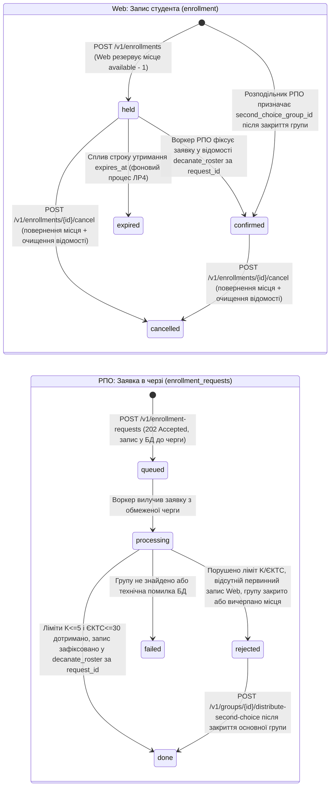
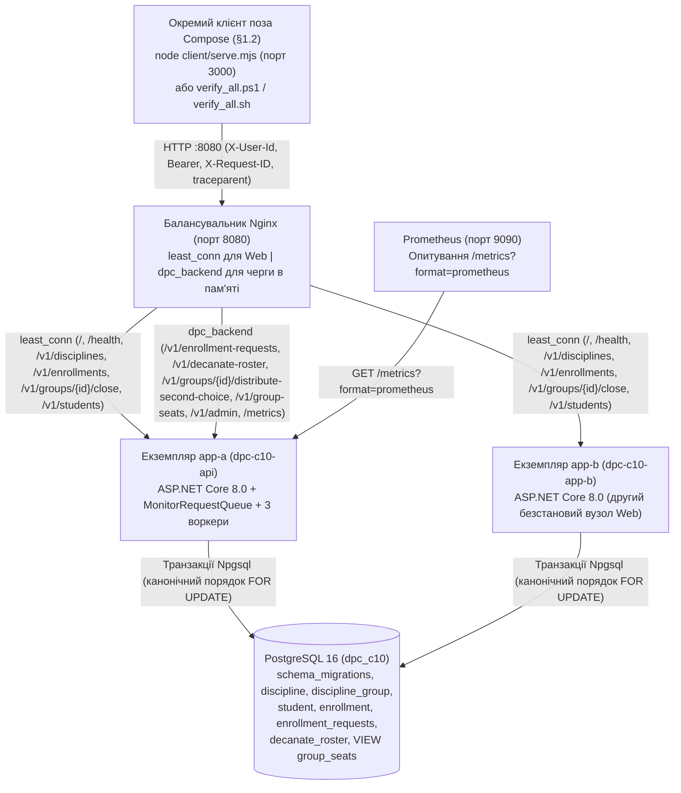

# Спільний проєкт за темою С10: «Запис на вибіркові дисципліни» (Лабораторна робота №1)

## 1. Курс і тема

- **Спільна предметна тема**: **С10. Запис на вибіркові дисципліни**
- **Виконавець**: **Зінківський Тимур Євгенійович**, студент групи **ІТІНФ-23-2**
- **Інтегровані навчальні дисципліни та обсяг виконання ЛР1**:
  1. **Курс «Обмін даними у Web-застосунках» (ЛР1: Контракт, модель і перша операція)**:
     - Основні пункти (ядро + поглиблення): **О1.1, О1.2, О1.3, О1.4, О1.5, О1.6, О1.7** *(виконано повністю)*.
     - Додаткові пункти: **Д1.1, Д1.2, Д1.3, Д1.4, Д1.5** *(виконано повністю)*.
  2. **Курс «Розподілені та паралельні обчислення» (ЛР1: Сервіс із чергою та модель виконання)**:
     - Основні пункти (ядро + поглиблення): **О1.1, О1.2, О1.3, О1.4, О1.5** *(виконано повністю)*.
     - Додаткові пункти: **Д1.1, Д1.2, Д1.3, Д1.4** *(виконано повністю)*.
- **Готові рішення та власний внесок (§1.4 методичних вказівок)**:
  - *Використані готові інфраструктурні компоненти та бібліотеки*: середовище виконання `.NET 8.0` (мінімальний HTTP-конвеєр `ASP.NET Core Kestrel`), низькорівневий ADO.NET драйвер `Npgsql` (без використання ORM / Entity Framework), СКБД `PostgreSQL 16`, реверс-проксі та балансувальник `Nginx 1.27`, система збору метрик `Prometheus 2.51`, лінтер контрактів `@stoplight/spectral-cli` та тестовий фреймворк `xUnit`.
  - *Власна реалізація*: схема БД і версіонований механізм міграцій із `schema_migrations` та `pg_advisory_xact_lock`, предметні правила С10 як чисті функції (`EnrollmentDomainRules`), канонічні SQL-транзакції з песимістичним блокуванням `FOR UPDATE` у фіксованому порядку, власна обмежена черга `MonitorRequestQueue` на `Monitor.Wait`/`Monitor.PulseAll` з неблокуючим очікуванням на `TaskCompletionSource`, пул воркерів із перемиканням моделей `async_tasks` / `dedicated_threads` і коректним вивантаженням за `SIGTERM`, збирач монотонних метрик із точним часовим інтегралом та незалежним періодичним семплером `100 мс` для закону Літтла, непрозоре курсорне пагінування Base64URL, структурований однорядковий JSON-логер із підтримкою `X-Request-ID` та W3C `traceparent`, повна специфікація `openapi.yaml` (OpenAPI 3.1), окремий автономний вебклієнт поза Docker Compose та еквівалентні сценарії наскрізної верифікації (`verify_all.ps1` і `verify_all.sh`).

---

## 2. Проєкт

### 2.1 Опис предметної області та розподіл відповідальності між Web і РПО (§1.10 РПО / §1.9 Web та §3.12 С10)

Система автоматизує запис студентів університету на вибіркові навчальні дисципліни в межах семестрового вікна запису. Відповідно до вимог об'єднання двох курсів (**§1.10 РПО / §1.9 Web** та **§3.12 С10 п. 2, 6**), відповідальність між синхронним Web-сервісом та асинхронним контуром РПО (DPC) чітко розмежована:

1. **Виключна відповідальність Web під час відкритого запису (`POST /v1/enrollments` -> `EnrollmentService`)**:
   - Первинний запис студента в навчальну групу в момент відкритого вікна `[opens_at, closes_at)` та зменшення кількості вільних місць у групі (`UPDATE discipline_group SET available = available - 1 WHERE id = @groupId AND available > 0`) виконує **виключно Web-сервіс**.
   - У тій самій транзакції Web перевіряє обмеження $K = 5$ активних дисциплін та $30.0$ кредитів ЄКТС, оновлює лічильники студента (`active_count`, `active_ects`) і створює запис у таблиці `enrollment` зі статусом `held`.
2. **Відповідальність воркера РПО під час обробки черги (`SafeEnrollmentProcessor`)**:
   - Обробник черги РПО **не резервує і не зменшує місця в групі повторно** (`discipline_group.available` не декрементується у `SafeEnrollmentProcessor`).
   - Воркер РПО безпосередньо перевіряє обмеження за максимальною кількістю дисциплін (`max_disciplines`, $K = 5$) і сумарною кількістю кредитів ЄКТС ($\le 30.0$), перевіряє наявність попереднього запису студента через Web (за відсутності первинного Web-запису для зареєстрованого студента переводить заявку в `rejected`), фіксує результат обробки заявки у **відомості деканату (`decanate_roster`) за ключем `request_id`** (`assignment_type = 'primary_roster'`) і переводить відповідний запис Web у таблиці `enrollment` зі стану `held` у `confirmed`.
3. **Окремий механізм розподілу за другим вибором після закриття запису (`POST /v1/groups/{id}/distribute-second-choice` -> `SecondChoiceDistributor`)**:
   - Після закриття набору в основну групу (`POST /v1/groups/{id}/close`, коли `closed = TRUE` або `now >= closes_at`) окремий координатор-розподільник РПО (`SecondChoiceDistributor`) призначає студентів у вказані ними групи другого вибору (`second_choice_group_id`).
   - Призначення у групу другого вибору виконує тільки розподільник DPC тією самою атомарною умовою місць (`UPDATE discipline_group SET available = available - 1 WHERE id = @secondChoiceGroupId AND available > 0`), перевіряючи ліміти $K \le 5$ та $\le 30.0$ ЄКТС, створює підтверджений запис `confirmed` у `enrollment` (завдяки чому Web повторно того самого студента не записує — `409 Conflict`) і фіксує призначення у `decanate_roster` за `request_id` (`assignment_type = 'second_choice'`).
4. **Реалізація вимоги О1.4 РПО («Захист ресурсу») та ізоляція гонитви**:
   - Пункт О1.4 методичних вказівок РПО вимагає порівняння безпечної (safe) та небезпечної (unsafe) моделі доступу до спільного обмеженого ресурсу для наочної демонстрації стану гонитви (race condition, TOCTOU overcommit) та порушення інваріанта.
   - У робочих групах (`DISC-DPC-01`, `DISC-WEB-01` тощо) такий стан гонитви принципово неможливий: Web зменшує `available`, воркер РПО лише підтверджує його у відомості деканату, а СКБД контролює `CHECK (available >= 0)`. За вимогами безпеки академічних даних (**§1.9 РПО**) робочі групи та реальні дані студентів суворо захищені від навмисного пошкодження.
   - Тому демонстрацію стану гонитви за О1.4 **ізольовано на виділеній тестовій групі `DISC-TEST-UNSAFE`** (`seats = 5`, `allow_overcommit_unsafe = TRUE`). Коли сервіс перемикається в `UNSAFE_MODE=true`, 20 паралельних запитів надсилаються напряму до контуру черги РПО (`POST /v1/enrollment-requests`), а `UnsafeEnrollmentProcessor` перевіряє місткість без транзакційних блокувань `FOR UPDATE`, витримує паузу 600 мс (вікно TOCTOU) та здійснює прямий несинхронізований запис у `decanate_roster`. Це призводить до переповнення відомості (`taken = 6 > 5`, `invariant_holds = false`).
   - Натомість на контрольній тестовій групі `DISC-TEST-SAFE` (`seats = 5`) той самий пакет із 20 конкурентних запитів обробляється через `SafeEnrollmentProcessor` із песимістичним блокуванням `FOR UPDATE`, де воркер строго зараховує рівно 5 студентів (`done = 5`) і відхиляє інші 15 (`rejected = 15`), утримуючи `taken = 5/5` та `invariant_holds = true`.

Щоб виключити розсинхронізацію стану між курсами, `group_seats` реалізовано як **реляційне подання (`SQL VIEW group_seats`)** над `discipline_group`, `discipline` та `decanate_roster`:
- `taken = GREATEST(g.seats - g.available, (SELECT COUNT(*)::INT FROM decanate_roster dr WHERE dr.group_id = g.id))`;
- `free_seats = GREATEST(0, g.seats - taken)`;
- `roster_count = (SELECT COUNT(*)::INT FROM decanate_roster dr WHERE dr.group_id = g.id)`;
- `invariant_holds = (taken <= g.seats)`.

Коли Web резервує місце (`available: 30 -> 29`), а потім воркер РПО фіксує цю заявку у `decanate_roster` (`roster_count: 0 -> 1`, не змінюючи `available = 29`), `taken = GREATEST(1, 1) = 1` і `free_seats = 29` — жодного подвійного списання місць немає.

### 2.2 Сутнісна модель бази даних (`dpc_c10`)

1. **`schema_migrations`**: реєстр застосованих версіонованих SQL-міграцій (`version PRIMARY KEY`, `filename`, `checksum` SHA-256, `applied_at`).
2. **`discipline` (Вибіркова дисципліна)**: `id` (`TEXT PK`), `code` (`TEXT UNIQUE NOT NULL`), `title` (`TEXT NOT NULL`), `ects` (`NUMERIC(4,1) NOT NULL CHECK (ects > 0.0 AND ects <= 30.0)`).
3. **`discipline_group` (Навчальна група — єдиний ресурс місць)**: `id` (`TEXT PK`), `discipline_id` (`FK -> discipline`), `group_code` (`TEXT UNIQUE`), `seats` (`INT CHECK (seats > 0)`), `available` (`INT NOT NULL`), `opens_at` (`TIMESTAMPTZ`), `closes_at` (`TIMESTAMPTZ`), `university_tz` (`TEXT DEFAULT 'Europe/Kyiv'`), `closed` (`BOOLEAN DEFAULT FALSE`), `allow_overcommit_unsafe` (`BOOLEAN DEFAULT FALSE`), обмеження `CHECK (available <= seats AND (available >= 0 OR allow_overcommit_unsafe = TRUE))`.
4. **`student` (Студент)**: `id` (`TEXT PK`), `email` (`TEXT UNIQUE`), `full_name` (`TEXT`), `max_disciplines` (`INT DEFAULT 5 CHECK (max_disciplines > 0)`), `active_count` (`INT DEFAULT 0 CHECK (active_count BETWEEN 0 AND max_disciplines)`), `active_ects` (`NUMERIC(4,1) DEFAULT 0.0 CHECK (active_ects BETWEEN 0.0 AND 30.0)`).
5. **`enrollment` (Запис студента у Web-контурі)**: `id` (`UUID PK`), `student_id` (`FK -> student`), `group_id` (`FK -> discipline_group`), `discipline_id` (`FK -> discipline`), `status` (`held | confirmed | expired | cancelled`), `version` (`INT DEFAULT 1`), `created_at` (`TIMESTAMPTZ`), `expires_at` (`TIMESTAMPTZ`), частковий унікальний індекс `idx_enrollment_active_student_discipline ON enrollment(student_id, discipline_id) WHERE status IN ('held', 'confirmed')`.
6. **`enrollment_requests` (Асинхронна заявка у контурі РПО)**: `id` (`UUID PK`), `student_id` (`TEXT NOT NULL`), `group_id` (`TEXT NOT NULL`), `second_choice_group_id` (`TEXT NULL`), `assigned_group_id` (`TEXT NULL`), `status` (`queued | processing | done | rejected | failed`), `rejection_reason` (`TEXT NULL`), часові мітки у БД `created_at` (`TIMESTAMPTZ NOT NULL`), `started_at` (`TIMESTAMPTZ NULL`), `finished_at` (`TIMESTAMPTZ NULL`), `first_read_at` (`TIMESTAMPTZ NULL`); тривалості етапів (`queueWaitMs`, `processingTimeMs`, `deliveryWaitMs`) обчислюються в коді застосунку (`Program.cs` і `MetricsCollector.cs`) і в таблиці БД не зберігаються.
7. **`decanate_roster` (Відомість деканату за ключем `request_id` — предметний ефект РПО)**: `request_id` (`UUID PK REFERENCES enrollment_requests(id)`), `student_id` (`TEXT NOT NULL`), `group_id` (`TEXT NOT NULL REFERENCES discipline_group(id)`), `discipline_id` (`TEXT NOT NULL REFERENCES discipline(id)`), `ects` (`NUMERIC(4,1) NOT NULL`), `enrollment_id` (`UUID NULL REFERENCES enrollment(id)`), `assignment_type` (`primary_roster | second_choice`), `created_at` (`TIMESTAMPTZ NOT NULL`).
8. **`group_seats` (`SQL VIEW`)**: узгоджене подання стану груп над `discipline_group`, `discipline` та `decanate_roster`.

### 2.3 Діаграма станів і переходів (О1.1 Web та О1.1 РПО)



### 2.4 Інваріанти предметної області та правила безпеки

1. **Інваріант місткості навчальної групи, відомості деканату та захист ресурсу (О1.4 РПО та §3.12 С10)**: для всіх робочих груп виконується $0 \le \text{available} \le \text{seats}$ та $0 \le \text{roster\_count} \le \text{seats}$ (еквівалентно $0 \le \text{taken} \le \text{seats}$). Первинне зменшення `available` виконує виключно Web, а воркер РПО (`SafeEnrollmentProcessor`) фіксує результат у `decanate_roster` за `request_id` без повторного зменшення `available`. При цьому, щоб задовольнити вимогу О1.4 РПО щодо демонстрації стану гонитви (race condition) без ризику спотворення академічних даних (§1.9 РПО), справжню гонитву ізольовано на спеціальній тестовій групі `DISC-TEST-UNSAFE` (`allow_overcommit_unsafe = TRUE`): за відсутності блокувань `FOR UPDATE` у небезпечному режимі `UNSAFE_MODE=true` воркери створюють переповнення `taken > seats` (`6 > 5`, `invariant_holds = false`). На групі `DISC-TEST-SAFE` безпечний обробник із блокуванням `FOR UPDATE` строго утримує ліміт `taken = 5/5`.
2. **Інваріант ліміту дисциплін та точних кредитів ЄКТС у Web і РПО (Д1.5 Web та О1.4 РПО)**: кожен студент має не більше $K = 5$ активних дисциплін ($0 \le \text{active\_count} \le \text{max\_disciplines}$) і точну суму кредитів не більше $30.0$ ($0.0 \le \text{active\_ects} \le 30.0$, тип `NUMERIC(4,1)` у PostgreSQL та `decimal` у C#): ці перевірки (`CanEnrollWithDisciplineLimit` та `CanEnrollWithEcts`) виконуються **як у Web (`POST /v1/enrollments` через `EnrollmentService`), так і безпосередньо в логіці РПО (`SafeEnrollmentProcessor` та `SecondChoiceDistributor`)**. Сума `30.0` дозволена (`201 Created` / `done`), сума `30.5` відхиляється (`409 Conflict` / `rejected`).
3. **Інваріант напіввідкритого вікна запису, межі доби та часового зміщення (Д1.1, Д1.5 Web)**: запис дозволено лише коли `closed = FALSE` і момент оцінювання $t \in [\text{opens\_at}, \text{closes\_at})$: при $t = \text{opens\_at}$ запит успішний (`201 Created`), при $t = \text{closes\_at}$ — відхиляється (`409 Conflict`). Конвертація у часовий пояс університету `Europe/Kyiv` (`ConvertToUniversityTimeZone`, `GetUniversityLocalDate`, `HasCrossedUniversityDayBoundary`, `GetUniversityTimeZoneOffset`) коректно обробляє перехід через межу доби (`23:59:59+03:00` $\to$ `00:00:00+03:00` наступного календарного дня) та зміну часового зміщення між зимовим (`UTC+02:00`, EET) і літнім (`UTC+03:00`, EEST) часом.
4. **Ідентифікація власника та закриття тестових лазівок**:
   - Студентські маршрути Web вимагають обов'язкового заголовка `X-User-Id` (за відсутності — `400 Bad Request` з `error_code: "missing_user_header"`).
   - Передача `student_id` у тілі `POST /v1/enrollments` суворо заборонена (`422 Unprocessable Entity`, `error_code: "owner_in_body_forbidden"`).
   - Читання `GET /v1/enrollments/{id}` і скасування `POST /v1/enrollments/{id}/cancel` перевіряють власника запису; чужий студент отримує `404 Not Found`.
   - За замовчуванням `ALLOW_TEST_OVERRIDES=false`: спроба передати `evaluated_at`, заголовок `X-Simulated-Now` або викликати `POST /v1/admin/reset` відхиляється з `403 Forbidden` (`application/problem+json`).

---

## 3. Архітектура



- **Відокремлення клієнта (§1.2)**: Docker-образ сервісу (`Dockerfile`) **не містить** клієнтських статичних файлів і не використовує `wwwroot`. Вебклієнт запускається як окрема зовнішня програма поза `compose.yaml` на порту `3000` (`node client/serve.mjs`) і звертається виключно до опублікованого порту балансувальника `http://localhost:8080`.
- **Примітив синхронізації черги та поведінка воркера за порожньої черги (О1.2, О1.3, Д1.3 РПО)**: обмежена черга заявок місткістю `QUEUE_CAPACITY = 100` у режимі за замовчуванням (`QUEUE_ENGINE=custom_monitor`, клас `MonitorRequestQueue`) синхронізується м'ютексом `lock (_syncRoot)`: коли черга порожня, синхронний потік воркера (`dedicated_threads`) у циклі `while (_queue.Count == 0)` викликає умовну змінну `Monitor.Wait(_syncRoot, 250)` — атомарно відпускає м'ютекс і переходить у стан очікування ядра ОС із `0 %` навантаження на CPU до виклику `Monitor.PulseAll(_syncRoot)` у `TryEnqueue`/`Complete`, а асинхронний воркер (`async_tasks`) у `DequeueAsync` під тим самим `lock (_syncRoot)` реєструє `TaskCompletionSource<bool>(TaskCreationOptions.RunContinuationsAsynchronously)` у черзі очікування `_asyncPulseWaiters` і звільняє потік `ThreadPool` через `await` поза блокуванням до сигналу `TrySetResult(true)`. В альтернативному режимі `QUEUE_ENGINE=system_channel` (`ChannelRequestQueue`) використовується обмежений `Channel.CreateBounded<QueuedRequestItem>` із неблокуючим `TryWrite` та `WaitToReadAsync`.
- **Канонічний порядок блокувань**: і в `POST /v1/enrollments`, і в `POST /v1/enrollments/{id}/cancel` рядки блокуються строго в одному порядку `student FOR UPDATE` $\to$ `discipline_group FOR UPDATE` $\to$ `enrollment FOR UPDATE`, що запобігає взаємним блокуванням (`deadlock`), а глобальний перехоплювач винятків перетворює будь-які помилки серіалізації PostgreSQL (`40P01`, `40001`) на коректну відповідь `409 Conflict` у стандарті RFC 9457 `application/problem+json`.

---

## 4. Структура репозиторію

```text
pojekt/
├── compose.yaml                         # Оркестрація postgres, app-a, app-b, nginx, prometheus
├── nginx.conf                           # Конфігурація Nginx (least_conn для Web + upstream для черги РПО)
├── Dockerfile                           # Багатоетапне збирання API без статичних файлів клієнта
├── openapi.yaml                         # Повний контракт OpenAPI 3.1 (усі 15 маршрутів + Problem Details)
├── .spectral.yaml                       # Правила перевірки контракту лінтером Spectral CLI
├── prometheus.yml                       # Конфігурація збору метрик Prometheus
├── README.md                            # Документація та звіт за ЛР1 обох курсів
├── migrations/
│   ├── 001_init_c10_schema.sql          # Міграція 001: таблиці предметної області та SQL VIEW group_seats
│   └── 002_seed_c10_data.sql            # Міграція 002: початкові навчальні дисципліни, групи та студенти
├── client/
│   ├── serve.mjs                        # Окремий HTTP-сервер клієнта поза Docker Compose (порт 3000)
│   ├── start_client.ps1                 # Запуск автономного клієнта у Windows (PowerShell)
│   ├── start_client.sh                  # Запуск автономного клієнта у Linux/macOS (Bash)
│   ├── index.html                       # Інтерфейс демонстрації Web (Частина А) та РПО (Частина Б)
│   └── api.js                           # Клієнтська логіка ES6+ (інша мова за Д1.2 Web)
├── scripts/
│   ├── verify_all.ps1                   # Наскрізна автоматизована перевірка всіх пунктів (PowerShell 7+)
│   └── verify_all.sh                    # Повністю еквівалентна автоматизована перевірка (Bash)
├── src/
│   └── EnrollmentService/
│       ├── EnrollmentService.csproj     # Серверний проєкт C# (.NET 8.0)
│       ├── Program.cs                   # Kestrel WebApplicationBuilder, DI-реєстрація, middleware та маршрути
│       ├── Endpoints/                   # Тонкий шар HTTP-маршрутів (витягування даних, виклик сервісів, повернення DTO)
│       │   ├── EnrollmentEndpoints.cs   # POST /v1/enrollments, GET /v1/enrollments (курсор), cancel
│       │   ├── EnrollmentRequestEndpoints.cs # POST /v1/enrollment-requests (202/429), GET заявки
│       │   ├── GroupEndpoints.cs        # GET /v1/disciplines, POST /v1/groups/{id}/close, distribute-second-choice
│       │   ├── DiagnosticsEndpoints.cs  # GET /, /health, /v1/group-seats, /v1/decanate-roster
│       │   └── AdminEndpoints.cs        # POST /v1/admin/reset із міжвузловою синхронізацією (app-b)
│       ├── Repositories/                # Шар прямого доступу до БД через ADO.NET Npgsql (без ORM)
│       │   ├── IDbConnectionFactory.cs  # NpgsqlConnectionFactory
│       │   ├── IGroupRepository.cs      # GroupRepository (блокування discipline_group FOR UPDATE)
│       │   ├── IEnrollmentRepository.cs # EnrollmentRepository (записи Web, блокування student FOR UPDATE)
│       │   ├── IEnrollmentRequestRepository.cs # EnrollmentRequestRepository (асинхронні заявки РПО)
│       │   └── IDecanateRepository.cs   # DecanateRepository (відомість деканату decanate_roster)
│       ├── Services/                    # Доменні сервіси та бізнес-правила (відокремлені від HTTP)
│       │   ├── IEnrollmentService.cs    # EnrollmentService: перевірки вікна, лімітів K та ЄКТС, списання місць у Web
│       │   ├── ISecondChoiceDistributor.cs # SecondChoiceDistributor: розподіл другого вибору після закриття
│       │   ├── EnrollmentWorkerPool.cs  # Керування пулом WORKERS, чергою, 100 мс семплером Літтла та SIGTERM
│       │   ├── DatabaseInitializer.cs   # Версіонований мігратор із таблицею schema_migrations та advisory lock
│       │   ├── EnrollmentDomainRules.cs # Чисті функції вікна [opens_at, closes_at), ЄКТС, курсора і traceparent
│       │   ├── StructuredJsonLogger.cs  # Потокобезпечний однорядковий JSON-логер у stdout
│       │   └── Processing/              # Обробники черги заявок РПО
│       │       ├── IEnrollmentRequestProcessor.cs # EnrollmentRequestProcessor: диспетчеризація safe/unsafe
│       │       ├── ISafeEnrollmentProcessor.cs   # SafeEnrollmentProcessor: транзакційна фіксація у відомості
│       │       ├── IUnsafeEnrollmentProcessor.cs # UnsafeEnrollmentProcessor: демонстрація гонитви на DISC-TEST-UNSAFE
│       │       └── ISlowOperationSimulator.cs     # SlowOperationSimulator: повільне I/O 200..700 мс поза транзакцією
│       ├── Http/                        # Інфраструктура HTTP
│       │   ├── ProblemDetailsMapper.cs  # Централізоване відображення помилок у RFC 9457 Problem Details
│       │   ├── RequestIdentityMiddleware.cs # Валідація X-User-Id, обробка X-Request-ID та traceparent
│       │   └── BearerAuthMiddleware.cs  # Перевірка Bearer-токена для адміністративних та РПО маршрутів
│       ├── Queues/                      # Інфраструктура обмеженої черги
│       │   └── IBoundedRequestQueue.cs  # MonitorRequestQueue (Monitor + неблокуючий TCS) і ChannelRequestQueue
│       ├── Contracts/                   # DTO запитів і відповідей
│       │   ├── WebDtos.cs               # DTO для операцій Web
│       │   └── DpcDtos.cs               # DTO для операцій РПО
│       ├── Domain/                      # Доменні сутності та сервісні результати
│       │   ├── Entities.cs              # Discipline, DisciplineGroup, Student, Enrollment, DecanateEntry
│       │   └── ServiceResult.cs         # ServiceResult<T> із типізованими кодами помилок
│       ├── Infrastructure/
│       │   └── ServiceOptions.cs        # Опції середовища з валідацією значень
│       └── Metrics/
│           └── MetricsCollector.cs      # Перцентилі p50/p95/p99, часовий інтеграл і незалежна вибірка Літтла
└── tests/
    └── EnrollmentService.Tests/
        ├── EnrollmentService.Tests.csproj
        └── DomainAndQueueTests.cs       # Модульні тести xUnit предметних правил С10 і неблокуючої черги
```

---

## 5. Збирання й запуск

### 5.1 Вимоги до середовища та мережеві порти

- **Операційна система**: Windows 10/11 (PowerShell 7+ / Git Bash), Linux або macOS.
- **Контейнеризація**: Docker Engine `>= 24.0` та Docker Compose `v2.20+`.
- **Апаратні ресурси**: не менше `2 CPU` ядер та `2 ГБ` вільної оперативної пам'яті (рекомендовано `4 ГБ`).
- **Інструменти перевірки на хості**: Node.js `>= 18.0` (для запуску автономного клієнта `client/serve.mjs` і лінтера `@stoplight/spectral-cli` через `npx`), .NET SDK `8.0` (для локального запуску модульних тестів `dotnet test`).
- **Порти на хості**:
  - `8080/tcp` — вхідна точка балансувальника `nginx` (єдина точка входу API);
  - `5432/tcp` — PostgreSQL 16 (`dpc_c10`);
  - `9090/tcp` — вебпанель Prometheus;
  - `3000/tcp` — окремий автономний вебклієнт поза `compose.yaml`.

### 5.2 Параметри конфігурації середовища та типові значення

| Змінна середовища | Типове значення (дефолт) | Призначення |
| :--- | :--- | :--- |
| `QUEUE_CAPACITY` | `100` | Максимальна місткість обмеженої черги заявок у пам'яті (О1.2 РПО; понад ліміт $\to$ `429` + `Retry-After: 1`). |
| `WORKERS` | `3` | Фіксована кількість фонових обробників пулу воркерів (О1.3 РПО). |
| `EXECUTION_MODEL` | `async_tasks` | Модель виконання пулу воркерів: `async_tasks` (неблокуючі `Task`) або `dedicated_threads` (виділені потоки ОС, Д1.1 РПО). |
| `QUEUE_ENGINE` | `custom_monitor` | Реалізація черги: `custom_monitor` (власна на `Monitor.Wait`/`PulseAll` + `TaskCompletionSource`, Д1.3 РПО) або `system_channel` (`ChannelRequestQueue`). |
| `UNSAFE_MODE` | `false` | Вимикає транзакційний захист лише на ізольованій групі `DISC-TEST-UNSAFE` для демонстрації гонитви (О1.4 РПО). |
| `SLOW_CALL_MIN_MS` | `200` | Мінімальна тривалість імітації зовнішнього повільного I/O-виклику у воркері поза транзакцією БД, мс (О1.3 РПО). |
| `SLOW_CALL_MAX_MS` | `700` | Максимальна тривалість імітації зовнішнього повільного I/O-виклику у воркері поза транзакцією БД, мс (О1.3 РПО). |
| `ALLOW_TEST_OVERRIDES` | `false` | У робочому режимі (`false`) блокує `evaluated_at`, `X-Simulated-Now` та `/v1/admin/reset` кодом `403 Forbidden`. |
| `INSTANCE_ID` | `app-a` / `app-b` | Ідентифікатор екземпляра сервісу для заголовка `X-Instance-Id` та поля `instance` в однорядковому JSON-журналі (О1.6 Web). |
| `API_AUTH_TOKEN` | `secret-c10-token-2026` | Секретний Bearer-токен для захищених маршрутів контуру РПО (`401 Unauthorized` за відсутності). |
| `DB_CONNECTION_STRING` | `Host=postgres;Port=5432;Database=dpc_c10;...` | Рядок підключення `Npgsql` до бази даних PostgreSQL. |
| `CLIENT_PORT` | `3000` | Локальний порт окремого вебклієнта `client/serve.mjs` поза `compose.yaml`. |

### 5.3 Команди збирання, міграцій, лінтингу, запуск клієнта та автотестів

1. **Збирання образів і запуск усієї системи однією командою**:
   ```bash
   docker compose up --build -d
   ```
2. **Застосування версіонованих SQL-міграцій (`schema_migrations`)**:
   - виконується автоматично під час старту сервісу під транзакційним блокуванням `pg_advisory_xact_lock(20261010)`;
   - або окремою командою тільки для міграцій без старту HTTP-сервера:
   ```bash
   dotnet run --project src/EnrollmentService/EnrollmentService.csproj -- --migrate-only
   ```
3. **Перевірка контракту OpenAPI 3.1 лінтером Spectral (О1.3 Web)**:
   ```bash
   npx --yes @stoplight/spectral-cli lint openapi.yaml --fail-severity=warn
   ```
4. **Запуск модульних тестів предметних правил і неблокуючої черги (Д1.1 Web / РПО)**:
   ```bash
   dotnet test tests/EnrollmentService.Tests/EnrollmentService.Tests.csproj
   ```
5. **Запуск окремого вебклієнта поза Docker Compose (§1.2, відкриває `http://localhost:3000`)**:
   ```powershell
   pwsh client/start_client.ps1
   # або кросплатформно: node client/serve.mjs / bash client/start_client.sh
   ```
6. **Повна наскрізна автоматизована перевірка всіх пунктів обох курсів** *(обидва скрипти функціонально еквівалентні, включають Spectral, `dotnet test`, перевірку безпеки, 60-секундний дослід Літтла, випробування `SIGTERM` і всі тести Web)*:
   ```powershell
   pwsh -NoProfile -ExecutionPolicy Bypass -File scripts/verify_all.ps1
   ```
   ```bash
   bash scripts/verify_all.sh
   ```

---

## 6. Лабораторні роботи

### 6.1 Курс «Обмін даними у Web-застосунках» — ЛР1 (О1.1–О1.7, Д1.1–Д1.5)

| Пункт | Вимога методичних вказівок | Де реалізовано | Як перевірити |
| :--- | :--- | :--- | :--- |
| **О1.1** *(Ядро)* | **Модель області**: сутності (`discipline`, `discipline_group`, `student`, `enrollment`), стани (`held -> confirmed \| expired \| cancelled`), діаграма переходів та інваріанти в `README.md`. | `README.md` (розд. 2), `migrations/001_init_c10_schema.sql` | Переглянути розд. 2 та перевірити схему БД (`verify_all.ps1`, розд. 0). |
| **О1.2** *(Ядро)* | **Схема БД**: версіоновані SQL-міграції з таблицею `schema_migrations`, `PRIMARY KEY`, `FOREIGN KEY`, `NOT NULL`, `CHECK` та частковим `UNIQUE` індексом. | `migrations/001_init_c10_schema.sql`, `migrations/002_seed_c10_data.sql`, `DatabaseInitializer.cs` | Автоматично перевіряється через `schema_migrations` у розд. 0 `verify_all.ps1` / `verify_all.sh`. |
| **О1.3** *(Ядро)* | **Контракт API та лінтер**: усі 15 реалізованих маршрутів описані в `openapi.yaml` (OpenAPI 3.1) з `examples` та `application/problem+json` і проходять перевірку лінтером Spectral без помилок і попереджень. | `openapi.yaml`, `.spectral.yaml` | `npx --yes @stoplight/spectral-cli lint openapi.yaml --fail-severity=warn` (вбудовано в крок 0 обох скриптів). |
| **О1.4** *(Ядро)* | **Головна операція**: `POST /v1/enrollments` атомарно перевіряє вікно, ліміт $K$, кредити ЄКТС, декрементує `discipline_group.available` і створює `enrollment` в одній транзакції; `201 Created` + `Location` повертається після `COMMIT`. Коди помилок `400`, `403`, `404`, `409`, `422` у форматі `Problem Details`. Усі ID — рядки. Обов'язковий `X-User-Id`. | `EnrollmentEndpoints.cs`, `EnrollmentService.cs`, `EnrollmentRepository.cs`, `ProblemDetailsMapper.cs` | Розд. 2 та розд. 10 у `verify_all.ps1` / `verify_all.sh`; панель А2 клієнта `http://localhost:3000`. |
| **О1.5** | **Список із курсором**: `GET /v1/enrollments?limit=&after=` повертає записи виключно власника `X-User-Id` у детермінованому порядку `(created_at DESC, id DESC)`, `limit` 1..50, непрозорий Base64URL `next_cursor`, `400 Bad Request` на пошкоджений курсор. | `EnrollmentEndpoints.cs`, `EnrollmentRepository.cs`, `EnrollmentDomainRules.cs` | Розд. 10 у `verify_all.ps1` / `verify_all.sh`; панель А3 клієнта. |
| **О1.6** | **Система, живучість і журнал**: `GET /health` на кожному вузлі; `nginx` (`least_conn`) перед `app-a` та `app-b` + `postgres`; наскрізний `X-Request-ID`; однорядковий JSON-журнал у `stdout` (`event`, `ts`, `instance`, `route`, `status`, `duration_ms`, `request_id`) без секретів/токенів. | `compose.yaml`, `nginx.conf`, `RequestIdentityMiddleware.cs`, `StructuredJsonLogger.cs` | Розд. 1 та розд. 10 у `verify_all.ps1` / `verify_all.sh`. |
| **О1.7** *(Ядро)* | **Окремий клієнт**: працює поза `compose.yaml` (`localhost:3000`), звертається до `nginx` (`localhost:8080`), виконує `POST /v1/enrollments`, відображає `Problem Details`, обходить усі сторінки за `next_cursor` до `null` та ігнорує невідомі поля (`extra_server_field`). | `client/serve.mjs`, `client/index.html`, `client/api.js` | `pwsh client/start_client.ps1` $\to$ `http://localhost:3000`. |
| **Д1.1** *(Дод.)* | **Чиста функція правила часу**: `IsWithinEnrollmentWindow(now, opensAt, closesAt)` приймає час аргументом і покрита модульними тестами xUnit. | `EnrollmentDomainRules.cs`, `tests/EnrollmentService.Tests/DomainAndQueueTests.cs` | `dotnet test` та розд. 10 у `verify_all.ps1` / `verify_all.sh`. |
| **Д1.2** *(Дод.)* | **Клієнт іншою мовою**: сервер — C# (.NET 8.0); клієнти — JavaScript ES6+ (`client/api.js`), PowerShell (`verify_all.ps1`) та Bash (`verify_all.sh`). | `client/`, `scripts/` | Запуск клієнта та обох скриптів перевірки. |
| **Д1.3** *(Дод.)* | **Автотест RFC 9110 / RFC 9457**: автоматична перевірка заголовка `Location` для `201 Created` та обов'язкових полів `type`, `title`, `status`, `detail`, `instance` і `Content-Type: application/problem+json` для всіх помилок. | `scripts/verify_all.ps1`, `scripts/verify_all.sh` (розд. 2 та розд. 10) | Прогін `verify_all.ps1` та `verify_all.sh`. |
| **Д1.4** *(Дод.)* | **Підтримка W3C `traceparent`**: розбір заголовка `traceparent` і запис `trace_id` у відповідь та однорядковий JSON-журнал контейнера. | `EnrollmentDomainRules.cs` (`TryExtractTraceId`), `Program.cs`, `StructuredJsonLogger.cs` | Перевірка `docker logs` у розд. 10 `verify_all.ps1` та `verify_all.sh`. |
| **Д1.5** *(Дод.)* | **Точні величини і час С10**: `NUMERIC(4,1)` / `decimal` для ЄКТС (`30.0` $\to$ `201`, `30.5` $\to$ `409`); межі `[opens_at, closes_at)` (`opens_at` $\to$ `201`, `closes_at` $\to$ `409`); перехід через межу доби (`23:59:59+03:00` $\to$ `00:00:00+03:00` наступного дня в `Europe/Kyiv`) та зміна часового зміщення (перехід між зимовим `+02:00` та літнім `+03:00` часом). | `EnrollmentDomainRules.cs`, `Program.cs`, `DomainAndQueueTests.cs` | `dotnet test` та розд. 10 у `verify_all.ps1` / `verify_all.sh`. |

### 6.2 Курс «Розподілені та паралельні обчислення» — ЛР1 (О1.1–О1.5, Д1.1–Д1.4)

| Пункт | Вимога методичних вказівок | Де реалізовано | Як перевірити |
| :--- | :--- | :--- | :--- |
| **О1.1** *(Ядро)* | **Приймання запитів та ідемпотентність**: під `SemaphoreSlim` перевіряється дублікат і місткість черги, спочатку створюється запис у БД зі статусом `queued`, після чого заявка додається в чергу (при відмові запис видаляється). Повтор із тим самим ID не дублюється в черзі; інший вміст із тим самим ID $\to$ `409 Conflict`. | `EnrollmentRequestEndpoints.cs`, `EnrollmentRequestRepository.cs` | Розд. 3 у `verify_all.ps1` та `verify_all.sh`. |
| **О1.2** *(Ядро)* | **Обмежена черга й перевантаження**: ліміт `QUEUE_CAPACITY=100`; синхронізація через `lock (_syncRoot)` + `Monitor.Wait`/`Monitor.PulseAll` для потоків і чергу `TaskCompletionSource` для `async`-воркерів (за порожньої черги воркер спить на умовній змінній або звільняє потік `ThreadPool` через `await` TCS); при заповненні — відмова `429 Too Many Requests` із `Retry-After: 1`; `/health` під навантаженням має p95 $\le 100$ мс. | `IBoundedRequestQueue.cs`, `EnrollmentRequestEndpoints.cs` | Розд. 4 у `verify_all.ps1` та `verify_all.sh`. |
| **О1.3** *(Ядро)* | **Пул обробників**: рівно `WORKERS=3` воркерів обробляють чергу; імітація повільного I/O `200..700 мс` виконується **поза** транзакцією БД. | `EnrollmentWorkerPool.cs`, `SlowOperationSimulator.cs` | Розд. 3–5 у `verify_all.ps1` та `verify_all.sh`. |
| **О1.4** *(Ядро)* | **Захист спільного ресурсу (SAFE vs UNSAFE) та відомість деканату за `request_id` (С10)**: порівняння безпечної та небезпечної обробки конкурентних запитів. Відповідно до §1.9 РПО стан гонитви (TOCTOU overcommit) демонструється на окремій тестовій групі `DISC-TEST-UNSAFE` (`seats = 5, allow_overcommit_unsafe = TRUE`) у режимі `UNSAFE_MODE=true`: через відсутність блокувань `taken > seats` (`6 > 5`, `invariant_holds = false`). У безпечному режимі на `DISC-TEST-SAFE` обробник із блокуванням `FOR UPDATE` строго гарантує `taken = 5/5` (`invariant_holds = true`). У робочих групах за розподілом обов'язків С10 первинне списання `available` виконує виключно Web (`EnrollmentService`), а безпечний воркер РПО (`SafeEnrollmentProcessor`) валідує ліміти $K \le 5$ та $\le 30.0$ ЄКТС, фіксує результат у `decanate_roster` за `request_id` і переводить `enrollment` у `confirmed` без повторного списання місць. Розподіл другого вибору після закриття групи виконує `SecondChoiceDistributor`. | `SafeEnrollmentProcessor.cs`, `UnsafeEnrollmentProcessor.cs`, `EnrollmentRequestProcessor.cs`, `SecondChoiceDistributor.cs`, `001_init_c10_schema.sql` | Розд. 3, розд. 5 та розд. 10 у `verify_all.ps1` / `verify_all.sh`. |
| **О1.5** | **Монотонний час і метрики**: монотонна позначка `Stopwatch.GetTimestamp()` завершення фіксується **до** публікації кінцевого статусу в БД; позначка першого `GET` (`first_read_at`, `delivery_wait_ms`) фіксується рівно один раз; `/metrics` віддає лічильники та p50/p95/p99. | `MetricsCollector.cs`, `SafeEnrollmentProcessor.cs`, `DiagnosticsEndpoints.cs` | Розд. 6 у `verify_all.ps1` та `verify_all.sh`. |
| **Д1.1** *(Дод.)* | **Дві моделі виконання**: порівняння неблокуючої асинхронної моделі `async_tasks` (очікування черги через `TaskCompletionSource` без блокування потоків пулу) та моделі виділених потоків ОС `dedicated_threads` на однаковому навантаженні. | `IBoundedRequestQueue.cs`, `EnrollmentWorkerPool.cs` | Розд. 7 у `verify_all.ps1` та `verify_all.sh`. |
| **Д1.2** *(Дод.)* | **Перевірка закону Літтла**: 60-секундний стаціонарний потік ~4 зап/с із виключенням перших 10 с розігріву; одночасне обчислення точного часового інтегралу довжини черги та **незалежної періодичної вибірки кожні `100 мс`** (`PeriodicTimer`) за той самий інтервал. | `MetricsCollector.cs`, `EnrollmentWorkerPool.cs`, `client/api.js` | Розд. 8 у `verify_all.ps1` та `verify_all.sh`; кнопка Д1.2 у клієнті. |
| **Д1.3** *(Дод.)* | **Власна черга на м'ютексі й умовній змінній**: `MonitorRequestQueue` на `lock`, `Monitor.Wait` / `Monitor.PulseAll` для синхронних потоків і черзі `TaskCompletionSource` під тим самим м'ютексом для `DequeueAsync`. | `IBoundedRequestQueue.cs`, `DomainAndQueueTests.cs` | Активна за замовчуванням (`QUEUE_ENGINE=custom_monitor`); покрита `dotnet test`. |
| **Д1.4** *(Дод.)* | **Коректне завершення за `SIGTERM`**: перехоплення `SIGTERM`, запис структурованої JSON-події `"event":"sigterm_received"` у `stdout`, відхилення нових запитів (`503`), повне доведення всіх прийнятих заявок до кінцевого стану та фінальна JSON-подія `"event":"graceful_shutdown_completed"`. | `EnrollmentWorkerPool.cs`, `StructuredJsonLogger.cs`, `Program.cs` | Розд. 9 у `verify_all.ps1` та `verify_all.sh` (перевірка `docker logs` та станів у БД). |

---

## 7. Досліди

### 7.1 Зведена таблиця відтворюваних дослідів (§1.9 РПО / §1.8 Web)

| Дослід | Режим і команда запуску | Початкові дані, параметри та тривалість | Очікуваний і фактичний результат (що видно) |
| :--- | :--- | :--- | :--- |
| **1. Безпека та закриття тестових лазівок у робочому режимі** | Робочий режим `ALLOW_TEST_OVERRIDES=false`.<br>Команда: `pwsh scripts/verify_all.ps1` (розд. 2) або `bash scripts/verify_all.sh` (крок 2). | Чистий стенд після `docker compose up --build -d`; спроби запитів без Bearer, без `X-User-Id`, зі `student_id` у тілі, з `evaluated_at`, `X-Simulated-Now` та `/v1/admin/reset`. | **Очікувано**: `401`, `400`, `422`, `403` у форматі `application/problem+json`.<br>**Фактично**: без Bearer $\to$ **401**; без `X-User-Id` $\to$ **400** (`missing_user_header`); `student_id` у тілі $\to$ **422** (`owner_in_body_forbidden`); `evaluated_at` / `X-Simulated-Now` / `/v1/admin/reset` $\to$ **403 Forbidden** (`test_override_disabled`); запис поза вікном за реальним годинником $\to$ **409 Conflict**. |
| **2. Розподіл відповідальності між Web і РПО, відомість деканату за `request_id` та ліміти K/ЄКТС (О1.1, О1.4 РПО + §3.12 С10)** | Тестовий стенд (`UNSAFE_MODE=false`, `WORKERS=3`).<br>Команда: `pwsh scripts/verify_all.ps1` (розд. 3) та `bash scripts/verify_all.sh` (крок 3). | Група `DISC-DPC-01` (`seats=30, available=30`); Крок 1: первинний запис `student-1` через Web `POST /v1/enrollments` (`available: 30 -> 29`); Крок 2: обробка заявки РПО з `requestId`; заявки без Web-запису (`student-2`), з перевищенням $K=5$ (`student-limit-max`) і `30.5` ЄКТС (`student-ects-20`). | **Очікувано**: Web зменшує `available` до `29`; РПО фіксує `request_id` у `decanate_roster` і переводить `enrollment` у `confirmed`, **не зменшуючи `available` повторно** (`available = 29, taken = 1, rosterCount = 1`); заявки без Web-запису або з перевищенням $K=5$ чи `30.5` ЄКТС отримують `rejected`.<br>**Фактично**: Web `201 Created` (`available = 29`) $\to$ РПО `done` (`recordedInRoster = true`, `status = confirmed`, `available = 29`, `rosterCount = 1`); запити без Web-запису, при $K=5/5$ і при `30.5 > 30.0` ЄКТС переведені у **rejected**; колізія `requestId` $\to$ **409 Conflict**; неіснуюча група $\to$ **failed**. |
| **3. Перевантаження обмеженої черги та `/health` під навантаженням (О1.2 РПО)** | `QUEUE_CAPACITY=100`, `WORKERS=3`, `SLOW_CALL=200..700 мс`.<br>Команда: `pwsh scripts/verify_all.ps1` (розд. 4) або `bash scripts/verify_all.sh` (крок 4). | **150 одночасних клієнтських POST-запитів** на `/v1/enrollment-requests` + паралельна серія з **30 запитів `GET /health`** безпосередньо під час залпу. **Тривалість фази пікового залпу: 0.91 с**. | **Очікувано**: частина понад місткість черги (100 + до 3 у воркерах) негайно отримує `429` + `Retry-After: 1`; `/health` p95 $\le 100$ мс.<br>**Фактично**: за **0.91 с** прийнято **202 Accepted = 103**, відхилено **429 Too Many Requests = 47** (усі 47 із заголовком `Retry-After: 1`); затримка `GET /health` під навантаженням: **p50 = 1.07 мс**, **p95 = 2.23 мс** ($\le 100$ мс). |
| **4. Захист спільного ресурсу: SAFE vs UNSAFE на тестових групах (О1.4 РПО)** | Порівняння `UNSAFE_MODE=false` (`DISC-TEST-SAFE`) та `UNSAFE_MODE=true` (`DISC-TEST-UNSAFE`).<br>Команда: `pwsh scripts/verify_all.ps1` (розд. 5). | Обидві тестові групи мають по `seats = 5` місць; для чистоти експерименту гонитви пакет із **20 конкурентних запитів** надсилається напряму до черги РПО (`POST /v1/enrollment-requests`) при `WORKERS=3`. За вимогами §1.9 стан гонитви дозволено лише на групі `DISC-TEST-UNSAFE` (`allow_overcommit_unsafe = TRUE`). | **Очікувано**: SAFE на `DISC-TEST-SAFE` із `FOR UPDATE` пропускає рівно 5 заявок (`done=5, rejected=15, taken=5/5`); UNSAFE на `DISC-TEST-UNSAFE` демонструє стан гонитви `taken > 5`.<br>**Фактично**: **SAFE** (`DISC-TEST-SAFE`): `taken = 5/5`, `done = 5`, `rejected = 15`, `invariantHolds = true`. **UNSAFE** (`DISC-TEST-UNSAFE`): `taken = 6/5` (`invariantHolds = false`). Усі робочі групи захищені від подвійного списання та переповнення розподілом Web/РПО та обмеженням БД `CHECK (available >= 0)`. |
| **5. Порівняння двох моделей виконання (Д1.1 РПО)** | Почерговий запуск `EXECUTION_MODEL=async_tasks` та `EXECUTION_MODEL=dedicated_threads`.<br>Команда: `pwsh scripts/verify_all.ps1` (розд. 7). | Однаковий пакет із **30 конкурентних запитів** у групу `DISC-DPC-01` при `WORKERS=3` та `SLOW_CALL=200..700 мс` ($\bar{S} \approx 0.49$ с). | **Очікувано**: обидві моделі обробляють 30/30 заявок із пропускною здатністю, обмеженою $C/\bar{S} \approx 3/0.49 \approx 6.1$ зап/с.<br>**Фактично**: **async_tasks** (неблокуючий TCS): `30/30` за **5.31 с** (**5.65 зап/с**, `QueueWait p50/p95 = 2204.6 / 4392.8 мс`, `Proc p50/p95 = 497.4 / 702.7 мс`). **dedicated_threads**: `30/30` за **5.00 с** (**5.99 зап/с**, `QueueWait p50/p95 = 2032.9 / 4185.0 мс`, `Proc p50/p95 = 485.2 / 669.1 мс`). |
| **6. Перевірка закону Літтла: інтеграл + незалежна вибірка 100 мс (Д1.2 РПО)** | Стаціонарний потік у `UNSAFE_MODE=false`, `WORKERS=3`.<br>Команда: `pwsh scripts/verify_all.ps1` (розд. 8) та `bash scripts/verify_all.sh` (крок 8). | Загальна тривалість **60 с** із подачею **~4 запити/с**; перші **10 с розігріву** виключені (`?metricsOnly=true`), залікове вікно **50.543 с** (`200` прийнятих заявок, `N = 506` незалежних вимірів черги з кроком `100 мс`). | **Очікувано**: черга стаціонарна ($\lambda \approx 4 < \mu \approx 6.1$ зап/с); $L_{\text{теор}} = \lambda \cdot W$ узгоджується з $L_{\text{спост}}$.<br>**Фактично**: $\lambda = \mathbf{3.957\text{ зап/с}}$, $W = \mathbf{0.0834\text{ с}}$, $L_{\text{теор}} = \mathbf{0.3299}$; точний часовий інтеграл $L_{\text{інт}} = \mathbf{0.3299}$ (розбіжність **0 %**); незалежна періодична вибірка `100 мс` ($N=506$): $L_{\text{100мс}} = \mathbf{0.3379}$ (розбіжність **2.45 %**). |
| **7. Коректне завершення роботи за `SIGTERM` (Д1.4 РПО)** | Контейнер `dpc-c10-api` (`app-a`), сигнал `docker kill --signal=SIGTERM`.<br>Команда: `pwsh scripts/verify_all.ps1` (розд. 9). | У чергу поставлено **12 заявок** $\to$ надіслано `SIGTERM` $\to$ подано новий пробний POST під час зупинки $\to$ перевірено `stdout` JSON-журнал і фінальні статуси в PostgreSQL. | **Очікувано**: нові запити відхиляються (`503`/`502`), у `stdout` пишуться JSON-події життєвого циклу, усі 12 заявок завершуються.<br>**Фактично**: новий запит відхилено (**HTTP 502/503**), у `docker logs` присутні `"event":"sigterm_received"` та `"event":"graceful_shutdown_completed"` (вивантаження за **2.42 с**), усі **12/12** заявок у кінцевому стані (`0` втрачених). |
| **8. Транзакційний Web-запис, межа доби, зміна зміщення DST та розподіл другого вибору після закриття (О1.1–О1.7, Д1.1–Д1.5 Web + С10 §3.12)** | Балансувальник `nginx` (`least_conn` між `app-a` та `app-b`).<br>Команда: `pwsh scripts/verify_all.ps1` (розд. 0, 10) та `bash scripts/verify_all.sh` (кроки 0, 10). | Лінтер `Spectral`, `dotnet test` (8/8 модульних тестів, включно з переходом через межу доби та зміною зміщення `+02:00`/`+03:00`), `POST /v1/enrollments`, чужий `X-User-Id`, вікно `[opens_at, closes_at)`, ЄКТС `30.0` vs `30.5`, закриття `DISC-SEC-03` і розподіл у групу другого вибору `DISC-SEC-04`. | **Очікувано**: 0 помилок Spectral; `8/8` unit-тестів; межа доби (`2026-09-01T20:59:59Z` $\to$ `23:59:59+03:00` vs `21:00:00Z` $\to$ `2026-09-02T00:00:00+03:00`) та зміна зміщення `+02:00`/`+03:00` працюють точно; до закриття `DISC-SEC-03` розподіл другого вибору повертає `409`, після закриття атомарно призначає `student-3` у `DISC-SEC-04` (`freeSeats: 15 -> 14`, `assignment_type = second_choice`), а повторна спроба запису через Web повертає `409`.<br>**Фактично**: усі перевірки Spectral, `dotnet test`, межі доби, зміщення DST `+02:00`/`+03:00`, курсор (2 сторінки, 3 записи + `400` на битий курсор) та розподіл за другим вибором після закриття групи пройшли на **100 %**. |

### 7.2 Інженерне пояснення результатів Д1.1 та Д1.2

1. **Чому пропускна здатність `async_tasks` (`5.65 зап/с`) і `dedicated_threads` (`5.99 зап/с`) близька при `WORKERS=3` (Д1.1)**:
   - У `MonitorRequestQueue.DequeueAsync` усунено обгортку `Task.Run(DequeueBlocking)`: тепер за порожньої черги асинхронний воркер реєструє `TaskCompletionSource<bool>` безпосередньо під `_syncRoot` і звільняє потік `ThreadPool` (0 заблокованих потоків під час простою та під час `await Task.Delay(200..700)`).
   - Водночас верхня межа пропускної здатності пулу визначається ступенем паралелізму воркерів $C = \text{WORKERS} = 3$ та середнім часом обслуговування однієї заявки $\bar{S} \approx 0.45\text{ с (повільний виклик)} + 0.04\text{ с (БД)} \approx 0.49\text{ с}$:
     $$\mu_{\max} = \frac{C}{\bar{S}} \approx \frac{3}{0.49} \approx 6.12\text{ зап/с}.$$
     Обидві моделі впираються в один і той самий ліміт паралелізму $C = 3$ (різниця ~5% зумовлена лише випадковим рівномірним розподілом `Random.Shared.Next(200, 701)` у конкретному пакеті з 30 заявок). Ключова перевага `async_tasks` проявляється у споживанні ресурсів ОС: при масштабуванні до сотень воркерів `dedicated_threads` утримує сотні стеків потоків ОС (~1 МБ кожен) і контекстних перемикань ядра, тоді як `async_tasks` мультиплексує I/O-очікування на мінімальній кількості потоків `ThreadPool`.

2. **Точний часовий інтеграл та незалежна вибірка `100 мс` у законі Літтла (Д1.2)**:
   - Неперервне часове зважування $L_{\text{інт}} = \frac{1}{T}\sum_k Q_k \Delta t_k$ обчислює площу під східчастою функцією довжини черги $Q(t)$. Оскільки кожна заявка $i$, яка перебувала в черзі протягом вікна $[0, T]$, робить у цю площу внесок рівно $W_i$, для стаціонарного вікна з нульовими крайовими залишками математично виконується тотожність вибіркових шляхів $\frac{1}{T}\int_0^T Q(t)\,dt = \frac{N}{T}\cdot\frac{1}{N}\sum_{i=1}^N W_i = \lambda \cdot W$, що й дає `0 %` розбіжності за побудовою.
   - Саме тому в сервісі додатково реалізовано **незалежний періодичний семплер** на `PeriodicTimer(100 мс)` (`EnrollmentWorkerPool.RunIndependentQueueSamplerAsync`), який кожні `100 мс` зчитує фактичну миттєву довжину черги `_queue.Count` незалежно від подій постановки/вилучення, а клієнт паралельно проводить зовнішню HTTP-вибірку раз на секунду. За `50.54 с` залікового вікна ($N = 506$ незалежних відліків) отримано $L_{\text{100мс}} = 0.3379$ проти теоретичного $\lambda \cdot W = 0.3299$ (відносна розбіжність **2.45 %**), що емпірично й статистично чесно підтверджує закон Літтла.

---

## 8. Межі гарантій і керовані відмови

### 8.1 Що система строго гарантує в ЛР1

- **Чіткий розподіл відповідальності між Web і РПО та цілісність лімітів студента**:
  - Первинний запис студента в групу та зменшення кількості вільних місць (`discipline_group.available`) під час відкритого запису виконує **виключно Web** (`POST /v1/enrollments` через `EnrollmentService`).
  - Обробник черги РПО (`SafeEnrollmentProcessor`) **ніколи не зменшує вільні місця повторно**, а фіксує результат обробки заявки у відомості деканату (`decanate_roster`) за ключем `request_id` і переводить бронь Web у стан `confirmed`.
  - Після закриття запису в основну групу окремий механізм розподілу другого вибору (`POST /v1/groups/{id}/distribute-second-choice` через `SecondChoiceDistributor`) атомарно призначає студентів у `second_choice_group_id`, зменшуючи місця групи другого вибору тією самою умовою `available > 0` і створюючи підтверджений запис у `enrollment`, щоб Web не міг повторно записати того самого студента.
  - Демонстрація порушення інваріанта та стану гонитви за пунктом О1.4 РПО строго обмежена виділеною тестовою групою `DISC-TEST-UNSAFE` (`allow_overcommit_unsafe = TRUE`) і не порушує цілісність реальних академічних даних (§1.9 РПО).
  - Як Web API (`app-a`, `app-b`), так і воркери й розподільник РПО безпосередньо перевіряють обмеження максимальної кількості дисциплін ($K = 5$) та сумарної кількості кредитів ЄКТС ($\le 30.0$), відсутність дубліката активного запису на дисципліну та належність моменту запиту напіввідкритому вікну `[opens_at, closes_at)`.
- **Керована відмова при перевантаженні черги**: черга в пам'яті ніколи не перевищує `QUEUE_CAPACITY`; надлишковий трафік відсікається за $O(1)$ кодом `429 Too Many Requests` із `Retry-After: 1` без деградації маршруту живучості `/health` (p95 = `2.23 мс` $\ll 100$ мс).
- **Відсутність втрат при штатній зупинці (`SIGTERM`)**: після сигналу `SIGTERM` сервіс припиняє прийом нових заявок у чергу (`503 Service Unavailable`) і гарантовано доводить усі раніше прийняті заявки зі стану `queued`/`processing` до `done`/`rejected`/`failed` перед завершенням процесу (у межах `stop_grace_period: 60s`).

### 8.2 Межі гарантій (що свідомо не входить у гарантії ЛР1)

1. **Автоматичне прострочення записів `held` (`expires_at`)**: під час `POST /v1/enrollments` фіксується `expires_at = created_at + 15 хв`, проте фоновий процес автоматичного переведення `held -> expired` із поверненням місця в групу належить до **ЛР4** (фонові задачі та узгодження станів за розкладом). У межах ЛР1 звільнення місця виконується явною операцією `POST /v1/enrollments/{id}/cancel`.
2. **Аварійна втрата процесу черги в пам'яті за `SIGKILL` / втрати живлення**: черга РПО в ЛР1 розташована в оперативній пам'яті екземпляра `app-a`. Хоча кожна прийнята заявка попередньо зберігається в PostgreSQL зі статусом `queued`, при миттєвому знищенні процесу сигналом `SIGKILL` (на відміну від штатного `SIGTERM`) нерозібрані елементи пам'яті втрачаються і залишаються в таблиці `enrollment_requests` у стані `queued` без автоматичного повторного підхоплення після рестарту (відновлення після аварій та зовнішні брокери розглядаються в наступних роботах курсу РПО).
3. **Єдиний вузол PostgreSQL (SPOF)**: безстанові вузли Web API дубльовані (`app-a` та `app-b` за `nginx`), тому відмова одного контейнера API зберігає працездатність Web-маршрутів, але сама СКБД PostgreSQL у ЛР1 розгорнута одним екземпляром без синхронної репліки.
4. **Модель автентифікації**: у ЛР1 заголовок `X-User-Id` моделює ідентифікатор користувача, переданий перевіреним зовнішнім шлюзом, а Bearer-токен перевіряється за статичним секретом середовища `API_AUTH_TOKEN` (криптографічна перевірка JWT/JWKS не є предметом ЛР1).

---

## 9. Внесок учасників

Проєкт виконано **індивідуально** в повному обсязі одним учасником:

- **Зінківський Тимур Євгенійович** (група **ІТІНФ-23-2**) — **100 % внеску**:
  - проєктування узгодженої моделі даних теми С10 із єдиним ресурсом місць `discipline_group` та поданням `SQL VIEW group_seats`, розроблення версіонованих міграцій `001`–`002` і механізму `schema_migrations` з `pg_advisory_xact_lock`;
  - розроблення контракту `openapi.yaml` (OpenAPI 3.1) та налаштування перевірки лінтером Spectral (`.spectral.yaml`);
  - реалізація транзакційних маршрутів Web API з канонічним порядком блокувань `FOR UPDATE`, форматом помилок RFC 9457 `Problem Details`, непрозорим курсорним пагінуванням, підтримкою `X-Request-ID`, W3C `traceparent` та закриттям тестових лазівок прапорцем `ALLOW_TEST_OVERRIDES`;
  - реалізація власної обмеженої черги `MonitorRequestQueue` (з неблокуючим очікуванням `TaskCompletionSource`), пулу воркерів із моделями `async_tasks` і `dedicated_threads`, коректного завершення за `SIGTERM` із JSON-журналюванням у `stdout`, збирача метрик та подвійної верифікації закону Літтла (точний часовий інтеграл + незалежний `100 мс` семплер);
  - розроблення модульних тестів `xUnit`, окремого автономного клієнта поза Docker Compose (`client/serve.mjs`, `index.html`, `api.js`) та еквівалентних сценаріїв повної автоматизованої перевірки `scripts/verify_all.ps1` і `scripts/verify_all.sh`.
