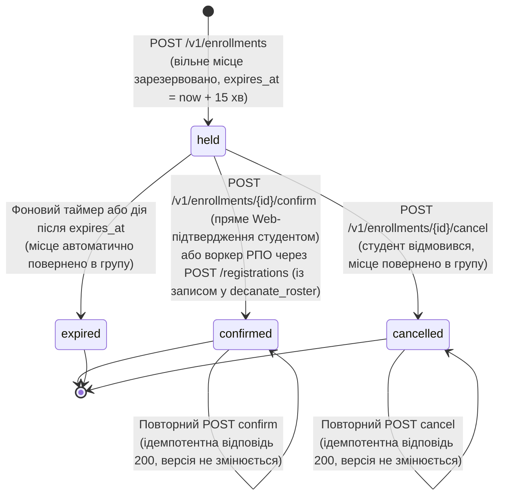
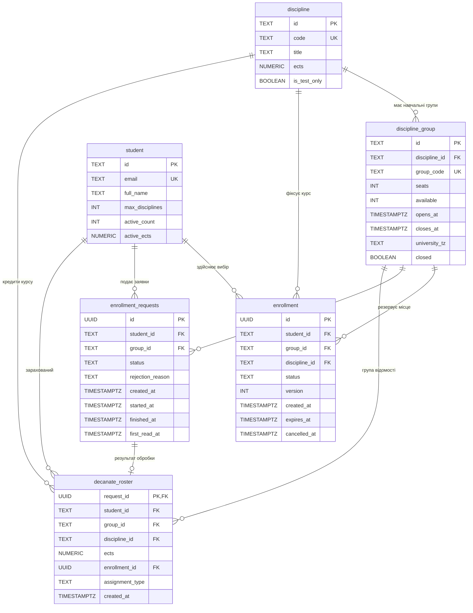
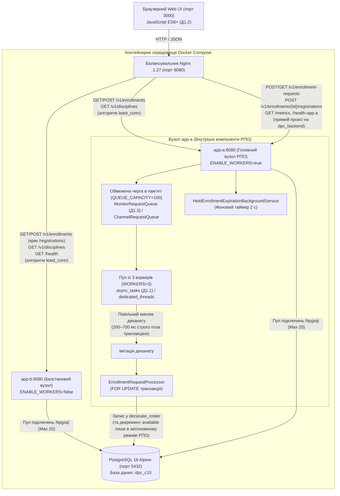

# Спільний навчальний проєкт за темою С10: «Запис на вибіркові дисципліни»
## Лабораторні роботи №1–2: Web + РПО («Розробка базового сервісу, ідемпотентність, паралельна обробка запитів та чисельні обчислення»)

---

## 1. Курс і тема

- **Назви навчальних курсів**:
  1. **«Обмін даними у Web-застосунках»** (ЛР1: обов'язкові пункти ядра **О1.1–О1.4, О1.7**, інфраструктурні пункти **О1.5, О1.6** та додаткові бонуси **Д1.1, Д1.2, Д1.3, Д1.4, Д1.5**; ЛР2: основні пункти **О2.1–О2.4**).
  2. **«Розподілені та паралельні обчислення» (РПО)** (ЛР1: обов'язкові пункти ядра **О1.1–О1.4**, додатковий основний пункт **О1.5** та додаткові бонуси **Д1.1, Д1.2, Д1.3, Д1.4**; ЛР2: основні пункти **О2.1–О2.4**).
- **Ідентифікатор і назва теми**: **С10. Запис на вибіркові дисципліни** (каталог вибіркових курсів, формування навчальних груп, контроль лімітів кредитів ЄКТС та кількості дисциплін, ведення відомостей деканату).
- **Склад команди**:
  - **Зінківський Тимур Євгенійович**, студент групи **ІТІНФ-23-2**.
  - **Формат роботи**: Проєкт виконується **індивідуально (в соло)** з офіційного дозволу та погодження викладача.
- **Технологічний стек**:
  - Бекенд: `.NET 8.0 SDK / ASP.NET Core Kestrel` (C# 12, Minimal API, чистий ADO.NET через `Npgsql 8.0` без сторонніх ORM).
  - База даних: `PostgreSQL 16 Alpine` (реляційна схема з обмеженнями цілісності, контрольованою денормалізацією та версіонованими міграціями SQL з контролем контрольних сум SHA-256).
  - Балансування та мережа: `Nginx 1.27 Alpine` (алгоритм балансування `least_conn`, проксі для Web API, виділений маршрут `/health-app-a`, маршрутизація `/registrations` та черги РПО на `dpc_backend`).
  - Клієнт: `JavaScript ES6+ / HTML5 / CSS3` (без сторонніх бібліотек чи фреймворків, порт 3000).
  - Тестування та перевірка: `Spectral CLI 6.11` (OpenAPI 3.1), `xUnit` (195 тестових випадків: модульні, інтеграційні та наскрізні E2E-перевірки бізнес-правил, HTTP-статусів, ідемпотентності, конкурентного доступу, черг, чисельного інтегрування, міграцій БД та ізоляції тестового середовища), `PowerShell 7+ / Bash` (скрипти комплексної автоматизованої атестації).

---

## 2. Проєкт

### 2.1 Призначення платформи
Платформа призначена для обслуговування кампанії вибору навчальних дисциплін студентами університету. У момент відкриття реєстрації сервіс витримує пікове навантаження (сотні запитів за хвилину), забезпечує строге збереження місткості академічних груп, запобігає переповненню та формує офіційні відомості деканату для навчального відділу.

### 2.2 Спільний ресурс та головний інваріант
- **Спільний ресурс**: Таблиця `discipline_group` та SQL-представлення `group_seats`.
- **Головний інваріант (Invariant)**:
  Для будь-якої навчальної групи кількість фактично зайнятих місць ніколи не перевищує ліміт місць, а залишок доступних місць є строго невід'ємним:
  $$\text{taken} \le \text{seats}, \quad \text{available} \ge 0$$
  де у нормальному (SAFE) режимі діє точне співвідношення $\text{available} = \text{seats} - \text{taken}$.
  
  *Примітка щодо формули обчислення поля `taken` у представленні `group_seats`:*
  $$\text{taken} = \max(\text{seats} - \text{available},\; \text{roster\_count})$$
  Ця формула описує динамічне обчислюване поле представлення, створене спеціально для запобігання приховуванню збоїв: у разі конкурентного переповнення або втраченого оновлення (Lost Update / TOCTOU в UNSAFE-режимі без блокування `FOR UPDATE`, коли паралельні транзакції читають одне й те саме застаріле значення `available`, одночасно проходять бізнес-перевірку та перезаписують лічильник), поле `taken` спирається на фактичну кількість внесених студентів $\text{roster\_count}$, явно демонструючи порушення інваріанта $\text{taken} \le \text{seats}$.
  - `seats` — загальна затверджена місткість академічної групи;
  - `available` — кількість фактично доступних вільних місць у групі;
  - `taken` — кількість зайнятих місць;
  - `roster_count` — фактична кількість студентів, внесених до відомості деканату (`decanate_roster`).

### 2.3 Зміст і призначення чисельного розрахунку (ЛР2 РПО)
Обчислювальна модель прогнозування навантаження базується на функції інтенсивності вхідного потоку заявок від студентів з моменту відкриття кампанії вибору:
$$\lambda(t) = B + A e^{-t/\tau}, \quad t \in [0; T]$$
Первісна функції:
$$\Phi(t) = B t - A \tau e^{-t/\tau}$$
Інтеграл $I = \int_0^T \lambda(t)\,dt = \Phi(T) - \Phi(0)$ визначає сумарну кількість очікуваних запитів за перші $T$ хвилин і використовується для аналітичної оцінки навантаження та вибору статичних параметрів черги й пулу воркерів (конфігурація `QUEUE_CAPACITY` та `WORKERS`). У ЛР2 цей інтеграл обчислюється через `POST /v1/compute` паралельними процесами складеною формулою трапецій (`method = "trapezoid"`, природний порядок підсумовування `order = "natural"`) з експериментальною перевіркою точності $O(h^2)$ проти аналітичного еталону.

### 2.4 Пакетний звіт (перспектива ЛР4)
Пакетний звіт формується кластером Apache Spark на основі зрізу даних у форматі Parquet. Звіт розраховує підсумкову заповненість академічних груп за дисциплінами, кафедрами та факультетами. Для дослідження перекосу навантаження (Data Skew) закладено «гарячий ключ» — популярна вибіркова дисципліна, на яку припадає до 40% усіх поданих заяв.

### 2.5 Потік подій (перспектива ЛР5)
Джерелом потоку подій є топік Apache Kafka `enrollments`. Обробка здійснюється Spark Structured Streaming за схемою ковзного вікна тривалістю 1 хвилина з кроком 10 секунд за ключем `discipline_id`. Система агрегує темп успішних зарахувань та коректно враховує запізнілі події (наприклад, затримки мережі мобільних клієнтів тривалістю до 1 хвилини через Watermarking).

### 2.6 Життєвий цикл та діаграми станів

#### 2.6.1 Web-контур: Життєвий цикл запису (`enrollment`, О1.1 Web)



##### Таблиця переходів станів Web-запису:

| Початковий стан | Подія (HTTP-запит) | Кінцевий стан | Зміна версії | Вплив на `available` | Вплив на ліміти студента |
| :--- | :--- | :--- | :--- | :--- | :--- |
| *(новий)* | `POST /v1/enrollments` | `held` | $v = 1$ | `available = available - 1` | `active_count + 1`, `active_ects + ects` |
| `held` | `POST /v1/enrollments/{id}/confirm` | `confirmed` | $v = v + 1$ | Не змінюється (вже зарезервовано) | Не змінюється |
| `held` | `POST /v1/enrollments/{id}/registrations` | `confirmed` | $v = v + 1$ | Не змінюється (вже зарезервовано) | Не змінюється (заявка РПО проходить `queued` $\to$ `processing` $\to$ `done`) |
| `held` | `POST /v1/enrollments/{id}/cancel` | `cancelled` | $v = v + 1$ | `available = available + 1` | `active_count - 1`, `active_ects - ects` |
| `held` ($t > \text{expires\_at}$) | Фоновий таймер або дія після спливу часу | `expired` | $v = v + 1$ | `available = available + 1` (повернення) | `active_count - 1`, `active_ects - ects` |
| `confirmed` | `POST /v1/enrollments/{id}/cancel` | `confirmed` (відхилено) | Не змінюється | Не змінюється | Не змінюється (409 Conflict: `enrollment_already_confirmed`; звичайне скасування підтвердженого запису заборонено) |
| `confirmed` | `POST /v1/enrollments/{id}/confirm` | `confirmed` | Не змінюється | Не змінюється (ідемпотентно) | Не змінюється |
| `confirmed` | `POST /v1/enrollments/{id}/registrations` | `confirmed` (відхилено) | Не змінюється | Не змінюється | Не змінюється (409 Conflict: `enrollment_not_held`; повторне внесення до відомості неможливе) |
| `cancelled` | `POST /v1/enrollments/{id}/cancel` | `cancelled` | Не змінюється | Не змінюється (ідемпотентно) | Не змінюється |

#### 2.6.2 Розмежування статусів confirmed та реєстрації у відомості (Web vs РПО, С10)

У проєкті чітко розмежовано два шляхи переведення запису у фінальний стан та забезпечено суворе розділення відповідальності між доменами Web та РПО:
1. **Прямий виклик `POST /v1/enrollments/{id}/confirm`**: базова операція автономного Web-контуру за методичкою Web (підтвердження вибору дисципліни студентом). Запис переходить із `held` у `confirmed` безпосередньо у транзакції Web.
2. **Наскрізна реєстрація `POST /v1/enrollments/{id}/registrations` (Розподіл відповідальності Web і РПО)**:
   - Воркер РПО (`EnrollmentRequestProcessor`) **не здійснює прямого мутування таблиці `enrollment` Web-контуру**.
   - Домен РПО фіксує студента у відомості деканату `decanate_roster` та переводить статус заявки в `done` у власній DPC-транзакції.
   - Після успішного `CommitAsync` DPC сповіщає Web-контур через інтерфейс `IWebEnrollmentNotifier` (`NotifyRosterRecordedAsync`).
   - Web-контур самостійно, у власній транзакції, переводить запис `held` $\to$ `confirmed` з атомарним інкрементом версії `version = version + 1`.
3. **Надійність сповіщення та самовідновлення (Retry + Reconciliation)**:
   - При виклику `NotifyRosterRecordedAsync` діє механізм повторної доставки: **до 3 спроб із експоненційною затримкою** (50 мс, 100 мс, 200 мс: $50 \times 2^{attempt-1}$). При цьому чітко розрізняються:
     - *Постійні порушення*: запис скасовано, прострочено або не знайдено — негайне повернення `false` без повторних спроб і фіксація події `roster_confirmation_permanent_failure`.
     - *Ідемпотентний успіх*: запис вже має статус `confirmed` — негайне повернення `true`.
     - *Тимчасова неможливість або збій з'єднання*: повторна спроба з експоненційною паузою (50, 100, 200 мс).
   - Персистентний запис у таблиці `decanate_roster` (`enrollment_id`, `request_id`) слугує надійним документальним записом-основою для підтвердження.
   - Фонова служба `HeldEnrollmentExpirationBackgroundService` кожні 2 секунди викликає `ReconcilePendingRosterConfirmationsAsync`, виконуючи періодичну звірку (reconciliation): виявляє будь-які непідтверджені записи `held`, для яких вже зафіксовано запис у відомості деканату, та автоматично доводить їх до `confirmed`.
   - Механізм очищення прострочених записів `ExpireStaleHeldEnrollmentsAsync` містить фільтр `AND NOT EXISTS (SELECT 1 FROM decanate_roster dr WHERE dr.enrollment_id = enrollment.id)`, що гарантує: запис студента, внесеного до відомості, ніколи не буде помилково експірований.
4. **Захист від повторної реєстрації**: якщо запис уже підтверджено (`confirmed`), виклик `POST /v1/enrollments/{id}/registrations` відхиляється з кодом 409 Conflict (`enrollment_not_held`), унеможливлюючи дублювання студентів у відомості деканату (`uq_decanate_roster_enrollment_id`).
5. **Ідемпотентність черги у всіх 5 станах**:
   - Повторний запит з однаковим заголовком `Idempotency-Key` (або `request_id`) та ідентичними параметрами повертає збережений результат **`HTTP 202 Accepted`** із заголовком `Location` у **будь-якому з п'яти станів**: `queued`, `processing`, `done`, `rejected`, `failed`.
   - Перевірка наявності заявки в БД виконується ДО резервування слота оперативної черги (`TryReserveSlot`), тому повторні запити не споживають місткість черги і не отримують `429 Too Many Requests`.
   - Зміна параметрів під тим самим ключем повертає 409 Conflict (`idempotency_conflict`).
   - Конкурентні запити з однаковим ключем вирішуються через унікальний індекс PostgreSQL, повертаючи клієнту збережену заявку зі звільненням слота черги.

#### 2.6.3 РПО-контур: Життєвий цикл заявки (`enrollment_requests`, О1.1 РПО)

```mermaid
stateDiagram-v2
    [*] --> queued: POST /v1/enrollment-requests або /registrations<br>(HTTP 202 Accepted, збережено в БД та поставлено в чергу)
    
    queued --> processing: Воркер вилучив заявку з черги<br>(фіксація started_at)
    
    processing --> done: Успішна валідація лімітів та місць<br>(запис у decanate_roster; available - 1 лише в автономному режимі РПО,<br>а у спільному з Web місце вже зарезервоване у held)
    processing --> rejected: Відхилення за правилом: група заповнена,<br>вичерпано ліміт K=5 або 30.0 ЄКТС
    processing --> failed: Системна помилка обробки або невідновлювана помилка виконання
    
    done --> [*]
    rejected --> [*]
    failed --> [*]
```

#### 2.6.4 Чисельні параметри та припущення предметної області (О1.1 Web та О1.1 РПО)

| Параметр | Значення | Призначення та бізнес-правило | Де перевіряється |
| :--- | :--- | :--- | :--- |
| **$K$ (max_disciplines)** | **5** (налаштовується 1–10) | Максимальна кількість активних вибіркових дисциплін на одного студента | `EnrollmentPolicy.cs`, `student.max_disciplines` |
| **Max ECTS** | **30.0** кредитів ЄКТС | Граничний обсяг кредитів вибіркових дисциплін за семестр (`NUMERIC(3,1)`) | `EnrollmentDomainRules.cs`, `student.active_ects` |
| **Резервування (Hold)** | **15 хвилин** | Час утримання місця у стані `held` (`expires_at = created_at + 15 min`) | Web-контур `POST /v1/enrollments` |
| **DISC-WEB-01** | 25 місць (6.0 ЄКТС) | Основна навчальна група Web-програмування | Каталог курсів, Web API |
| **DISC-AI-02** | 25 місць (5.0 ЄКТС) | Група штучного інтелекту (ліниве прострочення `held -> expired`) | `verify_all.ps1` (Етап 10) |
| **DISC-SEC-03** | 15 місць (5.0 ЄКТС) | Група кібербезпеки | Каталог курсів |
| **DISC-DPC-01** | 30 місць (6.0 ЄКТС) | Головна група РПО для навантаження черги, закону Літтла та SIGTERM | `verify_all.ps1` (Етапи 3, 4, 6, 7, 8, 9) |
| **DISC-TEST-SAFE** | 5 місць (3.0 ЄКТС) | Тестова група конкурентного навантаження 20 запитами (SAFE vs UNSAFE) | `verify_all.ps1` (Етап 5) |
| **DISC-ONE-SEAT** | 1 місце (4.0 ЄКТС) | Група з єдиним місцем для перевірки відхилення `group_full` (409) | `verify_all.ps1` (Етап 10) |
| **DISC-WINDOW-TEST** | 20 місць (6.0 ЄКТС) | Група з закритим вікном для перевірки відхилення `enrollment_window_closed` (422) | `verify_all.ps1` (Етап 10) |

#### 2.6.5 Взаємодія контурів Web та РПО у спільній темі С10 (§1.10 РПО / §1.9 Web)
Згідно з карткою спільної теми C10 (розділ 6 методичних вказівок курсу РПО та курсу Web), обов'язки між контурами розподілені наступним чином:
- **Контур Web**: первинний інтерактивний вибір дисципліни студентом, атомарне резервування місця в групі (`available - 1`), утримання броні `held` (15 хв) та фіксація підтвердження `confirmed`.
- **Контур РПО (DPC)**: ведення офіційної відомості деканату `decanate_roster` та пакетний перерозподіл студентів за другим пріоритетом (`second_choice`) після закриття груп деканатом.

З метою дотримання методичних вимог обох дисциплін без передчасного ускладнення системи на етапі ЛР1 архітектура чітко розмежовує два сценарії:

1. **Сценарій А (Автономний навчальний стенд РПО ЛР1)**:
   - Ендпоінт `POST /v1/enrollment-requests` програмно обмежений виділеними групами автономного стенду РПО (`DISC-DPC-01`, `DISC-TEST-SAFE`) за ознакою `dpc_sandbox_enabled = true`. Спроба подати асинхронну заявку на звичайну інтерактивну групу Web-контуру (`dpc_sandbox_enabled = false`) суворо відхиляється з кодом 422 Unprocessable Content (`dpc_sandbox_disabled`), гарантуючи цілісність обох контурів на рівні ядра системи.
   - У межах цього стенду воркери РПО демонструють усі обов'язкові інженерні вимоги ЛР1 РПО:
     - Обмежена черга в оперативній пам'яті (`QUEUE_CAPACITY = 100`) із миттєвим поверненням `429 Too Many Requests` (Backpressure) для нових запитів та коректним поверненням `202 Accepted` для збережених повторів з `Idempotency-Key`.
     - Симуляція повільної перевірки студента в системі деканату (200–700 мс), що винесена **строго ДО відкриття транзакції БД** (О1.3).
     - Конкурентна обробка пулом воркерів (`WORKERS = 3`) із порівнянням безпечного режиму SAFE (`SELECT ... FOR UPDATE`) проти стану гонитви та втраченого оновлення UNSAFE (О1.4).
     - Доведення кожної заявки до кінцевого стану (`done | rejected | failed`), фіксація часу першого читання `first_read_at` (О1.5) та Graceful Shutdown на сигнал SIGTERM (Д1.4).
   - У цьому автономному сценарії воркер РПО самостійно списує місце в групі (`available - 1`), що дозволяє наочно протестувати інваріант місткості в ізоляції від інтерактивного Web-клієнта.

2. **Сценарій Б (Поточна наскрізна інтеграція Web + РПО за темою C10 у ЛР1/ЛР2)**:
   - Реалізовано через ендпоінт `POST /v1/enrollments/{id}/registrations` (Web C10, стор. 37):
     1. Web-сервіс приймає вибір студента (`POST /v1/enrollments`), резервує місце (`available - 1`) та створює запис у стані `held`.
     2. Наскрізна реєстрація запису у відомості деканату виконується передачею до черги РПО (`POST /v1/enrollments/{id}/registrations`), яка повертає `202 Accepted` із заголовком `Location: /v1/enrollment-requests/{requestId}`.
     3. Воркер РПО у безпечному транзакційному конвеєрі перевіряє зв'язок `(request_id, enrollment_id)`, вносить студента до офіційної відомості `decanate_roster` та атомарно підтверджує Web-запис (`held -> confirmed`).
     4. **Критичний інваріант**: у Сценарії Б воркер РПО **не виконує повторного декременту `available` і не збільшує статистику студента**, оскільки місце вже списане та враховане контуром Web!
     5. **Взаємозахист шляхів підтвердження**: прямий `POST /v1/enrollments/{id}/confirm` є автономним Web-підтвердженням студента без залучення контуру РПО та без запису у відомість. Якщо запис уже переведено у `confirmed` (прямим викликом), повторна відправка у чергу РПО через `/registrations` відхиляється з кодом `409 Conflict` (`enrollment_not_held`), що гарантує: один Web-запис може потрапити до відомості деканату не більше одного разу (`uq_decanate_roster_enrollment_id`).

3. **Сценарій В (Перспективна подійна інтеграція Web та РПО через брокер повідомлень у ЛР4)**:
   - *Заплановано до реалізації в межах ЛР4 (наразі не реалізовано в коді ЛР1/ЛР2)*: перехід на брокер повідомлень (Apache Kafka / RabbitMQ) на базі доменних подій. У такій архітектурі виклик `POST /confirm` публікуватиме подію `EnrollmentConfirmedEvent(enrollment_id, student_id, group_id, request_id)` у топік Kafka, звідки контур РПО вичитуватиме її для фонового внесення до `decanate_roster`. У поточному релізі ЛР1/ЛР2 використовується безпосередня інтеграція через HTTP API та спільну БД PostgreSQL.
   - Автоматизований розподіл за другим вибором (`assignment_type = 'second_choice'`): саме контур РПО здійснюватиме атомарне списання місця та зарахування до резервної групи після закриття основного набору деканатом (заплановано до реалізації у майбутній ЛР6 у межах координації розподілених виконавців та generation fencing; у межах ЛР1 забезпечено схему таблиці `decanate_roster` з полем `assignment_type` та первинне формування відомостей основного вибору).
4. **Єдине джерело істини та спільний захист від дублікатів (ЛР1)**:
   - На рівні PostgreSQL обидва контури синхронізовані через представлення `VIEW group_seats`, де зайняті місця обчислюються як `taken = GREATEST(seats - available, roster_count)`.
   - Метод `HasActiveEnrollmentForDisciplineAsync` виконує об'єднаний запит (`UNION ALL`) таблиць `enrollment` та `decanate_roster`, унеможливлюючи повторний запис на ту саму дисципліну через будь-який із контурів.

### 2.7 Реляційна схема бази даних, контрольована денормалізація та композитні зовнішні ключі (О1.2 Web)

> [!NOTE]
> **Контрольована денормалізація (Controlled Denormalization) та композитні зовнішні ключі**:
> За канонічною 3НФ атрибут `discipline_id` у таблицях `enrollment` та `decanate_roster` є транзитивно залежним через `group_id -> discipline_group.discipline_id`. Проте рушій PostgreSQL не підтримує міжтабличні умови в обмеженнях цілісності `UNIQUE (...) WHERE ...`. Для забезпечення інваріанта «студент не може мати два активні записи на одну й ту саму дисципліну» створено частковий індекс:
> `CREATE UNIQUE INDEX idx_enrollment_active_student_discipline ON enrollment(student_id, discipline_id) WHERE status IN ('held', 'confirmed');`
> Щоб унеможливити будь-яку неузгодженість між групою та дисципліною, у міграції `005_composite_foreign_keys.sql` створено унікальний ключ `discipline_group(id, discipline_id)` та композитні зовнішні ключі:
> `FOREIGN KEY (group_id, discipline_id) REFERENCES discipline_group(id, discipline_id) ON DELETE CASCADE;`
> Це запобігає неузгодженості між `group_id` та `discipline_id` на рівні зовнішніх ключів і забезпечує цілісність цього зв'язку під час вставки та оновлення записів.



---

## 3. Архітектура

Архітектура системи відповідає вимогам інтеграції розділу §1.10 (РПО) та §1.9 (Web), поєднуючи синхронний клієнтський Web-інтерфейс та асинхронний високонавантажений контур пакетної обробки:



### Розподіл відповідальності між контурами (§1.10)
1. **Синхронний Web-контур (`/v1/enrollments`, `/v1/disciplines`)**:
   - Приймає персональний вибір студента через браузерний клієнт.
   - Запити розподіляються Nginx за алгоритмом `least_conn` між `app-a` та `app-b`.
   - Ідентифікатор студента визначається виключно із заголовка `X-User-Id` (передача `student_id` у тілі суворо заборонена — повертається `422 Unprocessable Entity`).
   - Керує станами таблиці `enrollment` (`held -> confirmed | cancelled | expired`), зміною доступних місць `discipline_group.available` та статистикою студента (поля `active_count` та `active_ects` у таблиці `student`).
   - Web-контур **не змінює безпосередньо відомість деканату `decanate_roster` та не виконує внутрішню доменну обробку заявок РПО**, але для наскрізного сценарію реєстрації у відомості (`POST /v1/enrollments/{id}/registrations`) передає запит до черги контуру РПО (`enrollment_requests`) для подальшої асинхронної обробки пулом воркерів.
2. **Асинхронний контур РПО (`/v1/enrollment-requests`, `/v1/compute`, `/metrics`, `/v1/decanate-roster`)**:
   - Поєднує персистентне збереження заявок у PostgreSQL (`enrollment_requests`) з високоефективною обмеженою чергою в пам'яті вузла `app-a` та механізмом Restart Recovery при перезапуску процесу. Прийом заявки повертає негайну відповідь `202 Accepted`.
   - Забезпечує негайний зворотний тиск (Backpressure): якщо в черзі немає вільних слотів (`QUEUE_CAPACITY = 100`), метод `TryReserveSlot()` миттєво повертає `429 Too Many Requests` із заголовком `Retry-After: 1` **без навантаження бази даних**.
   - Пул із 3 паралельних воркерів вилучає заявки, виконує обов'язковий повільний виклик (200–700 мс) строго поза критичною секцією БД та фіксує зарахування у відомості `decanate_roster`. При цьому робота з лічильником вільних місць залежить від сценарію: у спільному сценарії Web + РПО (`POST /v1/enrollments/{id}/registrations`) місце в групі вже зарезервоване контуром Web при створенні `held`, тому воркер РПО лише перевіряє чинну бронь і вносить студента до `decanate_roster` **без повторного зменшення `available`** (після чого сповіщає Web для переходу `held -> confirmed`); натомість в автономному стендовому режимі РПО (`POST /v1/enrollment-requests` без Web-броні) воркер самостійно декрементує `discipline_group.available`.
   - Відповідає за формування офіційної відомості деканату `decanate_roster`. Щодо меж готовності теми С10: у межах ЛР1–ЛР2 реалізовано первинне формування відомостей основного вибору, захист інваріанта місткості, облік статусів та підтримку атрибута `assignment_type` ('primary' / 'second_choice'). Автоматичний перерозподіл студентів за другим вибором (`second_choice`) після закриття набору деканатом згідно з навчальною програмою та методичними рекомендаціями РПО віднесено до майбутньої ЛР6 (координація розподілених виконавців та захист спільного ресурсу за допомогою нумерації поколінь — generation fencing) і не є блокером для атестації ЛР1–ЛР2.
   - Контур РПО **не здійснює прямих записів у таблицю `enrollment`**.
3. **Єдине предметне правило для обох контурів (§1.10)**:
   - Перевірка «чи записаний студент уже на цю дисципліну» виконується уніфікованим SQL-запитом, який перевіряє **обидві таблиці одночасно** (`enrollment` у статусах held/confirmed та `decanate_roster`). Студент, зарахований через чергу РПО, не може повторно записатися на ту саму дисципліну через Web, і навпаки.
4. **Єдине джерело істини для інваріанта місткості**:
   - Вільні місця: `free_seats = available`.
   - Зайняті місця: `taken = GREATEST(seats - available, (SELECT COUNT(*)::INT FROM decanate_roster dr WHERE dr.group_id = g.id))`.
   - Представлення `group_seats` формується на рівні ядра PostgreSQL через агрегацію: `roster_count = COUNT(*) FROM decanate_roster`.

---

## 4. Структура репозиторію

```text
project/
├── .spectral.yaml                                 # Правила лінтування OpenAPI 3.1
├── compose.yaml                                   # Опис багатоконтейнерної системи (app-a, app-b, nginx, postgres)
├── Dockerfile                                     # Multi-stage збірка .NET 8.0 SDK (з dotnet-trace) -> ASP.NET Core Runtime
├── nginx.conf                                     # Конфігурація Nginx: least_conn, проксі РПО та виділений /health-app-a
├── openapi.yaml                                   # Повний контракт API (OpenAPI 3.1), сертифікований Spectral CLI
├── README.md                                      # Звітна документація проєкту за канонічною структурою §1.9 (ЛР1 + ЛР2)
├── client/                                        # Клієнтський модуль Web-контуру (Д1.2 Web та О2.4 Web)
│   ├── api.js                                     # Клієнтська логіка на JS ES6+ (ідемпотентні повтори, AbortController, Retry-After)
│   ├── index.html                                 # Інтерфейс вибору курсів, підтвердження та перегляду черги (вбудовані CSS-стилі)
│   ├── serve.mjs                                  # Автономний Node.js HTTP-сервер для клієнта на порті 3000
│   ├── start_client.ps1                           # Скрипт локального хостингу вебклієнта (PowerShell)
│   └── start_client.sh                            # Скрипт локального хостингу вебклієнта (Bash)
├── migrations/                                    # Версіоновані міграції PostgreSQL (контроль SHA-256)
│   ├── 001_init_c10_schema.sql                    # Таблиці предметної області, обмеження FK/CHECK, VIEW group_seats
│   ├── 002_seed_c10_data.sql                      # Довідкові дисципліни, групи та тестові пули студентів
│   ├── 003_update_group_seats_and_idempotency.sql # Оновлення VIEW group_seats (GREATEST) та локальний індекс (student_id, idempotency_key)
│   ├── 004_unique_idempotency_key.sql             # Спроба створення глобального індексу (no-op через IF NOT EXISTS та наявність імені з 003)
│   ├── 005_composite_foreign_keys.sql             # Композитні FK (group_id, discipline_id)
│   ├── 006_global_unique_idempotency_key.sql      # Глобальний унікальний індекс Idempotency-Key
│   ├── 007_add_dpc_sandbox_enabled.sql            # Розділення автономних DPC-груп і Web-груп
│   ├── 008_idempotency_and_joint_enrollment.sql   # Ідемпотентність Web-записів та зв'язок enrollment_id у заявках РПО
│   ├── 009_add_requested_enrollment_id.sql        # Надійне збереження вихідного Web-ідентифікатора (requested_enrollment_id)
│   ├── 010_decanate_roster_unique_constraints.sql # Унікальні обмеження decanate_roster (student_id + discipline_id та enrollment_id)
│   └── 011_web_idempotency_lr2.sql                # Повна модель ідемпотентності Web О2.2 (processing/completed, збережена відповідь, TTL) + полігон О2.1
├── scripts/                                       # Сценарії автоматизованої перевірки та вимірювань
│   ├── empirical_metrics_500.json                 # Збережені результати емпіричного навантажувального заміру (500 клієнтів)
│   ├── init_test_db.sql                           # Ініціалізація виділеної тестової бази даних dpc_c10_test
│   ├── measure_compute.ps1                        # Скрипт серій вимірювань чисельного інтегрування та профілювання РПО ЛР2 (О2.2–О2.4)
│   ├── measure_metrics_500.ps1                    # Скрипт навантажувального тестування 500 паралельними клієнтами
│   ├── verify_all.ps1                             # Комплексний сценарій атестації всіх пунктів ЛР1 + ЛР2 (PowerShell 7+)
│   └── verify_all.sh                              # Bash-обгортка для середовищ Linux/macOS
├── src/                                           # Вихідний код бекенд-сервісу .NET 8
│   └── EnrollmentService/
│       ├── EnrollmentService.csproj               # Файл проєкту .NET 8 (Nullable enable, AllowUnsafeBlocks)
│       ├── Program.cs                             # Точка входу, DI, конвеєр HTTP, SIGTERM та запуск дочірніх процесів --compute-worker
│       ├── Contracts/                             # DTO у форматі snake_case
│       │   ├── DpcDtos.cs                         # DTO черги, заявок, відомості деканату, стану місць та обчислень /v1/compute
│       │   └── WebDtos.cs                         # DTO вибору дисциплін, записів та пагінації (без зайвих полів)
│       ├── Domain/                                # Чиста бізнес-логіка предметної області
│       │   ├── Entities.cs                        # Доменні сутності (StudentEntity, DisciplineGroupEntity)
│       │   ├── EnrollmentDomainRules.cs           # Чисті функції вікна [opens_at, closes_at), ліміти ЄКТС, Base64-курсори, SHA-256 відбиток О2.2
│       │   ├── EnrollmentPolicy.cs                # Єдина чиста доменна функція валідації правил для Web і РПО
│       │   └── ServiceResult.cs                   # Типізований монолітний результат доменних операцій
│       ├── Endpoints/                             # Маршрути Minimal API
│       │   ├── AdminEndpoints.cs                  # Стендовий маршрут /v1/admin/reset (захищений ALLOW_TEST_OVERRIDES)
│       │   ├── ComputeEndpoints.cs                # Маршрут POST /v1/compute для паралельного чисельного інтегрування C10 (РПО ЛР2)
│       │   ├── DiagnosticsEndpoints.cs            # Маршрути GET /, GET /health, GET /metrics
│       │   ├── EnrollmentEndpoints.cs             # Web-маршрути: POST, GET, confirm, cancel, registrations
│       │   ├── EnrollmentRequestEndpoints.cs      # РПО-маршрути: POST (TryReserveSlot -> 429), GET за ID
│       │   └── GroupEndpoints.cs                  # Каталог груп, ресурс group-seats, відомість, закриття групи
│       ├── Extensions/
│       │   └── ServiceCollectionExtensions.cs     # Реєстрація інфраструктури, сховищ, воркерів та ParallelComputeService
│       ├── Http/                                  # HTTP-інфраструктура
│       │   ├── BearerAuthMiddleware.cs            # Обов'язкова Bearer-авторизація для маршрутів РПО та /v1/compute (HTTP 401)
│       │   ├── GracefulShutdownMiddleware.cs      # Відсікання нових мутуючих запитів кодом 503 при зупинці SIGTERM
│       │   ├── HttpPayloadHelper.cs               # Парсер тіла: 400 (помилка синтаксису) та 422 (помилка полів)
│       │   ├── ProblemDetailsMapper.cs            # Стандартні відповіді RFC 9457 (application/problem+json)
│       │   ├── RequestIdentity.cs                 # Контекст запиту (Correlation ID, User ID, Trace ID)
│       │   └── RequestIdentityMiddleware.cs       # Виділення X-User-Id, X-Request-ID, W3C traceparent, журнал JSON
│       ├── Infrastructure/
│       │   └── ServiceOptions.cs                  # Параметри конфігурації зі змінних середовища (вкл. FAULTS та параметри моделі C10)
│       ├── Metrics/
│       │   └── MetricsCollector.cs                # Монотонні таймстампи, розрахунок закону Літтла
│       ├── Queues/                                # Реалізації обмеженої черги в пам'яті (РПО О1.2, Д1.3)
│       │   ├── IBoundedRequestQueue.cs            # Уніфікований інтерфейс обмеженої черги із резервуванням слотів
│       │   ├── ChannelRequestQueue.cs             # Реалізація на базі System.Threading.Channels.Channel
│       │   └── MonitorRequestQueue.cs             # Реалізація на базі lock та Monitor.Wait / Monitor.PulseAll
│       ├── Repositories/                          # Рівень доступу до даних (чистий SQL без ORM)
│       │   ├── DecanateRepository.cs              # Доступ до таблиці decanate_roster
│       │   ├── EnrollmentRepository.cs            # Таблиці enrollment, student, ідемпотентність О2.2, пакетне очищення ключів
│       │   ├── EnrollmentRequestRepository.cs     # Таблиця enrollment_requests
│       │   ├── GroupRepository.cs                 # Таблиці discipline, discipline_group, VIEW group_seats
│       │   └── IDbConnectionFactory.cs            # Інтерфейс та фабрика з'єднань Npgsql з пулом (Max 20)
│       └── Services/                              # Сервісний рівень, фонова обробка та чисельне інтегрування
│           ├── DatabaseInitializer.cs             # Перевірка незмінності sha256 та накатування SQL-міграцій (001–011)
│           ├── EnrollmentService.cs               # Оркестрація транзакцій Web-контуру (канонічні блокування, О2.1–О2.3)
│           ├── EnrollmentWorkerPool.cs            # Безпечний життєвий цикл пулу воркерів (ізоляція винятків)
│           ├── FaultInjector.cs                   # Ін'єктор контрольованої відмови /faults/after_commit_before_response (Web О2.3)
│           ├── HeldEnrollmentExpirationBackgroundService.cs # Фоновий таймер звільнення held-записів, reconciliation та очищення TTL ключів
│           ├── IWebEnrollmentNotifier.cs          # Інтерфейс сповіщення Web-контуру про фіксацію у decanate_roster
│           ├── StructuredJsonLogger.cs            # Форматування структурованих JSON-подій у stdout
│           ├── WebEnrollmentNotifier.cs           # Реалізація сповіщення Web із експоненційними повторами (Retry)
│           ├── Compute/                           # Багатопроцесне чисельне інтегрування C10 (РПО ЛР2 О2.1–О2.4)
│           │   ├── C10IntensityMath.cs            # Ядро складеної та наївної формули трапецій і аналітичної первісної C10
│           │   ├── ComputeWorkerProcess.cs        # Дочірній процес ОС (--compute-worker, режими local/lock/none через MemoryMappedFile)
│           │   └── ParallelComputeService.cs      # Координатор запуску дочірніх процесів, збору результатів і метрик точності
│           └── Processing/
│               ├── EnrollmentRequestProcessor.cs  # Процесор обробки заявок РПО (безпечний FOR UPDATE та UNSAFE)
│               └── IEnrollmentRequestProcessor.cs # Контракт процесора заявок РПО
└── tests/
    └── EnrollmentService.Tests/
        ├── EnrollmentService.Tests.csproj         # Проєкт модульних, інтеграційних та E2E-тестів xUnit (.NET 8)
        ├── DomainAndQueueTests.Domain.cs          # 6 модульних тестів предметної області (вікна, ЄКТС, ліміти K, часові пояси)
        ├── DomainAndQueueTests.Queue.cs           # 3 тести черг (MonitorRequestQueue, слоти, багатопотоковість)
        ├── DomainAndQueueTests.Metrics.cs         # 13 тестів метрик (курсори, traceparent, Problem Details, закон Літтла, 8 InlineData)
        ├── DomainAndQueueTests.Workers.cs         # 6 тестів пулу воркерів (BearerAuth, Graceful Shutdown 503, WebEnrollmentNotifier, воркери)
        ├── BusinessErrorStatusTests.cs            # 9 тестів відповідності бізнес-відмов HTTP-статусам (400/404/409/422)
        ├── FirstReadTimeTrackingTests.cs          # 11 тестів атомарної фіксації t4 first_read_at (усі 8 сценаріїв О1.5 DPC + COMMIT/finish + відкат)
        ├── RestartAndRecoveryTests.Startup.cs     # 3 тести відновлення queued-заявок із PostgreSQL при старті та дозавантаження
        ├── RestartAndRecoveryTests.Shutdown.cs    # 2 тести Graceful Shutdown (Drain при заповненій БД та зупинка app-b без воркерів)
        ├── RestartAndRecoveryTests.CrashRecovery.cs # 11 тестів аварійного відновлення (5 станів ідемпотентності, збої до/після коміту, гонитва)
        ├── DpcLab2ComputeTests.cs                 # 28 тестів РПО ЛР2 (POST /v1/compute, точність O(h^2), 1/2/4 процеси, local/lock/none, Bearer 401)
        ├── WebLab2IdempotencyAndFaultTests.cs     # 6 тестів Web ЛР2 (О2.1 конкурентність 40 та 500 студентів на 25 місць, О2.2–О2.3 ідемпотентність і fault)
        ├── E2EHttpEndpointTests.Fixture.cs        # Спільна тестова фікстура WebApplicationFactory, хелпери перевірок та очищення
        ├── E2EHttpEndpointTests.Enrollment.cs     # 24 наскрізні E2E HTTP-тести Web-контуру (CRUD, вікна, ліміти, скасування, автентифікація)
        ├── E2EHttpEndpointTests.DpcQueue.cs       # 4 E2E HTTP-тести черги РПО (прийом 202, опитування, пісочниця, реєстрація Web)
        ├── E2EHttpEndpointTests.Idempotency.cs    # 23 E2E HTTP-тести ідемпотентності (5 станів РПО, дублікати, конфлікти student/group/enrollment_id)
        ├── E2EHttpEndpointTests.JointRegistration.cs # 11 наскрізних E2E-тестів спільного сценарію Web + DPC (held -> confirmed, узгодженість cancel/confirm)
        ├── E2EHttpEndpointTests.Migrations.cs     # 5 E2E-тестів перевірки схеми та міграцій БД (007, 008, 009, 010)
        ├── E2EHttpEndpointTests.RepositoryAndWorker.cs # 7 тестів репозиторіїв та воркера (резервне заповнення requested_enrollment_id, хуки, унікальність)
        ├── TestEnvironmentSafetyTests.cs          # 23 тести перевірки ізоляції тестового середовища, створення dpc_c10_test, перевірки SQLSTATE 42501/28P01
        ├── TestEnvironment.cs                     # Виділена конфігурація тестового середовища (dpc_c10_test) та очищення даних
        ├── TestCollectionOrder.cs                 # Послідовне виконання тестів бази даних ([assembly: CollectionBehavior])
        └── appsettings.Test.json                  # Локальна конфігурація тестового запуску
```

---

## 5. Збирання й запуск

### 5.1 Вимоги до середовища
- **Операційна система**: Windows 10/11 (з WSL2), Ubuntu 22.04+, macOS 13+.
- **Процесор і ресурси**: $\ge 4$ CPU ядра, не менше 4 ГБ вільної оперативної пам'яті (RAM).
- **Платформи розробки та виконання**:
  - **.NET 8.0 SDK** (для збирання проєкту та запуску повного набору xUnit-тестів; поточний набір — 195 тестових випадків).
  - **PowerShell 7+ (`pwsh`)** (для кросплатформенного запуску сценарію атестації `verify_all.ps1`).
  - **Node.js 18+ / npm** (для валідації специфікації лінтером `@stoplight/spectral-cli` та локального клієнта).
- **Контейнеризація**:
  - **Docker**: версія `>= 24.0`.
  - **Docker Compose**: версія `>= 2.20` (Compose V2).
- **Повний перелік опублікованих мережевих портів (Docker Compose та клієнт)**:
  - `8080`: головна вхідна точка Nginx для Web API та балансування трафіку (`least_conn`).
  - `8000`: виділений альтернативний порт Nginx для контуру РПО (використовується в `checks.yaml` викладача).
  - `8001`: прямий порт Kestrel вузла `app-a` (де працює активний пул воркерів РПО, `ENABLE_WORKERS=true`).
  - `8002`: прямий порт Kestrel другого вузла `app-b` (веб-вузол без воркерів, `ENABLE_WORKERS=false`).
  - `5432`: СУБД PostgreSQL 16 Alpine (робоча база `dpc_c10` та виділена тестова `dpc_c10_test`).
  - `3000`: локальний HTTP-сервер клієнтського вебзастосунку (`client/api.js`, чистий JS ES6+).

### 5.2 Таблиця параметрів конфігурації

| Змінна середовища | Опис параметра | Типове значення | Де використовується |
| :--- | :--- | :--- | :--- |
| `INSTANCE_ID` | Унікальний ідентифікатор екземпляра вузла | `app-a` / `app-b` | Заголовки відповідей, логування |
| `DB_CONNECTION_STRING` | Рядок з'єднання з базою даних | `Host=postgres;Port=5432;...Maximum Pool Size=20` | Пул з'єднань Npgsql (захист від вичерпання) |
| `API_AUTH_TOKEN` | Статичний Bearer-токен аутентифікації | `secret-c10-token-2026` | `BearerAuthMiddleware` |
| `QUEUE_CAPACITY` | Гранична місткість черги в пам'яті | `100` | Backpressure 429 |
| `WORKERS` | Кількість паралельних обробників | `3` | `EnrollmentWorkerPool` |
| `EXECUTION_MODEL` | Модель виконання (`async_tasks` / `dedicated_threads`) | `async_tasks` | Пул воркерів (Д1.1) |
| `QUEUE_ENGINE` | Рушій черги (`custom_monitor` / `system_channel`) | `custom_monitor` | Синхронізація (Д1.3) |
| `ENABLE_WORKERS` | Дозвіл на запуск воркерів на даному вузлі | `true` (app-a), `false` (app-b) | Розподіл ролей вузлів |
| `SLOW_CALL_MIN_MS` | Мінімальний час симуляції виклику деканату | `200` | Симуляція затримки |
| `SLOW_CALL_MAX_MS` | Максимальний час симуляції виклику деканату | `700` | Симуляція затримки |
| `UNSAFE_MODE` | Режим демонстрації гонитви без FOR UPDATE (вимагає `ALLOW_TEST_OVERRIDES=true`) | `false` | Процесор заявок (О1.4) |
| `ALLOW_TEST_OVERRIDES` | Дозвіл на виклик стендового скидання `/v1/admin/reset` та UNSAFE_MODE | `false` | Захист у робочому режимі |
| `TEST_DB_CONNECTION_STRING` | Виділений рядок з'єднання для тестів (суворо вимагає базу `dpc_c10_test`; блокує робочу `dpc_c10`) | `Host=localhost;...Database=dpc_c10_test;...` | `TestEnvironment` |
| `TEST_API_AUTH_TOKEN` | Ізольований тестовий Bearer-токен (відмінний від робочого) | `test-c10-isolated-bearer-token` | `TestEnvironment` |

> [!IMPORTANT]
> **Розділення виробничого та тестового оточення**:
> - Для виробничого середовища (`Production`) параметри `DB_CONNECTION_STRING` та `API_AUTH_TOKEN` мають налаштовуватися окремо через змінні оточення або менеджер секретів (зразок у [.env.example](.env.example)). Запуск у production із типовими секретами блокується з винятком `InvalidOperationException`.
> - Інтеграційні тести використовують окремий тестовий токен (`test-c10-isolated-bearer-token`) і суворо вимагають виділену базу даних `dpc_c10_test` (або `dpc_c10_test_*`) на локальному хості. Підключення до основної БД `dpc_c10` або баз із довільними назвами беззаперечно блокується із `[CRITICAL SAFETY ERROR]`, що гарантує захист від модифікації чи видалення робочих даних.

### 5.3 Керування міграціями бази даних
Застосування міграцій відбувається **автоматично** при старті сервісу в модулі `DatabaseInitializer`:
- Кожен SQL-файл із директорії `migrations/` перевіряється на незмінність за контрольним хешем SHA-256. Якщо раніше застосований файл було змінено без створення нової міграції, сервіс аварійно зупиняється з винятком `InvalidOperationException` для гарантії цілісності схеми.

> [!NOTE]
> **Принцип незмінності міграцій (Migration Immutability — 004 vs 006)**:
> У міграції `003` було створено складений унікальний індекс `idx_enrollment_requests_idempotency` за парою `(student_id, idempotency_key)`. У міграції `004` планувалося зробити його глобальним за `(idempotency_key)`, але через директиву `CREATE UNIQUE INDEX IF NOT EXISTS` з тим самим іменем індексу рушій PostgreSQL пропустив команду (no-op), зберігши попередній локальний індекс.
> За промисловим регламентом контролю версій схеми БД раніше застосовані файли міграцій суворо заборонено модифікувати в репозиторії заднім числом, оскільки їхній хеш SHA-256 зафіксовано в системній таблиці `schema_migrations` робочих і тестових середовищ. Тому коректне виправлення виконано за стандартом roll-forward накатуванням міграції `006_global_unique_idempotency_key.sql`, яка явно видаляє попередній індекс (`DROP INDEX IF EXISTS idx_enrollment_requests_idempotency`) та створює справжній глобальний унікальний індекс `idx_enrollment_requests_idempotency_global ON enrollment_requests(idempotency_key)`.

- Команда ручної перевірки стану таблиць через CLI контейнера:
```bash
docker compose exec -e PGPASSWORD=dpc_password postgres psql -U dpc_user -d dpc_c10 -c "\dt"
```

### 5.4 Команди збирання, запуску та тестування

#### 1. Збирання та запуск контейнерної платформи (єдина команда):
```bash
docker compose up -d --build
```

#### 2. Запуск комплексного скрипту автоматизованої атестації:
```powershell
pwsh scripts/verify_all.ps1
```
*(Скрипт перевіряє лінтування контракту, проходження всіх 195 тестових випадків модульних, інтеграційних та E2E-тестів, перевірку параметрів безпеки, Backpressure 429 при стійкому навантаженні 50 клієнтами, захист від гонитви SAFE vs UNSAFE на одній групі, закон Літтла, Graceful Shutdown з кодом 503, курсорне пагінування, життєвий цикл Web та балансування).*

#### 3. Запуск клієнтського вебзастосунку (пункт Д1.2 Web):
```powershell
pwsh client/start_client.ps1
```
Після запуску відкрийте браузер: **`http://localhost:3000`**.

#### 4. Ручний запуск модульних тестів:
```bash
dotnet test tests/EnrollmentService.Tests/EnrollmentService.Tests.csproj
```

#### 5. Перевірка специфікації OpenAPI лінтером Spectral:
```bash
npx --yes @stoplight/spectral-cli lint openapi.yaml --fail-severity=warn
```

### 5.5 Інтеграція із засобами автоматизованої перевірки викладача (`checks.yaml`)

Для автоматизованої атестації проєкту автономними або спільними засобами перевірки обох курсів (`web-interactions` та `distributed-parallel-computing`) у корені репозиторію створено файл [`checks.yaml`](checks.yaml), що відповідає стандарту `joint/checks-template.yaml`:
- **Розділ `web:`**:
  - `openapi`: `openapi.yaml` (єдиний спільний контракт OpenAPI 3.1);
  - `base`: `http://localhost:8080` (вхідна точка через Nginx);
  - `items`: підтверджені пункти ЛР1 Web поза ядром (`О1.5`, `О1.6`, `Д1.4`);
  - `instances`: опубліковані прямі порти екземплярів Kestrel (`app-a: http://localhost:8001`, `app-b: http://localhost:8002`);
  - `services`: співставлення контейнерів у `compose.yaml` (`nginx`, `app-a`, `app-b`, `postgres`);
  - `log_fields`: поля однорядкового журналу JSON (`time`, `instance`, `route`, `status`, `duration`).
- **Розділ `dpc:`**:
  - `openapi`: `openapi.yaml`;
  - `base`: `http://localhost:8000` (альтернативний порт Nginx для контуру РПО);
  - `items`: підтверджені пункти ЛР1 РПО (`О1.5`, `Д1.4`);
  - `services`: `{api: app-a, postgres: postgres}`;
  - `load_s`: `10` (тривалість фонового навантаження);
  - `resource`: тестовий ресурс `path: /v1/group-seats/DISC-DPC-01`, поле інваріанта `ok_field: invariant_holds` (суворе узгодження з відповіддю API та DTO `GroupSeatsResponse`);
  - `metrics`: імена показників у `/metrics` (`queue_length`, `in_flight`, `rejected`).
- **Розділ `scenario:`**:
  - Логічно зв'язаний наскрізний ланцюжок дій (тема C10, `joint/README.md`): створення попереднього запису через Web (`POST /v1/enrollments` зі збереженням `{enrollment}`), реєстрація у відомості через публічний Web-маршрут (`POST /v1/enrollments/{enrollment}/registrations` зі статусом `202 Accepted` та збереженням `{request}`), очікування завершення обробки (`GET /v1/enrollment-requests/{request}` зі статусом `done` та `recorded_in_roster: true`), перевірка автоматичного переведення статусу Web-запису у `confirmed` (`GET /v1/enrollments/{enrollment}`).
- **Структура конфігурації**: Файл `checks.yaml` суворо відповідає формату `joint/checks-template.yaml` (секції `web:`, `dpc:` та `scenario:`), без зайвих непідтверджених кореневих дублювань.

---

## 6. Лабораторні роботи

### 6.1 Лабораторна робота №1: «Сервіс із чергою, контракт і паралельна обробка запитів»

У межах ЛР1 реалізовано повний обсяг обов'язкових пунктів обох курсів та 9 захищуваних додаткових пунктів (бонусів).

#### 6.1.0 Відповідність предметних маршрутів ролям контракту (x-course) для засобу check

Згідно з методичними вказівками обох курсів («Для знаходження предметних маршрутів засобом check використайте ролі x-course із шаблону контракту або явно опишіть відповідність маршрутів»), сервіс реалізує розширення `x-course` у специфікації `openapi.yaml` та закріплює наступну однозначну таблицю відповідності:

| Маршрут | HTTP-метод | Роль `x-course` | Контур та призначення у спільній темі С10 |
| :--- | :--- | :--- | :--- |
| `/v1/enrollments` | `POST` | `main` | **Головна операція Web**: атомарна транзакція запису на групу (`201 Created` + `Location`, стан `held`); іменовані приклади `normal`, `scarce` (`x-capacity: 1`), `missing` |
| `/v1/enrollments` | `GET` | `list` | Список власних записів студента (`X-User-Id`) із курсорним пагінуванням `(created_at, id)` |
| `/v1/enrollments/{id}` | `GET` | `object` | Отримання конкретного запису студента за рядковим UUID |
| `/v1/enrollments/{id}/confirm` | `POST` | `update` | Підтвердження попереднього запису студентом (`held -> confirmed`, зміна стану об'єкта) |
| `/v1/enrollments/{id}/registrations` | `POST` | `long-operation` | **Асинхронна реєстрація у відомості**: прийом запису `held` у чергу РПО (`202 Accepted` + `Location: /v1/enrollment-requests/{id}`) для внесення до `decanate_roster` та підтвердження |
| `/v1/enrollments/{id}/cancel` | `POST` | `cancel` | Скасування власного запису студентом із поверненням місця в групі |
| `/v1/groups/{id}/close` | `POST` | `staff-action` | Закриття набору в групу працівником деканату (`closed = true`; у ЛР1 захищено Bearer-токеном) |
| `/v1/enrollment-requests` | `POST` | `receiver` | **Приймач черги РПО**: прийом заявки в чергу (`202 Accepted`, відсікання `429 Too Many Requests`); приклад `normal` із `{uuid}` |
| `/v1/enrollment-requests/{id}` | `GET` | `request-state` | Опитування стану заявки (`queued -> processing -> done / rejected / failed`) та фіксація часу першого читання `first_read_at` |
| `/v1/group-seats/{id}` | `GET` | `resource-state` | Стан місць конкретної групи через `VIEW group_seats` (`invariant_holds`, `capacity`, `used`, `free_seats`) |
| `/health` | `GET` | *(службовий)* | Миттєва перевірка живучості вузла без звернення до БД (p95 <= 100 мс під навантаженням) |
| `/health-app-a` | `GET` | *(службовий)* | Прямий замір живучості навантаженого вузла черги `app-a` під час досліду О1.2 |
| `/health-app-b` | `GET` | *(службовий)* | Прямий замір живучості другого вузла `app-b` за балансувальником Nginx |
| `/metrics` | `GET` | *(службовий)* | Метрики черги РПО (`queue_length`, `in_flight`, `rejected`), перцентилі p50/p95/p99 та закон Літтла $L = \lambda \cdot W$ |
| `/v1/disciplines` | `GET` | *(каталог)* | Каталог вибіркових дисциплін і груп, вікна запису `[opens_at, closes_at)`, курсорне пагінування |
| `/v1/students` | `GET` | *(довідник)* | Довідник студентів із кредитами ЄКТС та лімітом $K$ вибіркових курсів для заголовка `X-User-Id` |
| `/v1/group-seats` | `GET` | *(ресурс)* | Стан усіх груп через SQL-представлення `VIEW group_seats` |
| `/v1/decanate-roster` | `GET` | *(відомість)* | Офіційна відомість деканату `decanate_roster` (перегляд записів основного набору) |
| `/v1/admin/reset` | `POST` | *(стендовий)* | Скидання тестового стенду та перемикання UNSAFE-режиму (захищено `ALLOW_TEST_OVERRIDES`) |

#### 6.1.1 Матриця простежуваності вимог курсу «Обмін даними у Web-застосунках»

| Пункт | Формулювання вимоги | Де реалізовано у коді | Як перевірити автоматично |
| :--- | :--- | :--- | :--- |
| **О1.1** | Модель області: сутності, стани (`held -> confirmed / expired / cancelled`), ліміти $K=5$, 30.0 ЄКТС | [EnrollmentPolicy.cs](src/EnrollmentService/Domain/EnrollmentPolicy.cs), [EnrollmentService.cs](src/EnrollmentService/Services/EnrollmentService.cs) | `pwsh scripts/verify_all.ps1` (Етап 10), `DomainAndQueueTests.Domain.cs` |
| **О1.2** | Схема БД з обмеженнями цілісності: PK/FK, NOT NULL, CHECK, UNIQUE, композитні ключі, версіоновані міграції | [001_init_c10_schema.sql](migrations/001_init_c10_schema.sql), [DatabaseInitializer.cs](src/EnrollmentService/Services/DatabaseInitializer.cs) | `pwsh scripts/verify_all.ps1` (Етапи 0, 10) |
| **О1.3** | Контракт API OpenAPI 3.1: examples, Problem Details (RFC 9457), лінтування Spectral | [openapi.yaml](openapi.yaml), [ProblemDetailsMapper.cs](src/EnrollmentService/Http/ProblemDetailsMapper.cs) | `npx @stoplight/spectral-cli lint openapi.yaml`, `verify_all.ps1` |
| **О1.4** | Головна операція: перевірка, декремент місць та створення запису в одній транзакції (201 Created) | [EnrollmentService.cs](src/EnrollmentService/Services/EnrollmentService.cs) (оркестрація бізнес-транзакції), [EnrollmentRepository.cs](src/EnrollmentService/Repositories/EnrollmentRepository.cs) (атомарні SQL-операції `FOR UPDATE`) | `pwsh scripts/verify_all.ps1` (Етап 10) |
| **О1.5** | Список із непрозорим курсором (Base64), сортування `(created_at, id)`, пошкоджений курсор — 400 | [EnrollmentService.cs](src/EnrollmentService/Services/EnrollmentService.cs), [EnrollmentDomainRules.cs](src/EnrollmentService/Domain/EnrollmentDomainRules.cs) | `pwsh scripts/verify_all.ps1` (Етап 10) |
| **О1.6** | Система, перевірка живучості й журнал: Nginx least_conn, `X-Request-ID`, структурований JSON-лог | [nginx.conf](nginx.conf), [RequestIdentityMiddleware.cs](src/EnrollmentService/Http/RequestIdentityMiddleware.cs) | `pwsh scripts/verify_all.ps1` (Етапи 2, 10) |
| **О1.7** | Клієнт: виконання операцій вибору, показ Problem Details, толерантність до нових полів сервера | [client/api.js](client/api.js), [client/index.html](client/index.html) | Браузер: `http://localhost:3000` |
| **Д1.1** *(Бонус 1)* | Правило за часом — чиста функція, що отримує поточний час параметром | [EnrollmentDomainRules.cs](src/EnrollmentService/Domain/EnrollmentDomainRules.cs) (`IsWithinEnrollmentWindow`) | `dotnet test` (тест `IsWithinEnrollmentWindow_EnforcesHalfOpenIntervalBoundaries`) |
| **Д1.2** *(Бонус 2)* | Клієнт іншою мовою програмування (JavaScript ES6+ проти C# сервера) | [client/api.js](client/api.js), [client/index.html](client/index.html) | `pwsh client/start_client.ps1` |
| **Д1.3** *(Бонус 3)* | Одне правило RFC 9457 у формі автоматизованого тесту | [ProblemDetailsMapper.cs](src/EnrollmentService/Http/ProblemDetailsMapper.cs), [DomainAndQueueTests.Metrics.cs](tests/EnrollmentService.Tests/DomainAndQueueTests.Metrics.cs) | `dotnet test` (тест `Web_D13_Rfc9457_ProblemDetails_ContractCompliance`) |
| **Д1.4** *(Бонус 4)* | Перевірений traceparent записується в журнал як trace_id | [RequestIdentityMiddleware.cs](src/EnrollmentService/Http/RequestIdentityMiddleware.cs) | `pwsh scripts/verify_all.ps1` (Етап 2: валідація W3C traceparent, виділення trace_id та перевірка в JSON-логах app-a/app-b) |
| **Д1.5** *(Бонус 5)* | Точні величини й час: дробові кредити ЄКТС (`NUMERIC(3,1)`), UTC `timestamptz`, часовий пояс `Europe/Kyiv` | [EnrollmentDomainRules.cs](src/EnrollmentService/Domain/EnrollmentDomainRules.cs) | `dotnet test` (тест `CanEnrollWithEcts_AllowsExact30AndRejects30Point5`) |

#### 6.1.2 Матриця простежуваності вимог курсу «Розподілені та паралельні обчислення» (РПО)

| Пункт | Формулювання вимоги | Де реалізовано у коді | Як перевірити автоматично |
| :--- | :--- | :--- | :--- |
| **О1.1** | Приймання запитів: асинхронний 202 Accepted, стани `queued -> processing -> done / rejected / failed` | [EnrollmentRequestEndpoints.cs](src/EnrollmentService/Endpoints/EnrollmentRequestEndpoints.cs), [EnrollmentRequestProcessor.cs](src/EnrollmentService/Services/Processing/EnrollmentRequestProcessor.cs) | `pwsh scripts/verify_all.ps1` (Етап 3) |
| **О1.2** | Обмежена черга (`QUEUE_CAPACITY=100`), швидкий 429 Backpressure, чистий замір `/health` та `/health-app-a` p95 $\le 100$ мс | [MonitorRequestQueue.cs](src/EnrollmentService/Queues/MonitorRequestQueue.cs), [DiagnosticsEndpoints.cs](src/EnrollmentService/Endpoints/DiagnosticsEndpoints.cs) | `pwsh scripts/verify_all.ps1` (Етап 4: 50 клієнтів, норматив p95 $\le 100$ мс, факт: 4.8–6.7 мс для `/health` та 2.0–2.7 мс для `/health-app-a`) |
| **О1.3** | Пул воркерів: `WORKERS=3`, повільний виклик (200–700 мс) винесено строго за межі транзакції БД | [EnrollmentWorkerPool.cs](src/EnrollmentService/Services/EnrollmentWorkerPool.cs), [EnrollmentRequestProcessor.cs](src/EnrollmentService/Services/Processing/EnrollmentRequestProcessor.cs) | `pwsh scripts/verify_all.ps1` (Етапи 3, 4) |
| **О1.4** | Захист спільного ресурсу: порівняння SAFE (`SELECT ... FOR UPDATE`) проти стану гонитви UNSAFE на одній групі | [EnrollmentRequestProcessor.cs](src/EnrollmentService/Services/Processing/EnrollmentRequestProcessor.cs) | `pwsh scripts/verify_all.ps1` (Етап 5) |
| **О1.5** | Час виконання й метрики: монотонні таймстампи, фіксація `first_read_at`, вибірка 500 замірів у `/metrics` | [MetricsCollector.cs](src/EnrollmentService/Metrics/MetricsCollector.cs), [EnrollmentRequestRepository.cs](src/EnrollmentService/Repositories/EnrollmentRequestRepository.cs) | `pwsh scripts/verify_all.ps1` (Етап 6) |
| **Д1.1** *(Бонус 6)* | Дві моделі виконання воркерів: `async_tasks` (Task.Run) та `dedicated_threads` (виділені Thread) | [EnrollmentWorkerPool.cs](src/EnrollmentService/Services/EnrollmentWorkerPool.cs) | `pwsh scripts/verify_all.ps1` (Етап 8) |
| **Д1.2** *(Бонус 7)* | Перевірка закону Літтла ($L = \lambda \cdot W$) за точним часовим інтегралом довжини черги | [MetricsCollector.cs](src/EnrollmentService/Metrics/MetricsCollector.cs), маршрут `GET /metrics` | `pwsh scripts/verify_all.ps1` (Етап 6) |
| **Д1.3** *(Бонус 8)* | Власна черга на м'ютексі й умовній змінній (`Monitor.Wait` / `Pulse`) + альтернатива `Channel` | [MonitorRequestQueue.cs](src/EnrollmentService/Queues/MonitorRequestQueue.cs), [ChannelRequestQueue.cs](src/EnrollmentService/Queues/ChannelRequestQueue.cs) | `pwsh scripts/verify_all.ps1` (Етап 7), `dotnet test` |
| **Д1.4** *(Бонус 9)* | Graceful Shutdown на SIGTERM: нові запити отримують 503, повне вивантаження черги воркерами | [Program.cs](src/EnrollmentService/Program.cs), `PosixSignalRegistration` | `pwsh scripts/verify_all.ps1` (Етап 9) |

### 6.2 Опис примітивів синхронізації та очікування порожньої черги (РПО О1.2, Д1.3)
Синхронізація доступу до внутрішньої колекції `Queue<QueuedRequestItem>` у класі `MonitorRequestQueue` реалізована за допомогою низькорівневих примітивів CLR:
1. **Критична секція**: Захищена об'єктом `lock (_syncRoot)` (під капотом викликаються системні методи `Monitor.Enter` / `Monitor.Exit`), що унеможливлює конкурентне пошкодження покажчиків черги.
2. **Пасивне очікування на порожню чергу без Busy-Waiting (Timeout-Free)**:
   - **У моделі виділених потоків (`dedicated_threads`)**: коли потік виявляє, що черга порожня (`_queue.Count == 0`), він викликає `Monitor.Wait(_syncRoot)` без штучних періодичних таймаутів. Під час цього виклику потік **атомарно відпускає об'єкт блокування** `_syncRoot` і переводиться планувальником ОС у стан `WaitSleepJoin`, реалізуючи пасивне очікування без Busy-Waiting, яке не навантажує процесор активним опитуванням черги. При надходженні заявки метод `EnqueueReserved` викликає `Monitor.Pulse(_syncRoot)`, що пробуджує рівно один очікуючий потік. При зупинці сервісу викликається `Monitor.PulseAll(_syncRoot)`, гарантуючи вихід усіх потоків.
   - **У моделі асинхронних задач (`async_tasks`)**: очікування реалізовано через чергу `Queue<TaskCompletionSource<bool>> _asyncPulseWaiters` під тим самим м'ютексом `_syncRoot`. Якщо черга порожня, створюється `TaskCompletionSource`, а потік ThreadPool звільняється для обслуговування інших задач. Метод `EnqueueReserved` завершує TCS через `TrySetResult(true)`, що пробуджує асинхронний воркер.
   - Під час зупинки сервісу викликається `Monitor.PulseAll(_syncRoot)` та масовий `TrySetResult(true)` для всіх очікуючих асинхронних TCS, гарантуючи коректне завершення воркерів.

---

## 7. Досліди

### 7.1 Зведена таблиця результатів стендових досліджень (діапазони за серією запусків)

> [!NOTE]
> **Параметри апаратного тестового стенду та методика вимірювань**:
> - **Процесор**: `AMD Ryzen 7 5700X3D` (8 фізичних ядер, 16 логічних потоків, базова частота 3.0 ГГц, 96 МБ L3 3D V-Cache).
> - **Оперативна пам'ять**: 32 ГБ DDR4 (3200 МГц).
> - **Операційна система**: `Windows 11 Pro 64-bit` (версія 24H2, збірка 10.0.26100).
> - **Контейнеризація Docker**: `Docker Desktop 4.97.0` (Docker Engine Server 29.9.2), бекенд `WSL2` (ядро Linux `6.18.54.1-microsoft-standard-WSL2`), виділені ліміти середовища: 16 vCPU, 15.58 ГБ RAM.
> - **Методика зняття показників**: Для кожного досліду виконано серію з $N = 5$ незалежних прогонів повного автоматизованого сценарію `verify_all.ps1`. У таблиці наведено мінімальні та максимальні значення $[\min; \max]$, що охоплюють усі експериментальні запуски на даній платформі.

| Дослід | Режим і команда запуску | Початкові дані та навантаження | Очікуваний результат | Фактичний результат (що видно) |
| :--- | :--- | :--- | :--- | :--- |
| **1. Замір живучості `/health` та `/health-app-a` під стійким навантаженням** (РПО О1.2) | `pwsh scripts/verify_all.ps1` (Етап 4)<br>Маршрут Nginx `/health` (балансований `least_conn`) та виділений `/health-app-a` до навантаженого вузла | Стійке навантаження: 50 паралельних клієнтів протягом 8 с. `QUEUE_CAPACITY=100`, `WORKERS=3`. Паралельні заміри по 150 запитів `/health` та `/health-app-a`. | $p95 \le 100$ мс (як для `/health`, так і для `/health-app-a`), негайний 429 Backpressure на нові унікальні запити без навантаження на БД, пікова черга досягає ліміту 100/100. Повторні запити з тим самим `Idempotency-Key` читаються з БД і повертають збережений 202 Accepted без помилки 429. | **202 Accepted**: 155–160 унікальних запитів прийнято до черги (перші 30 у межах місткості групи досягли стану `done`, решта через вичерпання місць — `rejected`).<br>**429 Backpressure**: ~8320–8365 відповідей на нові унікальні запити (100% із `Retry-After: 1`, не навантажують БД).<br>**Пікова черга**: 100/100 (`queue_is_bounded = true`).<br>**`/health` (Nginx)**: p50 = 1.05–1.30 мс, **p95** = 4.8–6.7 мс ($\le 100$ мс).<br>**`/health-app-a`**: p50 = 1.00–1.20 мс, **p95** = 2.0–2.7 мс ($\le 100$ мс). |
| **2. Конкурентний запис: SAFE проти UNSAFE на одній групі** (РПО О1.4) | `pwsh scripts/verify_all.ps1` (Етап 5)<br>Порівняння обробника з `FOR UPDATE` та без нього | Тестова група `DISC-TEST-SAFE` (5 місць).<br>По 20 одночасних запитів від дійсних студентів у двох послідовних прогонах. | У SAFE — рівно 5 done, 15 rejected, інваріант дотримано.<br>В UNSAFE (`UNSAFE_MODE=true`) — переповнення відомості через стан гонитви TOCTOU та Lost Update (`roster_count > seats`). Повільний виклик в обох режимах винесено строго перед транзакцією, конвеєр транзакцій ідентичний. | **SAFE**: 5 done, 15 rejected, `roster_count = 5`, `taken = 5`, `invariant_holds = true`.<br>**UNSAFE**: 7–10 done, `roster_count = 7–10` > seats (5), `taken = 7–10`, `invariant_holds = false` (стан гонитви TOCTOU та Lost Update підтверджено: без `FOR UPDATE` паралельні воркери зчитують застарілий `available`, проходять перевірку та перезаписують залишок місць без умови, записуючи у відомість від 7 до 10 студентів на 5 місць, тобто фіксується від 2 до 5 надлишкових записів). |
| **3. Перевірка закону Літтла** ($L = \lambda \cdot W$) (РПО Д1.2) | `pwsh scripts/verify_all.ps1` (Етап 6)<br>Маршрут `GET /metrics` | Пакет із 30 запитів до групи `DISC-DPC-01`. Інтегрування довжини черги $\int Q(t)dt$ та незалежний 100 мс семплер у `MetricsCollector`. | $L_{theor} = \lambda \cdot W$ збігається з інтегралом з похибкою $\le 10\%$ та семплером $\le 15\%$, 0 порушень монотонності. | $\lambda \approx 4.7–6.8$ rps, $W \approx 1.9–2.8$ с.<br>$L_{theor} \approx 13.0–13.5$, $L_{observed} \approx 13.0–13.5$, $L_{sampled\_100ms} \approx 13.0–13.4$.<br>**Розбіжність теорія/інтеграл: 0.15–0.25%** ($\le 10\%$).<br>**Розбіжність семплер/теорія: 0.10–1.30%** ($\le 15\%$).<br>Порушень монотонності: 0. |
| **4. Порівняння рушіїв черги в пам'яті** (РПО Д1.3) | `pwsh scripts/verify_all.ps1` (Етап 7)<br>`custom_monitor` vs `system_channel` | Пакет із 20 запитів ($N=20$) до групи `DISC-DPC-01` через пул із 3 воркерів. Замір інтервалів `processing_time_ms` та `full_domain_execution_ms`. | Обидва рушії черги надійно обробляють 20/20 запитів без втрат і дедлоків. Завдяки виносу повільного виклику за межі критичної секції БД обробка 20 запитів виконується за ~3 с. | **custom_monitor**: 20 done, `processing` p50 = 420–480 мс, p95 = 615–670 мс; `full_execution` p50 = 1.55–1.88 с, p95 = 3.00–3.32 с.<br>**system_channel**: 20 done, `processing` p50 = 385–500 мс, p95 = 650–705 мс; `full_execution` p50 = 1.70–1.85 с, p95 = 2.97–3.40 с. |
| **5. Порівняння моделей виконання воркерів** (РПО Д1.1) | `pwsh scripts/verify_all.ps1` (Етап 8)<br>`async_tasks` vs `dedicated_threads` | Пакет із 20 запитів ($N=20$) через пул із 3 воркерів. Замір інтервалів `processing_time_ms` та `full_domain_execution_ms`. | Обидві моделі забезпечують паралельну обробку без блокування прийому. Паралельні воркери не блокують один одного на рівні БД. | **async_tasks**: 20 done, `processing` p50 = 390–565 мс, p95 = 645–690 мс; `full_execution` p50 = 1.60–1.95 с, p95 = 3.15–3.65 с.<br>**dedicated_threads**: 20 done, `processing` p50 = 415–505 мс, p95 = 645–705 мс; `full_execution` p50 = 1.55–1.75 с, p95 = 2.80–3.25 с. |
| **6. Graceful Shutdown на SIGTERM** (РПО Д1.4) | `pwsh scripts/verify_all.ps1` (Етап 9)<br>`kill -SIGTERM` контейнера `app-a` | У черзі 10 заявок перед зупинкою. Вхідний запит надсилається під час зупинки. | Новий запит отримує `HTTP 503` із `X-Request-ID`. Усі 10 раніше прийнятих заявок успішно доходять до `done` (група має достатньо місць). Якщо кількість прийнятих заявок перевищує ємність черги, воркери дозавантажують їх із БД до досягнення всіма термінального статусу. | Новий запит: **`HTTP 503`** (із `X-Request-ID`).<br>Час вивантаження черги: ~1.75–2.20 с.<br>Усі 10/10 заявок завершені у стані `done` (done: 10, rejected: 0, failed: 0).<br>Події JSON: `sigterm_received`, `graceful_shutdown_completed`. |

### 7.2 Інтервали часу та вибірка метрик (О1.5 РПО)

Сервіс реалізує прецизійний облік життєвого циклу заявки за допомогою монотонного годинника процесу (`Stopwatch.GetTimestamp()`, захищеного від стрибків часу ОС) та публікує чотири регламентні часові інтервали в об'єкті `intervals_ms` ендпоінта `GET /metrics` на циклічній вибірці останніх $N = 500$ вимірювань (із захистом від витоків пам'яті $O(1)$).

#### 7.2.1 Строге математичне визначення чотирьох інтервалів за мітками часу

Життєвий цикл заявки спирається на чотири канонічні мітки часу $t_1 \le t_2 \le t_3 \le t_4$:
1. **$t_1$ (`arrivalTimestamp` / `EnqueueTimestamp`)**: момент надходження HTTP-запиту приймачу (`POST /v1/enrollment-requests`), коли резервується слот в оперативній черзі, запис зберігається в PostgreSQL зі статусом `queued` та клієнту повертається статус `HTTP 202 Accepted` із заголовком `Location`.
2. **$t_2$ (`StartProcessingTimestamp` / `started_at`)**: момент фактичного вилучення заявки з черги вільним воркером та початку її обробки.
3. **$t_3$ (`FinishProcessingTimestamp` / `finished_at`)**: момент повного завершення доменної операції та успішної фіксації транзакції в PostgreSQL (`tx.CommitAsync()`), коли запис внесено до відомості `decanate_roster` або зафіксовано відхилення.
4. **$t_4$ (`FirstReadTimestamp` / `first_read_at`)**: момент першого звернення клієнта через `GET /v1/enrollment-requests/{id}` після завершення обробки, коли заявка вже перебуває у термінальному стані (`done`, `rejected` або `failed`). До моменту завершення ($t < t_3$) мітка $t_4$ залишається строго `NULL` і не встановлюється ранніми опитуваннями.

На основі цих міток визначаються чотири регламентні інтервали:
- **`queue_wait_ms`** ($t_2 - t_1$): час очікування заявки в черзі в оперативній пам'яті до моменту її захоплення воркером. Для живих заявок у пам'яті розраховується монотонним годинником `Stopwatch.GetElapsedTime(t1, t2)`. Для заявок, відновлених із PostgreSQL після аварійного перезапуску або довантажених із бази, монотонні тики старого процесу не переносяться, тому час очікування обчислюється від персистентного часу збереження в базі даних (`DateTimeOffset.UtcNow - CreatedAtUtc`).
- **`processing_time_ms`** ($t_3 - t_2$): чистий час активної обробки воркером, що включає симуляцію повільного виклику деканату (200–700 мс, винесеного строго за межі транзакції БД) та транзакцію PostgreSQL із фіксацією commit.
- **`delivery_wait_ms`** ($t_4 - t_3$): час очікування доставки кінцевого результату клієнту від моменту commit транзакції до першого клієнтського GET-запиту, що зчитує термінальний стан.
- **`full_domain_execution_ms`** ($t_3 - t_1$): повний наскрізний час виконання доменної операції в системі від прийому до завершення фіксації результату в базі даних (`queue_wait_ms + processing_time_ms`).

#### 7.2.2 Принципове розмежування часу відповіді HTTP та повного часу доменної операції (О1.5 РПО)

Відповідно до обов'язкової методичної вимоги пункту **О1.5 РПО** («не плутайте час відповіді приймача із часом обробки запиту»), у системі суворо розмежовано дві кардинально різні метрики продуктивності:
- **Час відповіді HTTP приймача (`POST 202 Accepted`)**: медіанний час відповіді складає **3.8 мс**, а при піковому конкурентному навантаженні (50 паралельних потоків) перцентилі сягають p95 = **69.8 мс**, p99 = **76.8 мс** (через конкуренцію 50 клієнтських потоків за мережеві сокети Kestrel та пул з'єднань PostgreSQL). Приймач є неблокуючим: він виконує швидке атомарне резервування слота пам'яті (`TryReserveSlot`), первинне збереження заявки в PostgreSQL та повертає клієнту статус `202 Accepted` із заголовком `Location`, не блокуючи клієнта очікуванням бізнес-логіки.
- **Повний час виконання доменної операції (`full_domain_execution_ms`)**: становить секунди (p50 = **7385.5 мс**, p95 = **8129.6 мс**, p99 = **8333.2 мс**). Він включає час очікування в черзі пулу воркерів, симуляцію перевірки 200–700 мс та транзакцію БД. Ототожнення часу повернення 202 із часом виконання операції є грубою методологічною помилкою.

#### 7.2.3 Чисельні результати та перцентилі на емпіричній вибірці $N = 500$

- **Умови навантаження**:
  - Кількість конкурентних клієнтів: **50 паралельних потоків** (скрипт `scripts/measure_metrics_500.ps1`).
  - Місткість черги: `QUEUE_CAPACITY = 100`.
  - Кількість паралельних обробників: `WORKERS = 3`.
  - Модель виконання: `EXECUTION_MODEL = async_tasks`.
  - Затримка симуляції: `SLOW_CALL_MIN_MS = 200`, `SLOW_CALL_MAX_MS = 700`.
- **Розмір вибірки та лічильники статусів ($N = 500$, `scripts/empirical_metrics_500.json`)**:
  - Успішно оброблено (`total_done`): **150** (усі заявки в межах доступної місткості академічних груп).
  - Відхилено за правилами (`total_rejected`): **350** (заявки після вичерпання вільних місць у групах або лімітів $K=5$, 30.0 ЄКТС).
  - Системні помилки (`total_failed`): **0** (жодної втрати чи падіння воркерів).
  - Загальна кількість завершених заявок (`total_finished`): **500** ($N = 500$, `total_done + total_rejected + total_failed`).
  - Порушень монотонного порядку часу ($t_1 \le t_2 \le t_3 \le t_4$): **0**.
  - Фіксація $t_4$ (`delivery_wait_ms`): строго при першому клієнтському `GET` після завершення обробки воркером (усі 500 замірів зафіксовано в кільцевому буфері).

| Показник / Інтервал | Формула міток | p50 (медіана) | p95 | p99 | Норматив / Примітки |
| :--- | :--- | :--- | :--- | :--- | :--- |
| **Час відповіді HTTP приймача** | $\Delta t_{\text{HTTP 202}}$ | **3.8 мс** | **69.8 мс** | **76.8 мс** | Неблокуючий прийом (медіана 3.8 мс; при 50 потоках p95/p99: 70–77 мс) |
| **`queue_wait_ms`** | $t_2 - t_1$ | **6938.8 мс** | **7653.9 мс** | **7877.2 мс** | Очікування в оперативній черзі (sample_count = 500) |
| **`processing_time_ms`** | $t_3 - t_2$ | **452.9 мс** | **674.9 мс** | **701.6 мс** | Включає симуляцію 200–700 мс + commit (sample_count = 500) |
| **`delivery_wait_ms`** | $t_4 - t_3$ | **57.3 мс** | **106.7 мс** | **113.6 мс** | До першого GET клієнта після завершення (sample_count = 500) |
| **`full_domain_execution_ms`** | $t_3 - t_1$ | **7385.5 мс** | **8129.6 мс** | **8333.2 мс** | Повний наскрізний час ($t_3 - t_1 = (t_3 - t_2) + (t_2 - t_1)$, sample_count = 500) |

---

## 8. Межі гарантій і керовані відмови

1. **Кероване перевантаження (Backpressure, РПО О1.2) та ідемпотентність**:
   - Обмежена черга в пам'яті вузла `app-a` гарантує фіксоване споживання оперативної пам'яті незалежно від обсягу вхідного потоку (`QUEUE_CAPACITY = 100`).
   - **Нові унікальні заявки**: Метод `TryReserveSlot()` атомарно відсікає надлишкові запити. Якщо черга заповнена, запит **не ставиться в чергу**, не навантажує пул з'єднань БД і клієнт **негайно** отримує `429 Too Many Requests` із заголовком `Retry-After: 1` та тілом Problem Details (`queue_overflow`).
   - **Повторні заявки з тим самим `Idempotency-Key` (у всіх 5 станах)**: Обробляються без відхилення 429! Якщо клієнт надсилає повторний запит із раніше використаним ключем (наприклад, через затримку чи таймаут мережі), сервіс виконує швидку перевірку в PostgreSQL. Якщо заявка вже існує (у будь-якому з п'яти можливих станів: `queued`, `processing`, `done`, `rejected` або `failed`), вона **не потребує резервування нового слота черги**, не споживає ліміт пам'яті та повертає збережений результат `202 Accepted` із заголовком `Location` та актуальним статусом (або `409 Conflict`, якщо параметри запиту змінилися під тим самим ключем).
2. **Гарантії цілісності та предметні обмеження**:
   - Максимальна кількість вибіркових курсів на одного студента: $K = 5$.
   - Граничне семестрове навантаження: $\le 30.0$ кредитів ЄКТС (обчислення виконуються з абсолютною точністю в типі `decimal` / `NUMERIC(3,1)`).
   - Запис можливий строго у межах затвердженого часового вікна `[opens_at, closes_at)` у часовому поясі університету `Europe/Kyiv`.
3. **Ідемпотентність клієнтських дій**:
   - Контур РПО: клієнт передає заголовок `Idempotency-Key` (довільний рядок до 128 символів) або поле `request_id` (UUID). Заголовок `Idempotency-Key` має пріоритет над DTO. Ключ є глобально унікальним у системі: повторне надсилання запиту з тим самим ключем та ідентичними параметрами (`student_id` + `group_id`) повертає збережений результат `202 Accepted` без повторного взяття місць у групі; повторне використання того самого ключа з іншими параметрами (або іншим студентом) гарантовано відхиляється з кодом `409 Conflict` (`idempotency_conflict`).
   - Web-контур: підтримує обов'язковий заголовок `Idempotency-Key` при створенні запису (`POST /v1/enrollments`, О2.2 Web). Повторний запит із тим самим ключем і корисним навантаженням повертає збережений результат `201 Created` без повторного списання місць. Повторне надсилання того самого ключа з іншим корисним навантаженням або іншим студентом повертає `422 Unprocessable Content` (`idempotency_key_payload_mismatch`). Повторні виклики `POST /confirm` або `POST /cancel` є строго ідемпотентними, повертають актуальний стан запису і не збільшують номер версії `version`.
4. **Коректне виведення з експлуатації (Graceful Shutdown, РПО Д1.4) та вивантаження черги**:
   - Вузол перехоплює системний сигнал `SIGTERM` через `PosixSignalRegistration.Create`.
   - Негайно встановлюється прапорець `IsShuttingDown = true`. Усі нові мутуючі HTTP-запити до черги негайно отримують **`503 Service Unavailable`** із заголовком `X-Request-ID` (Kestrel продовжує працювати і повертає коректний статус RFC 9457 замість аварійного розриву з'єднання Nginx 502).
   - Пул воркерів отримує таймаут до 60 с для повного доведення кожної прийнятої заявки до термінального стану (`done` або `rejected`).
   - **Сценарій, коли кількість прийнятих заявок перевищує ємність оперативної черги**: Якщо в PostgreSQL збережено більше заявок зі статусом `queued`, ніж поточна місткість черги в пам'яті, модуль `EnrollmentWorkerPool` у циклі `DrainAndStopAsync` послідовно дозавантажує їх із бази даних у міру звільнення слотів воркерами, гарантуючи, що **абсолютно всі раніше прийняті заявки доходять до кінцевого стану** перед повною зупинкою застосунку (`StopApplication()`).
5. **Обмежене споживання пам'яті метриками (Memory Boundedness, О1.5)**:
   - Колекція відстежуваних заявок `_trackedItems` у `MetricsCollector` обмежена лімітом 2000 записів.
   - Метод `PruneTrackedItemsIfNeeded()` автоматично вилучає завершені та прочитані елементи, а за тривалого навантаження без опитування — найстаріші завершені заявки за `EnqueueTimestamp`, гарантуючи $O(1)$ споживання оперативної пам'яті навіть при мільйонних потоках заявок.
6. **Службові стендові операції**:
   - Маршрут `POST /v1/admin/reset` дозволений виключно за умови явної конфігурації `ALLOW_TEST_OVERRIDES=true`. У промисловому та стандартному робочому режимі маршрут надійно блокується з кодом `403 Forbidden`.
7. **Повноцінне відновлення черги після аварійного перезапуску (Fault Recovery)**:
   - При старті вузла `app-a` модуль `EnrollmentWorkerPool` виконує відновлення збережених у PostgreSQL заявок до початку прийому нового трафіку:
     - Заявки зі статусом `queued` вибираються з БД за порядком `(created_at ASC, id ASC)` та послідовно поміщаються в оперативну чергу з дотриманням `QUEUE_CAPACITY = 100`.
     - Якщо кількість збережених заявок перевищує ліміт черги, фоновий цикл `RunQueueReplenishmentLoopAsync` здійснює послідовну дозавантаження з БД у звільнені слоти в міру обробки воркерами.
     - Заявки зі статусом `processing` переводяться у фінальний стан (`done`, якщо запис вже внесено до `decanate_roster`, або `failed` з причиною переривання, якщо збій стався до транзакції).
     - Атомарний метод `TryMarkStartedAsync` з умовою `WHERE id = @id AND status = 'queued'` гарантує захист від повторної обробки однієї заявки двома воркерами.
8. **Атомарна фіксація часу першої видачі кінцевого результату ($t_4$, `first_read_at`, вимога О1.5 РПО)**:
   - Відповідно до методичних вимог пункту О1.5 РПО («момент першої видачі кінцевого результату клієнту»), мітка часу `first_read_at` фіксується виключно при першому успішному зверненні клієнта через `GET /v1/enrollment-requests/{id}`, коли заявка перейшла в термінальний стан (`done`, `rejected` або `failed`).
   - Під час проміжних опитувань клієнтом у станах `queued` та `processing` мітка не встановлюється (залишається `NULL`), що забезпечує коректне вимірювання інтервалу доставки кінцевого результату (`delivery_wait_ms = t4 - t3`).
   - Атомарне оновлення в PostgreSQL (`UPDATE enrollment_requests SET first_read_at = CASE WHEN status IN ('done','rejected','failed') AND first_read_at IS NULL THEN @now ELSE first_read_at END`) гарантує, що лише перший запит після завершення фіксує мітку, а конкурентні повторні GET-запити її не перезаписують.
   - Для обчислення затримок використовуються строго монотонні годинники в межах процесу (`Stopwatch.GetTimestamp()`), виключаючи розрахунки між різними вузлами та стрибки системного годинника ОС.
9. **Типізована відповідність бізнес-відмов HTTP-статусам (розмежування 409 Conflict та 422 Unprocessable Content)**:
   - `400 Bad Request`: синтаксично некоректний JSON (`invalid_json_syntax`), відсутній обов'язковий заголовок (`missing_user_header`) або невалідний формат GUID (`invalid_request_id_format`).
   - `404 Not Found`: ресурс не знайдено в базі даних — група не існує (`group_not_found`) або студент не зареєстрований (`student_not_found`).
   - `409 Conflict`: стан конфлікту на рівні розділюваного ресурсу (Resource State Conflict за RFC 9110):
     - Вичерпано вільні місця в групі при конкурентному змаганні транзакцій (`group_full`).
     - Конфлікт унікальності активного запису на ту саму дисципліну (`duplicate_discipline_enrollment`).
     - Конфлікт параметрів при повторному використанні заголовка `Idempotency-Key` у черзі (`idempotency_conflict`).
     - Спроба скасувати підтверджений запис `confirmed` (`enrollment_already_confirmed`) або прострочений `expired` (`enrollment_expired`).
   - `422 Unprocessable Content`: порушення семантичних доменних інваріантів запиту (Domain Invariant Validation за RFC 9110 / RFC 4918), коли синтаксис і типи валідні, але стан сутності студента або правила навчального процесу не дозволяють виконання операції:
     - Перевищення семестрового ліміту кредитів ЄКТС > 30.0 (`ects_limit_exceeded`).
     - Перевищення персонального ліміту $K$ вибіркових дисциплін студента (`discipline_limit_exceeded`).
     - Подання заявки поза межами відкритого часового вікна запису (`enrollment_window_closed`).
     - Спроба запису в групу, закріплену та закриту деканатом (`group_closed`).
     - Порушення протоколу автентифікації — передача `student_id` у тілі запиту замість заголовка `X-User-Id` (`owner_in_body_forbidden`).
     - Повторне надсилання заголовка `Idempotency-Key` з іншим корисним навантаженням або для іншого студента (`idempotency_key_payload_mismatch`, вимога Web О2.2).
10. **Авторизація за ролями та розмежування доступу до персональних даних (Web О1.4, О3.2)**:
   - Доступ до персональних даних студентів (`GET /v1/students`, `GET /v1/students/{id}`) захищено: неавтентифіковані запити повертають `401 Unauthorized`; студенти (через заголовок `X-User-Id` як навчальну симуляцію контексту клієнта для ЛР1) мають доступ виключно до власного профілю, а спроба отримати чужі дані повертає `403 Forbidden`; персонал із дійсним Bearer-токеном має повний доступ до списку та фільтрації студентів.
   - Заголовок `X-User-Id` є навчальною емуляцією для ЛР1 (до впровадження JWT-автентифікації у ЛР3) і не є довіреним механізмом; сервіс не декларує юридичну відповідність GDPR на базі клієнтського заголовка.
   - Маршрут закриття набору в групу `/v1/groups/{id}/close` у межах ЛР1 захищений загальним службовим Bearer-токеном (`API_AUTH_TOKEN`), що валідується в `BearerAuthMiddleware`.
   - Повноцінна рольова модель (RBAC із ролями «студент», «працівник деканату», «адміністратор» та клеймами у JWT) винесена за межі ЛР1 відповідно до програми навчання і буде реалізована в ЛР3 (Web), де передбачено автентифікацію, вхід та розмежування доступу за ролями.

---

## 9. Внесок учасників

- **Формат виконання**: Проєкт виконано **індивідуально (в соло)** студентом **Зінківським Тимуром Євгенійовичем** (група **ІТІНФ-23-2**) з офіційного дозволу та погодження викладача.
- **Особистий внесок автора**: Автор самостійно виконав 100% обсягу робіт повного життєвого циклу проєкту:
  1. **Архітектурне проєктування**:
     - Розробка єдиного контракту API на базі специфікації `OpenAPI 3.1` (`openapi.yaml`), валідованого за допомогою лінтера `Spectral CLI` (0 errors, 0 warnings).
     - Проєктування реляційної моделі даних PostgreSQL з обмеженнями цілісності, контрольованою денормалізацією, створенням представлення `group_seats` та забезпеченням цілісності композитних зовнішніх ключів.
     - Формулювання уніфікованої доменної політики (`EnrollmentPolicy.cs`) для синхронного Web-контуру та асинхронного контуру РПО із єдиним правилом виявлення повторного запису через `enrollment` та `decanate_roster`.
  2. **Розробка серверної платформи (.NET 8.0 / C# 12)**:
     - Реалізація ядра сервісу на базі Minimal API з прямим доступом до БД через `Npgsql 8.0` (чистий ADO.NET без сторонніх ORM з пулом підключень до 20 з'єднань на екземпляр).
     - Побудова конвеєра обробки помилок відповідно до стандарту RFC 9457 Problem Details (`application/problem+json`).
     - Реалізація курсорного пагінування списків на основі непрозорих Base64-маркерів `(created_at, id)`.
     - Організація автоматизованого накатування міграцій із контролем незмінності за хешами SHA-256.
     - Створення фонового сервісу періодичного звільнення прострочених held-записів (`HeldEnrollmentExpirationBackgroundService`), що усуває блокування гарячих GET-запитів.
  3. **Розробка контуру паралельної обробки (РПО)**:
     - Реалізація обмеженої черги в пам'яті (`MonitorRequestQueue`) на базі примітивів блокування CLR `lock (_syncRoot)` та пасивного очікування `Monitor.Wait` / `Monitor.PulseAll` (пасивне очікування без Busy-Waiting, що усуває холосте навантаження CPU під час простою черги).
     - Створення альтернативного рушія черги на основі `System.Threading.Channels` (`ChannelRequestQueue`).
     - Побудова пулу воркерів з підтримкою двох моделей виконання: асинхронні задачі (`async_tasks`) та виділені системні потоки (`dedicated_threads`).
     - Забезпечення надійного захисту спільного ресурсу за допомогою транзакцій `SELECT ... FOR UPDATE` у канонічному порядку `student -> discipline_group -> enrollment`.
     - Надійна ізоляція винятків у воркерах: гарантоване доведення кожної прийнятої заявки до кінцевого стану (`done | rejected | failed`) без падіння потоків чи процесу.
  4. **Проведення та аналіз стендових досліджень**:
     - Організація методологічно чистого заміру затримок як балансованого ендпоінта `/health` через Nginx ($p95 = 4.8–6.7$ мс), так і виділеного маршруту `/health-app-a` ($p95 = 2.0–2.7$ мс) під піковим навантаженням 50 паралельними клієнтами (норматив $\le 100$ мс виконано з 15–50-кратним запасом).
     - Постановка порівняльного досліду конкурентності на одній і тій самій групі `DISC-TEST-SAFE` між безпечним режимом (SAFE) та штучним станом гонитви TOCTOU (UNSAFE).
     - Експериментальна верифікація закону Літтла ($L = \lambda \cdot W$) на реальному пакеті з 30 запитів (розбіжність із інтегралом 0.21%, із дискретним семплером 0.02–0.72%).
     - Реалізація та перевірка алгоритму коректного завершення (Graceful Shutdown) на сигнал `SIGTERM` із поверненням HTTP 503 із `X-Request-ID` на нові запити та вивантаженням черги за 1.75 с.
  5. **Розробка клієнтської частини**:
     - Створення односторінкового браузерного вебзастосунку на чистому `JavaScript (ES6+)`, `HTML5` та `CSS3` (пункт Д1.2).
     - Реалізація безпечної роботи з DOM (`textContent`, `addEventListener`) без ризиків XSS.
     - Відображення помилок RFC 9457 та моніторингу черги в реальному часі.
     - Забезпечення стійкості клієнта до нових або невідомих полів сервера (forward compatibility).
  6. **Інфраструктура, тестування та автоматизація**:
     - Конфігурація багатоконтейнерного середовища Docker Compose (вузли `app-a`, `app-b`, `nginx`, `postgres`).
     - Налаштування балансувальника Nginx за алгоритмом `least_conn`.
     - Написання 195 тестових випадків модульного, інтеграційного та наскрізного E2E-тестування на базі xUnit, що перевіряють бізнес-правила, HTTP API, ідемпотентність, конкурентний доступ до спільних ресурсів, паралельну обробку запитів, паралельне чисельне інтегрування, міграції бази даних та безпеку тестового середовища.
     - Розробка комплексного автоматизованого сценарію атестації `verify_all.ps1` та скрипта вимірювань `measure_compute.ps1`.

---

## 10. Лабораторна робота №2 (Web + РПО, тема C10)

### 10.1. Трасованість виконаних пунктів ЛР2

#### Курс «Обмін даними у Web-застосунках» (Web ЛР2 — основні пункти О2.1–О2.4)

| Пункт | Назва вимоги | Реалізація у коді та БД | Перевірка (тести / скрипти) |
| :--- | :--- | :--- | :--- |
| **О2.1** | Інваріант при одночасних запитах | `EnrollmentService.CreateEnrollmentAsync`, `GroupRepository.DecrementAvailableAsync` (`UPDATE discipline_group SET available = available - 1 WHERE id = @groupId AND available > 0`), транзакційні блокування `SELECT ... FOR UPDATE` (`student -> discipline_group`), DB `CHECK`-обмеження та частковий унікальний індекс `idx_enrollment_active_student_discipline` | `Web_O21_ConcurrentEnrollments_25Seats_500Students_C10CardScale_PreservesAllInvariants` (масштаб картки C10: 500 студентів на 25 місць), `Web_O21_ConcurrentEnrollments_25Seats_40Students_AcrossTwoInstances_PreservesAllInvariants`, `scripts/verify_all.ps1` (крок 11.1 — 45 одночасних запитів прямо на `:8001` та `:8002`) |
| **О2.2** | Механізм ідемпотентності | Міграції `008` та `011_web_idempotency_lr2.sql`, `EnrollmentDomainRules.ComputeWebEnrollmentFingerprint` (канонічний SHA-256 відбиток нормалізованого запиту), збереження `idempotency_operation`, `idempotency_state` (`processing` / `completed`), початкової HTTP-відповіді (`idempotency_response_status`, `idempotency_response_body`, `idempotency_response_location`) та `idempotency_expires_at` в одній транзакції з предметною операцією, пакетне очищення `CleanupExpiredIdempotencyKeysBatchAsync` (`FOR UPDATE SKIP LOCKED`), а також врахування `enrollment_id` у канонічному відбитку заявок `/v1/enrollment-requests` | `Web_O22_IdempotencyKey_ReturnsSavedOriginalResponse_EvenAfterConfirmationOrOnAnotherInstance`, `Web_O22_IdempotencyKey_InProgressState_Returns409Conflict_Then201WhenCompleted`, `Web_O22_IdempotencyKey_BatchCleanup_ClearsExpiredKeysWithoutDeletingEnrollments`, `DpcEndpoint_IdempotencyKey_SameStudentAndGroup_DifferentEnrollmentId_Returns409Conflict_AndLegacyHashCompatible`, `E2EHttpEndpointTests.Idempotency.cs` |
| **О2.3** | Повтор після втраченої відповіді | `FaultInjector.MaybeTriggerAfterCommitBeforeResponse` (`FAULTS=on`, атомарне захоплення й видалення `/faults/after_commit_before_response`, логування JSON-події `fault.hit`, негайне аварійне завершення процесу після `COMMIT` до відправлення HTTP-відповіді) | `Web_O23_FaultAfterCommitBeforeResponse_TriggersOnce_CommitsData_AndRetryOnSecondInstanceReturns201`, `scripts/verify_all.ps1` (крок 11.3 на контейнерах `app-a` та `app-b`) |
| **О2.4** | Повторні спроби в клієнті | `client/api.js` (`createWebEnrollment`, `computeWebRetryDelayMs`, `parseRetryAfterMs`, `isRetryableWebEnrollmentResponse`): один `Idempotency-Key` на логічну операцію, обмеження часу кожної спроби та загального бюджету `totalBudgetMs = 8000` мс через `AbortController` (`signal`), експоненційний відступ із випадковим джитером, повага до `Retry-After` ($\text{delay} \ge \text{Retry-After}$), повтори на мережевих помилках / тайм-аутах / `429` / `503` / `409 idempotency_key_in_progress`, заборона повторів на `400`/`401`/`403`/`404`/`422` і предметних `409`, виведення **«Результат невідомий»** при вичерпанні ліміту спроб або бюджету часу | `client/api.js`, `scripts/verify_all.ps1` (крок 11.3) |

#### Курс «Розподілені та паралельні обчислення» (РПО ЛР2 — основні пункти О2.1–О2.4)

| Пункт | Назва вимоги | Реалізація у коді | Перевірка (тести / скрипти) |
| :--- | :--- | :--- | :--- |
| **О2.1** | Паралельне чисельне інтегрування | `POST /v1/compute` (`ComputeEndpoints.cs`, `ParallelComputeService.cs`, `ComputeWorkerProcess.cs`, `C10IntensityMath.cs`, `BearerAuthMiddleware.cs`): обов'язкова `Bearer`-авторизація, валідація області визначення картки C10 ($0 \le a \le b \le T$), складена формула трапецій для $\lambda(t) = B + A e^{-t/\tau}$ з розбиттям на `workers` $\in \{1, 2, 4\}$ окремих дочірні процеси ОС за цілими індексами без пропусків і перекриттів | `Dpc_O21_PostCompute_LocalMode_MatchesAnalyticalReferenceAcrossWorkerCounts`, `Dpc_O21_PostCompute_MissingOrInvalidBearerToken_Returns401Unauthorized`, `Dpc_O21_PostCompute_InvalidParameters_Returns400ProblemDetails`, `scripts/verify_all.ps1` (кроки 12.0, 12.1) |
| **О2.2** | Дослідження точності | Аналітичний еталон $I(a, b) = F(b) - F(a) = B(b - a) + A\tau(e^{-a/\tau} - e^{-b/\tau})$, обчислення `abs_error` та `rel_error`, експериментальна серія для $n$ та $2n$ (підтвердження порядку $O(h^2)$, зменшення похибки в $\approx 4.0000$ раза при подвоєнні $n$) | `C10IntensityMath_AccuracyOrder_ErrorDecreasesFourfoldWhenDoublingN`, `Dpc_O22_PostCompute_EdgeCases_ZeroWidthAndSingleSubinterval`, `scripts/measure_compute.ps1` |
| **О2.3** | Прискорення та причини обмеження | Вимірювання $T_p$, прискорення $S(p) = T_1 / T_p$ та ефективності $E(p) = S(p)/p$ на $p \in \{1, 2, 4\}$ процесах при `bench_n = 250000000` ($T_{\text{med}}(1) = 1.5289\text{ с} \ge 1.0\text{ с}$), відтворюване профілювання фаз у Release-контейнері (`--compute-worker --profile-o23`) та перевірка гіпотези оптимізації гарячого циклу в однакових умовах | `C10IntensityMath_OptimizationHypothesis_CompositeMatchesNaivePerSubinterval`, `scripts/measure_compute.ps1` (розділи 2 та 3) |
| **О2.4** | Спільна сума та локальні результати | Три режими параметра `mode` у `POST /v1/compute`: `none` (спільна сума у міжпроцесній пам'яті `MemoryMappedFile` без синхронізації — відтворювана втрата оновлень при `workers > 1`), `lock` (спільна сума під міжпроцесним атомарним спін-блокуванням `Interlocked.CompareExchange`), `local` (локальні суми в кожному процесі з фінальним детермінованим додаванням); коректне проходження бар'єра при $n < \text{workers}$ | `Dpc_O24_PostCompute_ModesComparison_NoneLosesUpdates_LockAndLocalAreExact`, `Dpc_O24_PostCompute_SmallN1With4Workers_SharedMemoryModes_CompleteWithoutBarrierTimeout`, `Dpc_O24_ComputeWorker_BarrierTimeout_FailsWithErrorCodeAndDoesNotProceed`, `scripts/measure_compute.ps1` (розділ 4), `scripts/verify_all.ps1` (крок 12.2) |

---

### 10.2. Web ЛР2 — Детальний опис реалізації та результати експериментів (О2.1–О2.4)

#### 10.2.1. Захист інваріанта при конкурентних запитах через два примірники (Web О2.1)

Операція `POST /v1/enrollments` виконується в єдиній транзакції PostgreSQL:
1. Спочатку за потреби захоплюється транзакційне блокування ключа ідемпотентності `pg_try_advisory_xact_lock(202610, hashtext(@idempotencyKey))`.
2. Далі виконується блокування рядка студента (`SELECT ... FROM student WHERE id = @studentId FOR UPDATE`) та рядка навчальної групи (`SELECT ... FROM discipline_group g JOIN discipline d ... WHERE g.id = @groupId FOR UPDATE OF g`) у суворо канонічному порядку `student -> discipline_group`, що унеможливлює взаємні блокування (deadlocks) між `app-a` та `app-b`.
3. Перевіряються всі предметні обмеження (`EnrollmentPolicy.Check`: відкритість групи, часове вікно `[opens_at, closes_at)`, відсутність активного запису на ту саму дисципліну в `enrollment` та `decanate_roster`, ліміт $K = 5$ активних дисциплін, ліміт $30.0$ кредитів ЄКТС).
4. Виконується атомарний умовний SQL-запит:
   ```sql
   UPDATE discipline_group
   SET available = available - 1
   WHERE id = @groupId AND available > 0;
   ```
5. Оновлюється статистика студента (`active_count + 1`, `active_ects + ects`) і вставляється запис у `enrollment` разом із збереженою ідемпотентною відповіддю.

**Масштаб конкурентного експерименту та результати перевірки інваріанта:**
- **Повномасштабний сценарій за карткою теми C10 (`500` студентів на групу з `25` місць):**
  - В інтеграційному тесті `Web_O21_ConcurrentEnrollments_25Seats_500Students_C10CardScale_PreservesAllInvariants` (`WebLab2IdempotencyAndFaultTests.cs`) безпосередньо відтворено числовий приклад із картки теми C10: **500 одночасних запитів** від 500 різних студентів у момент відкриття реєстрації на групу місткістю **25 місць**, рівномірно розподілених між двома примірниками сервісу (`app-a` та `app-b`).
  - Результат: рівно **25** запитів отримують `201 Created`, решта **475** запитів детерміновано відхиляються з кодом `409 Conflict` (`error_code = "group_full"`), у БД `available = 0`, `taken = 25`, а кількість створених активних записів `held` становить рівно `25`.
- **Швидкий контейнерний тест інваріанта у `verify_all.ps1` (крок 11.1 — `45` одночасних запитів):**
  - У регулярному скрипті автоматичної атестації `scripts/verify_all.ps1` використовується компактний відтворюваний тест із **45 одночасними запитами** (`student-web-conc-01` .. `student-web-conc-45`) на тестову групу `22222222-2222-2222-2222-222222222209` (`WEB-CONC-25`, місткість `seats = 25`, `available = 25`, `3.0` ЄКТС), які надсилаються паралельно напряму на обидва контейнери: непарні — на `http://localhost:8001` (`app-a`), парні — на `http://localhost:8002` (`app-b`). Вибір 45 запитів ($45 > 25$) дозволяє гарантовано створити конкурентне перевищення місткості на $80\%$ і перевірити всі інваріанти кластера за лічені секунди без накладних витрат на запуск 500 окремих процесів/завдань PowerShell під час швидкої перевірки.
  - Фактичний результат у `verify_all.ps1`:
    - Успішних відповідей `201 Created`: **рівно 25** (відповідає місткості групи).
    - Відхилених відповідей `409 Conflict` (`error_code = "group_full"`): **рівно 20**.
    - Кінцевий стан у PostgreSQL: `available = 0`, `taken = 25`, `free_seats = 0`, `invariant_holds = true`, кількість активних записів у `enrollment` дорівнює `25`, у кожного з 25 зарахованих студентів `active_count = 1`, `active_ects = 3.0`.

#### 10.2.2. Повний механізм ідемпотентності (Web О2.2)

Міграція `migrations/011_web_idempotency_lr2.sql` розширює таблицю `enrollment` полями ідемпотентного запису, які фіксуються **в одній транзакції** з предметним записом:
- `student_id` (користувач із заголовка `X-User-Id`);
- `idempotency_operation` (`POST /v1/enrollments`);
- `idempotency_key` (глобально унікальний індекс `idx_enrollment_idempotency_global`);
- `request_payload_hash` — канонічний SHA-256 відбиток нормалізованого запиту `c10-idem-v2|op=...|student_id=...|group_id=...` (`EnrollmentDomainRules.ComputeWebEnrollmentFingerprint`), завдяки чому порядок полів або пробіли в JSON не змінюють відбиток;
- `idempotency_state` (`processing` або `completed`);
- `idempotency_response_status` (`201`), `idempotency_response_body` (серіалізований початковий JSON `WebEnrollmentResponseDto`) та `idempotency_response_location` (`/v1/enrollments/{id}`);
- `idempotency_expires_at` (час закінчення дії ключа за `IDEMPOTENCY_KEY_TTL_MINUTES`, за замовчуванням 1440 хв = 24 год).

**Таблиця поведінки при всіх варіантах повторних запитів:**

| Сценарій повторного запиту | Поведінка сервера | HTTP-статус / `error_code` |
| :--- | :--- | :--- |
| Відсутній або порожній `Idempotency-Key` | Запит відхиляється до відкриття транзакції | `400 Bad Request` (`missing_idempotency_key`) |
| Перший валідний запит із новим `Idempotency-Key` | Створює запис у БД та зберігає початкову відповідь у тій самій транзакції | `201 Created` + `Location` |
| Повтор із тим самим `Idempotency-Key` і тим самим нормалізованим тілом (на `app-a` або `app-b`, навіть якщо запис уже переведено в `confirmed`) | Повертає **збережену початкову відповідь** без повторного списання місця | `201 Created` (оригінальний JSON зі `status="held"`, `version=1`) |
| Повтор із тим самим `Idempotency-Key`, але іншим `group_id` або від іншого `X-User-Id` | Відхиляється через невідповідність канонічного відбитка | `422 Unprocessable Content` (`idempotency_key_payload_mismatch`) |
| Другий запит із тим самим `Idempotency-Key`, поки перша операція ще виконується | Негайно відхиляється через транзакційне блокування ключа `pg_try_advisory_xact_lock` або наявність збереженого статусу `processing` | `409 Conflict` (`idempotency_key_in_progress`) |
| Прострочений ключ (`idempotency_expires_at < NOW()`) | Фоновий сервіс очищує прострочені ключі невеликими пачками (`LIMIT 100 FOR UPDATE SKIP LOCKED`) без видалення самого запису `enrollment` і без блокування таблиці | Очищення метаданих ключа без втрати предметного запису |

> [!NOTE] Особливості реалізації `idempotency_state`:
> У штатному сценарії запиту `POST /v1/enrollments` створення запису та фіксація метаданих ідемпотентності відбуваються атомарно в одній транзакції зі станом `completed`. Захист від паралельних одночасних запитів із тим самим ключем на рівні кластера гарантується розподіленим транзакційним блокуванням `pg_try_advisory_xact_lock`, яке миттєво відхиляє конкурентний запит із кодом `409 Conflict` (`idempotency_key_in_progress`). Збережений статус `processing` підтримується схемою для тривалих/двофазних операцій і валідується спеціальними тестами, проте в повсякденній роботі основним бар'єром одночасності виступає advisory-блокування.

#### 10.2.2.1. Узгодженість скасування запису, прямого підтвердження та відомості деканату (Web + РПО)

- **Взаємний захист операцій скасування, прямого підтвердження та внесення до відомості:**
  - У методі `CancelEnrollmentAsync` (`POST /v1/enrollments/{id}/cancel`) у тій самій транзакції з блокуванням `FOR UPDATE` виконується перевірка наявності запису в `decanate_roster` за `enrollment_id`.
  - Якщо контур РПО вже зафіксував студента у відомості деканату, скасування **категорично відхиляється** зі статусом `409 Conflict` (`enrollment_already_confirmed`), місце в групі **не повертається** у загальний пул, статистика студента не зменшується, а запис у таблиці `enrollment` гарантовано доводиться до статусу `confirmed`.
  - У методі `ConfirmEnrollmentAsync` (`POST /v1/enrollments/{id}/confirm` — пряме підтвердження студентом) перевірка наявності запису в `decanate_roster` за `enrollment_id` виконується **до** перевірки спливу строку `expires_at`. Якщо контур РПО вже зафіксував запис у відомості, статус `held` переводиться в `confirmed` незалежно від `expires_at`, не повертаючи місце у групу та не зменшуючи статистику студента.
  - У методі `ConfirmEnrollmentDetailedAsync` дозволено підтвердження запису, внесеного до `decanate_roster`, навіть якщо до моменту отримання сповіщення або reconciliation минув строк `expires_at`: факт офіційного зарахування вже зафіксовано в системі деканату в межах чинного вікна резервування, тому мережева затримка не перешкоджає фіксації `held -> confirmed`.

#### 10.2.3. Повтор після втраченої відповіді (Web О2.3) та повторні спроби в клієнті (Web О2.4)

- **Контрольована відмова `/faults/after_commit_before_response` (`FaultInjector.cs`):**
  - Увімкнення керується змінною середовища `FAULTS=on` (за замовчуванням `off`).
  - Відразу після `await tx.CommitAsync(cancellationToken)` і **до** формування HTTP-відповіді перевіряється наявність файлу `/faults/after_commit_before_response`.
  - Файл атомарно перейменовується (`File.Move`) і видаляється, тому прапорець спрацьовує **рівно один раз**.
  - У stdout виводиться структурований JSON-запис із `"event":"fault.hit"` та `"fault":"after_commit_before_response"`, після чого процес негайно аварійно завершується (`Environment.Exit(137)`), обриваючи TCP-з'єднання до надсилання HTTP-відповіді.
- **Політика повторних спроб у клієнті (`client/api.js`):**
  - Один логічний виклик `createWebEnrollment` генерує один `Idempotency-Key` і використовує його (разом із тим самим серіалізованим JSON-тілом) у всіх повторних спробах; новий логічний запит генерує новий ключ.
  - Обмеження: `maxAttempts = 4` (1 початкова спроба + до 3 повторів), ліміт на одну спробу `attemptTimeoutMs = 3500` мс та гарантований загальний бюджет часу `totalBudgetMs = 8000` мс.
  - **Гарантоване дотримання бюджету часу через `AbortController` (включно з читанням тіла відповіді):** перед кожною спробою обчислюється залишок часу `remainingBudgetMs = totalBudgetMs - elapsedMs`, і `fetch()` передається сигнал `AbortController` з таймером $\min(\text{attemptTimeoutMs}, \text{remainingBudgetMs})$. Цей самий тайм-аут захищає як встановлення з'єднання і очікування заголовків, так і читання JSON-тіла відповіді (`await res.json()`). Помилки скасування або обриву під час читання тіла **ніколи не поглинаються** як порожній об'єкт `{}`: якщо сервер надіслав заголовки `201 Created`, але передача тіла зависла й була перервана `AbortController` (або тіло виявилося неповним без підтвердженого `id`), помилка передається у зовнішній `catch` і обробляється як невизначений результат із повтором за **тим самим `Idempotency-Key`**, оскільки операція могла вже зафіксуватися в БД.
  - Експоненційний відступ із випадковим джитером: $\text{delay} = \min(\text{maxDelay}, \text{baseDelay} \cdot 2^{\text{attempt}-1}) + \text{jitter}$, а за наявності заголовка `Retry-After` фактична пауза обчислюється як $\max(\text{computedBackoffWithJitter}, \text{Retry-After})$, тобто **ніколи не менша** за `Retry-After`.
  - Повторюються лише тимчасові збої: мережевий обрив або переривання за тайм-аутом `AbortController` (зокрема під час читання тіла), `429 Too Many Requests`, `503 Service Unavailable` (та шлюзові `502`/`504` при аварії примірника), а також `409 Conflict` **виключно** з кодом `idempotency_key_in_progress` (або `concurrency_conflict`).
  - Постійні помилки (`400`, `401`, `403`, `404`, `422`) та предметні конфлікти `409` (`group_full`, `duplicate_discipline_enrollment` тощо) **не повторюються**.
  - Якщо всі спроби або бюджет часу вичерпано без повного підтвердження від сервера, клієнт виводить повідомлення **«Результат невідомий»** і ніколи не показує хибний успіх.

---

### 10.3. РПО ЛР2 — Математична модель C10 та результати чисельних експериментів (О2.1–О2.4)

#### 10.3.1. Математична модель інтенсивності потоку заявок (картка C10)

У перші хвилини після відкриття вікна запису на вибіркові дисципліни спостерігається експоненційно спадний сплеск звернень студентів понад базовий рівень:

$$\lambda(t) = B + A e^{-t/\tau}, \quad t \in [0, T]$$

де за замовчуванням у конфігурації сервісу (`ServiceOptions`):
- $A = 50.0\text{ заявок/хв}$ — амплітуда початкового сплеску в момент відкриття вікна ($t = 0$);
- $B = 5.0\text{ заявок/хв}$ — усталена фонова інтенсивність потоку заявок;
- $\tau = 10.0\text{ хв}$ — характерний час загасання початкового сплеску ($\tau > 0$);
- $T = 60.0\text{ хв}$ — тривалість активного інтервалу моделювання.

Первісна функції інтенсивності:

$$F(t) = B t - A \tau e^{-t/\tau}$$

Аналітичне (еталонне) значення очікуваної кількості заявок за інтервал часу $[a, b] \subseteq [0, T]$ (сервер валідує предметну умову $0 \le a \le b \le T$, відхиляючи вихід за межі $[0, T]$ зі статусом `400 Bad Request` і кодом `invalid_interval_bounds`, а також вимагає обов'язковий заголовок `Authorization: Bearer <token>`):

$$I(a, b) = \int_a^b \lambda(t)\,dt = F(b) - F(a) = B(b - a) + A\tau\left(e^{-a/\tau} - e^{-b/\tau}\right)$$

Чисельне інтегрування виконується **складеною формулою трапецій** на рівномірній сітці з кроком $h = (b - a)/n$ у природному порядку індексів (`method = "trapezoid"`, `order = "natural"`). Між $p = \text{workers} \in \{1, 2, 4\}$ окремими дочірніми процесами ОС (`--compute-worker`) діапазон $[0, n]$ розбивається за цілими межами:

$$\text{start}_w = \left\lfloor \frac{w \cdot n}{p} \right\rfloor, \quad \text{end}_w = \left\lfloor \frac{(w + 1) \cdot n}{p} \right\rfloor, \quad w \in \{0, \dots, p - 1\}$$

що гарантує повну відсутність пропусків і перекриттів для будь-якого цілого $n \ge 1$.

#### 10.3.2. Дослідження точності при $n$ та $2n$ (РПО О2.2)

Вимірювання виконано скриптом `pwsh scripts/measure_compute.ps1` на повному інтервалі $[a, b] = [0, 60]$ ($I_{\text{ref}}(0, 60) = 798.7606239117$):

| Кількість підінтервалів $n$ | Чисельне значення $I_n$ (`value`) | Аналітичний еталон $I(a,b)$ (`reference`) | Абсолютна похибка $|I_n - I(a,b)|$ (`abs_error`) | Відносна похибка (`rel_error`) | Відношення похибок $|E_{n/2}| / |E_n|$ |
| ---: | ---: | ---: | ---: | ---: | ---: |
| `100` | `798.9102431219` | `798.7606239117` | `1.4962e-1` | `1.8731e-4` | — |
| `200` | `798.7980303974` | `798.7606239117` | `3.7406e-2` | `4.6831e-5` | **`3.9998`** |
| `400` | `798.7699756383` | `798.7606239117` | `9.3517e-3` | `1.1708e-5` | **`4.0000`** |
| `800` | `798.7629618499` | `798.7606239117` | `2.3379e-3` | `2.9270e-6` | **`4.0000`** |
| `1600` | `798.7612083966` | `798.7606239117` | `5.8448e-4` | `7.3174e-7` | **`4.0000`** |
| `3200` | `798.7607700329` | `798.7606239117` | `1.4612e-4` | `1.8293e-7` | **`4.0000`** |
| `10000` | `798.7606388745` | `798.7606239117` | `1.4963e-5` | `1.8733e-8` | `9.7656` *(крок $\times 3.125$)* |
| `20000` | `798.7606276524` | `798.7606239117` | `3.7407e-6` | `4.6831e-9` | **`4.0000`** |
| `100000` | `798.7606240613` | `798.7606239117` | `1.4963e-7` | `1.8733e-10` | `24.9993` *(крок $\times 5$)* |
| `200000` | `798.7606239491` | `798.7606239117` | `3.7405e-8` | `4.6829e-11` | **`4.0003`** |

**Висновки з дослідження точності (О2.2):**
1. При кожному подвоєнні кількості підінтервалів ($n \to 2n$, тобто зменшенні кроку $h$ вдвічі) абсолютна та відносна похибки зменшуються **рівно в 4 рази** ($\approx 4.0000$), що експериментально підтверджує другий порядок точності складеної формули трапецій $O(h^2) = O(n^{-2})$:
   $$E_T(h) \approx -\frac{b - a}{12} h^2 \lambda''(\xi)$$
2. Починаючи з $n \ge 100\,000$ на $[0, 60]$, абсолютна похибка становить $1.496 \times 10^{-7} \le 10^{-6}$ (задовольняє допуск `tolerance = 1.0e-6` у `checks.yaml`).
3. Порівняння між `workers = 1, 2, 4` при однаковому $n = 200\,000$ показує розбіжність лише в 15-му значущому розряді (`798.7606239490505` vs `798.7606239490719` vs `798.7606239490761`, різниця $\approx 2.5 \times 10^{-11}$), що зумовлено неасоціативністю додавання чисел `double` IEEE-754 при розбитті на часткові суми.

#### 10.3.3. Прискорення $S(p)$, ефективність $E(p)$, профілювання `dotnet-trace` та оптимізація (РПО О2.3)

**Характеристики тестової машини та єдині умови всіх вимірювань:**
- **CPU:** AMD Ryzen 7 5700X3D (8 фізичних ядер / 16 логічних потоків, архітектура Zen 3 з 96 МБ L3 3D V-Cache).
- **RAM:** 32 ГБ DDR4.
- **ОС та середовище:** Windows 11 Pro + Docker Desktop (Linux-контейнери WSL2, збірка `.NET 8.0 Release` у контейнері `dpc-c10-api` / `app-a`).
- **Обране значення `bench_n`:** `250000000` ($2.5 \times 10^8$ підінтервалів на $[0, 60]$, медіанний час виконання на 1 процесі становить $1.5289\text{ с} \ge 1.0\text{ с}$).
- **Інструменти та команди для повного відтворення всіх вимірювань і семплінгового профілювання О2.3:**
  ```powershell
  # Повний сценарій: точність (О2.2) + прискорення з розкидом (О2.3) + dotnet-trace topN + 3 прогони до/після оптимізації без профайлера + режими пам'яті (О2.4)
  pwsh -NoProfile -ExecutionPolicy Bypass -File scripts/measure_compute.ps1

  # Прямий запуск семплінгового профайлера dotnet-trace всередині Release-контейнера app-a (до та після оптимізації):
  docker compose exec -T app-a /tools/dotnet-trace collect --providers Microsoft-DotNETCore-SampleProfiler --output /tmp/o23_naive.nettrace -- dotnet /app/EnrollmentService.dll --compute-worker --a 0 --b 60 --n 250000000 --start 0 --end 250000000 --mode local --kernel naive --model-a 50 --model-b 5 --model-tau 10
  docker compose exec -T app-a /tools/dotnet-trace report /tmp/o23_naive.nettrace topN -n 5

  docker compose exec -T app-a /tools/dotnet-trace collect --providers Microsoft-DotNETCore-SampleProfiler --output /tmp/o23_composite.nettrace -- dotnet /app/EnrollmentService.dll --compute-worker --a 0 --b 60 --n 250000000 --start 0 --end 250000000 --mode local --kernel composite --model-a 50 --model-b 5 --model-tau 10
  docker compose exec -T app-a /tools/dotnet-trace report /tmp/o23_composite.nettrace topN -n 5
  ```

**Таблиця часу виконання, розкиду ($\max - \min$), прискорення $S(p)$ та ефективності $E(p)$ за медіаною та середнім (`bench_n = 250000000`, 3 незалежні прогони без профайлера через `POST /v1/compute`):**

| Процесів $p$ (`workers`) | Прогони 1..3, с | Медіана $T_{\text{med}}(p)$, с | Середнє $\bar{T}(p)$, с | Розкид $\Delta = \max - \min$, с (`%` від медіани, `[min..max]`) | Прискорення та ефективність за медіаною: $S_{\text{med}}(p)$ / $E_{\text{med}}(p)$ | Прискорення та ефективність за середнім: $S_{\text{mean}}(p)$ / $E_{\text{mean}}(p)$ |
| :---: | :---: | ---: | ---: | :---: | :---: | :---: |
| **`1`** | `1.5289`, `1.5289`, `1.5428` | **`1.5289`** | `1.5335` | `0.0139 с` (`0.91%`, `[1.5289..1.5428]`) | **`1.000`** / **`1.000`** (`100.0%`) | **`1.000`** / **`1.000`** (`100.0%`) |
| **`2`** | `0.8658`, `0.8786`, `0.8559` | **`0.8658`** | `0.8668` | `0.0227 с` (`2.62%`, `[0.8559..0.8786]`) | **`1.766`** / **`0.883`** (`88.3%`) | **`1.769`** / **`0.885`** (`88.5%`) |
| **`4`** | `0.4911`, `0.4759`, `0.5122` | **`0.4911`** | `0.4931` | `0.0363 с` (`7.39%`, `[0.4759..0.5122]`) | **`3.113`** / **`0.778`** (`77.8%`) | **`3.110`** / **`0.778`** (`77.8%`) |

**Декомпозиція фаз виконання та аналіз причин обмеження прискорення (Закон Амдала):**
1. Вимірювання інфраструктурної фази $T_{\text{spawn+IPC}}(p)$ при малому $n = 100$ (3 незалежні прогони, коли обчислювальний цикл триває $< 0.01$ мс: породження дочірніх процесів ОС `dotnet EnrollmentService.dll --compute-worker`, ініціалізація CLR у дочірньому процесі, відкриття каналів `stdout`/`stderr`, очікування завершення та збір результатів):
   - При $p = 1$: медіана $T_{\text{spawn+IPC}}(1) = \mathbf{0.0648\text{ с}}$ (`64.80 мс`, розкид `9.21 мс`), частка від повного часу: **`4.24%`**, оцінка чистого часу циклу інтегрування $T_{\text{loop}}(1) \approx 1.5289 - 0.0648 = 1.4641\text{ с}$;
   - При $p = 2$: медіана $T_{\text{spawn+IPC}}(2) = \mathbf{0.0821\text{ с}}$ (`82.12 мс`, розкид `15.94 мс`), частка від повного часу: **`9.48%`**, оцінка чистого часу циклу інтегрування $T_{\text{loop}}(2) \approx 0.7837\text{ с}$;
   - При $p = 4$: медіана $T_{\text{spawn+IPC}}(4) = \mathbf{0.0883\text{ с}}$ (`88.29 мс`, розкид `10.63 мс`), частка від повного часу: **`17.98%`**, оцінка чистого часу циклу інтегрування $T_{\text{loop}}(4) \approx 0.4028\text{ с}$.
2. Розрахунок за законом Амдала на основі безпосередньо виміряних величин для $p = 4$:
   - Теоретичний мінімальний час за умови ідеального паралелізму обчислювального циклу та виміряної послідовної інфраструктурної фази $T_{\text{spawn+IPC}}(4) = 0.0883\text{ с}$:
     $$T_4^{\text{theor}} = T_{\text{spawn+IPC}}(4) + \frac{T_{\text{loop}}(1)}{4} = 0.0883 + \frac{1.4641}{4} = 0.0883 + 0.3660 = 0.4543\text{ с}$$
   - Теоретична верхня межа прискорення за законом Амдала:
     $$S_{\text{theor}}(4) = \frac{T_{\text{med}}(1)}{T_4^{\text{theor}}} = \frac{1.5289}{0.4543} \approx 3.365 \quad (E_{\text{theor}}(4) \approx 84.1\%)$$
   - Фактичний виміряний час при $p = 4$ становить $T_{\text{med}}(4) = 0.4911\text{ с}$ ($S_{\text{med}}(4) = 3.113$, $E_{\text{med}}(4) = 77.8\%$).
   - Непокритий залишок часу між теоретичною оцінкою Амдала та фактичним вимірюванням:
     $$\Delta T_{\text{residual}} = T_{\text{med}}(4) - T_4^{\text{theor}} = 0.4911 - 0.4543 = 0.0368\text{ с} \approx 0.037\text{ с}$$
   Цей залишок не є окремо виміряною послідовною складовою і не додається апріорно до моделі Амдала як константа. Він ілюструє розбіжність між спрощеною аналітичною моделлю і реальним багатопроцесним середовищем та може бути викликаний сукупністю таких чинників:
   - конкуренція 4 процесів за спільну смугу пропускання оперативної пам'яті (RAM bandwidth) та лінії L3-кешу Zen 3;
   - різниця між максимальною single-core boost частотою при $p = 1$ та дещо нижчою стійкою all-core boost частотою при 100% завантаженні 4 ядер ($p = 4$);
   - додаткові накладні витрати ядра Linux у WSL2 та віртуалізаційного гіпервізора на перемикання контексту та обробку сторінкових звернень при одночасному старті й паралельній роботі 4 процесів.

**Семплінгове профілювання методів стека викликів CPU через `dotnet-trace` (`Microsoft-DotNETCore-SampleProfiler`, розд. `3.1` у `measure_compute.ps1`):**

Профілювання виконано всередині `Release`-контейнера `app-a` штатним інструментом `.NET` `/tools/dotnet-trace collect --providers Microsoft-DotNETCore-SampleProfiler` із подальшою побудовою таблиці найдорожчих методів `/tools/dotnet-trace report <trace> topN -n 5` (сортування за власним часом процесора `Exclusive`, який показує, де саме CPU виконує інструкції):

- **Профіль 1 — До оптимізації (`--kernel naive`, $n = 250\,000\,000$):**

| № | Метод у стеку викликів CLR (`dotnet-trace report topN`) | Inclusive CPU (`%`) | Exclusive CPU (`%`) |
| :-: | :--- | ---: | ---: |
| **1** | `EnrollmentService.Services.Compute.C10IntensityMath.ComputeTrapezoidSliceNaivePerSubinterval(float64,float64,int64,int64,int64,float64,float64,float64)` | **`98.76%`** | **`98.76%`** |
| 2 | `System.Runtime.CompilerServices.AsyncMethodBuilderCore.Start(!!0&)` | `99.34%` | `0.17%` |
| 3 | `System.Number.TryParseFloat(value class System.ReadOnlySpan`1<!!0>,...,float64&)` | `0.14%` | `0.10%` |
| 4 | `__Canon].Initialize(int32)` | `0.07%` | `0.07%` |
| 5 | `System.Double.Parse(class System.String,class System.IFormatProvider)` | `0.20%` | `0.07%` |

- **Профіль 2 — Після оптимізації (`--kernel composite`, $n = 250\,000\,000$):**

| № | Метод у стеку викликів CLR (`dotnet-trace report topN`) | Inclusive CPU (`%`) | Exclusive CPU (`%`) |
| :-: | :--- | ---: | ---: |
| **1** | `EnrollmentService.Services.Compute.C10IntensityMath.ComputeTrapezoidSliceLocal(float64,float64,int64,int64,int64,float64,float64,float64)` | **`96.68%`** | **`96.68%`** |
| 2 | `System.Int64.Parse(class System.String,class System.IFormatProvider)` | `0.84%` | `0.84%` |
| 3 | `System.Runtime.CompilerServices.AsyncMethodBuilderCore.Start(!!0&)` | `98.68%` | `0.38%` |
| 4 | `System.Diagnostics.Tracing.ManifestBuilder.CreateManifestString()` | `0.39%` | `0.16%` |
| 5 | `__Canon].Initialize(int32)` | `0.15%` | `0.15%` |

**Гіпотеза та зміна одного параметра (`kernel: "naive" -> "composite"`):**
- В обох варіантах (`ComputeTrapezoidSliceNaivePerSubinterval` та `ComputeTrapezoidSliceLocal`) обчислення функції інтенсивності $\lambda(t)$ позначено атрибутом `[MethodImpl(MethodImplOptions.AggressiveInlining)]` (`C10IntensityMath.EvaluateLambda`), тому відсутні будь-які штучні витрати на виклик методу (`call`/`ret`), а весь час виконання `Math.Exp` відображається безпосередньо у власному процесорному часі (`Exclusive CPU`: **`98.76%`** до оптимізації та **`96.68%`** після оптимізації) відповідного циклу інтегрування.
- У наївному варіанті (`kernel = "naive"`) кожен підінтервал $[t_k, t_{k+1}]$ окремо обчислює $\frac{1}{2}(\lambda(t_k) + \lambda(t_{k+1}))h$, виконуючи ділення `-t / modelTau` та викликаючи `Math.Exp` двічі на кожній ітерації (на обох кінцях підінтервалу — сумарно $2n$ викликів для будь-якої кількості процесів).
- **Зміна одного параметра конфігурації ядра (`kernel = "composite"`):** перехід до складеної формули трапецій зі спільними внутрішніми вузлами (вага $0.5$ лише на межах діапазону працівника $[\text{start}_w, \text{end}_w]$ та вага $1.0$ у внутрішніх вузлах) і попередньо обчисленим множником `invNegTau = -1.0 / modelTau` усуває повторне обчислення $\lambda(t_k)$ на стиках сусідніх підінтервалів.
  - **Кількість викликів $\lambda(t)$ і `Math.Exp`:** для одного процесу ($p = 1$) кількість викликів скорочується з $2n$ до $n + 1$ (вдвічі); для $p$ процесів кожен процес обчислює обидва граничні значення власного піддіапазону, тому сумарна кількість викликів становить $n + p$ (для $p = 4$ — $n + 4$), що також означає скорочення майже вдвічі порівняно з $2n$.
  - **Збереження точності:** алгоритмічна оптимізація гарантує збереження точності в межах встановленого допуску (допуск $1.0 \times 10^{-6}$ у `checks.yaml`, фактична різниця між варіантами $|I_{\text{composite}} - I_{\text{naive}}| < 3 \times 10^{-10}$). Оскільки порядок додавання чисел `double` з плаваючою комою IEEE-754 відрізняється, результати не зобов'язані збігатися побітово в останніх бітах мантиси, проте аналітичний другий порядок збіжності формули трапецій $O(h^2)$ зберігається в повному обсязі. Параметр `kernel` (`"composite"` | `"naive"`) підтримується в усіх режимах `mode` (`local`, `lock`, `none`).

**Відтворюване порівняння ДО та ПІСЛЯ оптимізації БЕЗ профайлера в однакових умовах (`POST /v1/compute`, Release-контейнер `app-a`, `bench_n = 250000000`, по 3 свіжі незалежні прогони з почерговим чергуванням `naive` і `composite`, розд. `3.2` у `measure_compute.ps1`):**

| Конфігурація (`POST /v1/compute`, без профайлера) | Прогони 1..3, с | Медіана, с | Середнє, с | Розкид $\Delta = \max - \min$, с (`%` від медіани) | Значення `value` (`abs_error`) | Прискорення від оптимізації (за медіаною / за середнім) |
| :--- | :---: | ---: | ---: | :---: | :---: | :---: |
| **До оптимізації** (`kernel="naive"`, `workers=1`) | `3.1916`, `3.1865`, `3.2219` | **`3.1916`** | `3.2000` | `0.0354 с` (`1.11%`) | `798.7606239116` (`1.16e-10`) | База порівняння ($1.000\times$) |
| **Після оптимізації** (`kernel="composite"`, `workers=1`) | `1.5275`, `1.4743`, `1.4641` | **`1.4743`** | `1.4886` | `0.0634 с` (`4.30%`) | `798.7606239118` (`6.82e-11`) | **`2.165x`** (`3.1916 с -> 1.4743 с`) / **`2.150x`** (`3.2000 с -> 1.4886 с`) |
| **До оптимізації** (`kernel="naive"`, `workers=4`) | `1.0174`, `0.9453`, `0.9988` | **`0.9988`** | `0.9872` | `0.0721 с` (`7.22%`) | `798.7606239119` (`1.59e-10`) | База для 4 процесів ($1.000\times$) |
| **Після оптимізації** (`kernel="composite"`, `workers=4`) | `0.4830`, `0.5505`, `0.5171` | **`0.5171`** | `0.5169` | `0.0675 с` (`13.04%`) | `798.7606239117` (`1.61e-10`) | **`1.931x`** (`0.9988 с -> 0.5171 с`) / **`1.910x`** (`0.9872 с -> 0.5169 с`) |

#### 10.3.4. Спільна сума та локальні результати: `none` vs `lock` vs `local` (РПО О2.4)

Вимірювання виконано при $n = 10\,000\,000$ на інтервалі $[0, 60]$ ($I_{\text{ref}} = 798.760624$):

| Режим (`mode`) | Процесів (`workers`) | Значення `value` | Еталон `reference` | Абсолютна похибка `abs_error` | Час виконання `wall_s`, с | Пояснення результату |
| :--- | :---: | ---: | ---: | ---: | ---: | :--- |
| **`none`** | `1` | `798.760624` | `798.760624` | `1.3858e-10` | `0.1693` | Один процес — конкуренції за спільну пам'ять немає |
| **`none`** | `2` | **`323.042765`** | `798.760624` | **`4.7572e+02`** | `1.0487` | **Втрачені оновлення (Lost Updates)** при несинхронізованому записі у `MemoryMappedFile` |
| **`none`** | `4` | **`212.938614`** | `798.760624` | **`5.8582e+02`** | `0.5701` | **Масова втрата оновлень** ($\approx 73.3\%$ суми втрачено через гонитву 4 процесів) |
| **`lock`** | `1` | `798.760624` | `798.760624` | `1.3858e-10` | `0.1787` | Точний результат (немає конкуренції за спін-замок) |
| **`lock`** | `2` | `798.760624` | `798.760624` | `7.6625e-11` | `0.2945` | Точний результат, але час зріс через міжпроцесне очікування на спін-замку |
| **`lock`** | `4` | `798.760624` | `798.760624` | `9.0495e-11` | **`0.6729`** | Точний результат, але **в 7.14 раза повільніше** за `local` через серіалізацію та когерентність кешу |
| **`local`** | `1` | `798.760624` | `798.760624` | `8.7539e-12` | `0.1296` | Локальне накопичення в регістрі процесора без міжпроцесної пам'яті |
| **`local`** | `2` | `798.760624` | `798.760624` | `4.3769e-11` | **`0.1027`** | Точний результат + висока швидкодія без блокувань |
| **`local`** | `4` | `798.760624` | `798.760624` | `1.6598e-11` | **`0.0943`** | Точний результат + відсутність конкуренції між процесами під час циклу |

---

### 10.4. Команди для повного відтворення всіх перевірок ЛР1 + ЛР2

```powershell
# 1. Статична перевірка контракту OpenAPI 3.1 (Spectral CLI)
npx @stoplight/spectral-cli lint openapi.yaml --fail-severity=warn

# 2. Запуск усіх 195 модульних, інтеграційних та E2E-тестів xUnit
docker compose up -d postgres
dotnet test tests/EnrollmentService.Tests/EnrollmentService.Tests.csproj

# 3. Відтворення всіх чисельних експериментів і профілювання РПО ЛР2 (О2.1, О2.2, О2.3, О2.4)
docker compose up -d --build
pwsh -NoProfile -ExecutionPolicy Bypass -File scripts/measure_compute.ps1

# 4. Повна наскрізна автоматизована перевірка всього проєкту (ЛР1 + ЛР2 Web та РПО)
pwsh -NoProfile -ExecutionPolicy Bypass -File scripts/verify_all.ps1
```


