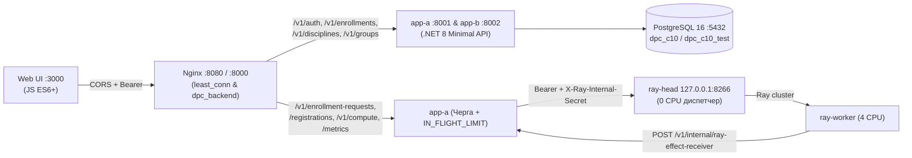

# Об'єднаний навчальний проєкт С10: «Запис на вибіркові дисципліни»
**Лабораторні роботи №1–3: Web + РПО** (`.NET 8`, `PostgreSQL 16`, `Nginx`, `Python Ray`, `Docker Compose`, `JavaScript ES6+`)

---

## 1. Курс і тема

- **Дисципліни та реалізований обсяг**:
  - **«Обмін даними у Web-застосунках»**: ЛР1 (`О1.1–О1.7`, `Д1.1–Д1.5`), ЛР2 (`О2.1–О2.4`), **ЛР3 (`О3.1–О3.4` — повний основний обсяг: вхід/вихід, доступ до об'єктів і персоналу, CORS, сценарії клієнта)**.
  - **«Розподілені та паралельні обчислення» (РПО)**: ЛР1 (`О1.1–О1.5`, `Д1.1–Д1.4`), ЛР2 (`О2.1–О2.4`), **ЛР3 (`О3.1–О3.4` — повний основний обсяг: задачі в Ray, `IN_FLIGHT_LIMIT`, атомарний ефект, відновлення після відмови до ack)**.
  - *Додаткові пункти **Д3.x** обох курсів і завдання **ЛР4–ЛР6** навмисно не реалізовувалися.*
- **Тема**: **С10. Запис на вибіркові дисципліни** (резервування місць, контроль лімітів $K=5$ та $\le 30.0$ ЄКТС, формування відомості деканату `decanate_roster`).
- **Виконавець**: **Зінківський Тимур Євгенійович**, група **ІТІНФ-23-2** (індивідуальне виконання за погодженням викладача).

---

## 2. Проєкт

- **Спільний ресурс та головний інваріант**: таблиця `discipline_group` і представлення `VIEW group_seats` (`taken = GREATEST(seats - available, roster_count)`). Інваріант системи: $\text{taken} \le \text{seats}$ і $\text{available} \ge 0$ без перевищення квоти навіть за конкурентних запитів та повторного доставлення задач.
- **Точність та час**: кредити ЄКТС зберігаються у `NUMERIC(3,1)` / `decimal` (семестровий ліміт $\le 30.0$); усі часові мітки у UTC (`TIMESTAMPTZ` / `DateTimeOffset`), розклад пар перевіряється у часовій зоні `Europe/Kyiv`, вікно запису $[opens\_at, closes\_at)$.
- **Повільний виклик (О1.3 РПО)**: штучна затримка `200–700 мс` виконується у Ray-воркері **строго ДО транзакції БД**, тому з'єднання і рядкові блокування PostgreSQL не утримуються під час I/O-паузи.
- **Математичний еталон ЛР2 РПО**: інтенсивність заявок $\lambda(t) = B + A e^{-t/\tau}$ ($A=50$, $B=5$, $\tau=10$, $T=60$) з аналітичною первісною $F(t) = B t - A\tau e^{-t/\tau}$ і точним значенням $I_{\text{ref}}(0,60) = 798.7606239117$.
- **Спільна взаємодія С10 (Web + РПО)**:
  1. Web-контур (`app-a` / `app-b`) резервує місце в `enrollments` зі статусом `held` (`POST /v1/enrollments`).
  2. Реєстрація у відомості (`POST /v1/enrollments/{id}/registrations`) передає попередньо зарезервований запис (`held`) у чергу РПО.
  3. Диспетчер `app-a` відправляє задачу на `ray-head` (`0 CPU`), який планує виконання `@ray.remote`-функції на окремому воркері `ray-worker` (`4 CPU`).
  4. Окремий Ray-воркер (`ray-worker`) виконує затримку та викликає захищений приймач `POST /v1/internal/ray-effect-receiver`.
  5. Приймач у транзакції БД атомарно фіксує ефект у `dpc_applied_effects` та оновлює `decanate_roster` без подвійного списання `available`.
  6. **Окремим етапом після коміту** транзакції приймача викликається сповіщення Web-контуру (`TryNotifyWebAsync`), яке переводить запис `enrollments` зі стану `held` у `confirmed`.

---

## 3. Архітектура

### 3.1 Загальна схема та взаємодія



На межі контурів Web і РПО використовуються спільні ідентифікатори `student_id`, `group_id`, `enrollment_id` та `request_id`; детальну схему обробки повторів і дедуплікації наведено в [docs/architecture-and-experiments.md](docs/architecture-and-experiments.md).

### 3.2 HTTP API та контракт

Контракт OpenAPI 3.1 (з розширеннями `x-course` та форматом помилок RFC 9457 Problem Details) зафіксовано в [openapi.yaml](openapi.yaml).

| Контур | Метод і шлях | Короткий опис |
| :--- | :--- | :--- |
| **Auth / Web ЛР3** | `POST /v1/auth/login`, `POST /v1/auth/logout`, `GET /v1/me` | Вхід за `username`/`password`, спільна сесія в БД (`app-a`/`app-b`), негайне відкликання токена `wbt_...` |
| **Каталог Web C10** | `GET /v1/disciplines`, `GET /v1/students`, `GET /v1/students/{id}` | Каталог із Base64-курсором; картка та список студентів із фільтрацією власника/`staff` |
| **Записи Web C10** | `POST/GET /v1/enrollments`, `GET/PATCH /v1/enrollments/{id}` | Резервування (`held`, `Idempotency-Key`), читання (`404`-паритет), переведення групи (перевірка `If-Match`/`ETag` за наявності заголовка) |
| **Дії над записом** | `POST .../registrations`, `.../confirm`, `.../cancel` | Передача `held` у чергу РПО, підтвердження за наявності запису в `decanate_roster` (`409 roster_registration_required` без нього) або скасування |
| **Персонал (Staff)** | `POST /v1/groups/{id}/close` | Закриття групи персоналом деканату (`403` для ролі `user`) |
| **Черга та інваріант** | `POST/GET /v1/enrollment-requests`, `GET /v1/group-seats`, `GET /v1/decanate-roster` | Черга РПО (`202`/`429`), опитування з `first_read_at`, інваріант місць, відомість деканату |
| **Обчислення та службові** | `POST /v1/compute`, `GET /health`, `GET /metrics`, `/v1/internal/ray-effect-receiver`, `/v1/admin/reset` | Інтегрування в процесах ОС, стан вузлів, закон Літтла + `in_flight`, приймач Ray, тестове скидання |

---

## 4. Структура репозиторію

| Каталог / файл | Призначення |
| :--- | :--- |
| `src/EnrollmentService/Endpoints/` | Minimal API: `AuthEndpoints`, `EnrollmentEndpoints`, `GroupEndpoints`, `EnrollmentRequestEndpoints`, `InternalReceiverEndpoints`, `ComputeEndpoints`, `DiagnosticsEndpoints`, `AdminEndpoints` |
| `src/EnrollmentService/Domain/` | Предметні правила С10 та інваріанти (`EnrollmentPolicy`, `EnrollmentDomainRules`, `Entities`, `ServiceResult`) |
| `src/EnrollmentService/Http/` | Middleware та HTTP-допоміжні модулі (`BearerAuthMiddleware`, `GracefulShutdownMiddleware`, `RequestIdentityMiddleware`, `ProblemDetailsMapper`, `HttpPayloadHelper`, `RequestIdentity`) |
| `src/EnrollmentService/Queues/` | Реалізації обмеженої черги (`IBoundedRequestQueue`, `MonitorRequestQueue`, `ChannelRequestQueue`) |
| `src/EnrollmentService/Services/` | `WebAuthService`, `EnrollmentService`, `EnrollmentWorkerPool`, `FaultInjector`, `RayTaskClient`, `RayEffectReceiverService`, `EnrollmentRequestProcessor`, `ParallelComputeService` |
| `src/EnrollmentService/Repositories/` | Доступ до PostgreSQL через `Npgsql 8.0` без ORM (`AuthRepository`, `EnrollmentRepository`, `EnrollmentRequestRepository`, `DecanateRepository`, `GroupRepository`) |
| `ray_worker/` | `app.py`, `Dockerfile`, `requirements.txt` — кластер Ray 2.38 + FastAPI диспетчер (`/health`, захищений `/dispatch`), `@ray.remote` із ретраями та збоєм `after_effect_before_ack` |
| `migrations/` | Послідовні SQL-міграції `001`–`012` з контролем SHA-256 (`011` — ідемпотентність, `012` — `web_users`, `web_auth_tokens`, `dpc_applied_effects`) |
| `client/` | Браузерний клієнт ES6+ без фреймворків (`index.html`, `api.js`, `serve.mjs`, `start_client.ps1`, `start_client.sh`) |
| `tests/EnrollmentService.Tests/` | Набір тестів xUnit (`WebLab3AuthAndAccessTests.cs`, `DpcLab3RayAndRecoveryTests.cs`, тести ЛР1–ЛР2) |
| `scripts/`, `docs/` та конфіги | `openapi.yaml`, `checks.yaml`, `compose.yaml`, `nginx.conf`, `scripts/verify_all.ps1|.sh`, `scripts/measure_compute.ps1`, [docs/architecture-and-experiments.md](docs/architecture-and-experiments.md) |

---

## 5. Збірка та запуск

Для повного тестування й автоперевірки необхідні `Docker`, `.NET 8 SDK`, `PowerShell 7` та `Node.js/npm`; SQL-міграції (`001`–`012`) і початкові тестові дані ініціалізуються автоматично під час запуску сервісу (`DatabaseInitializer`).

1. **Запуск контейнерного стенду** (`postgres`, `ray-head`, `ray-worker`, `app-a`, `app-b`, `nginx`):
   ```powershell
   docker compose up -d --build
   ```
   - API через Nginx: `http://localhost:8080` та `http://localhost:8000`; прямі порти вузлів: `:8001` (`app-a`), `:8002` (`app-b`).
   - `app-a` очікує готовності `postgres` і `ray-head` (`service_healthy`); порт диспетчера Ray опубліковано виключно на `127.0.0.1:8266`.
2. **Запуск браузерного клієнта (`http://localhost:3000`)**:
   ```powershell
   pwsh client/start_client.ps1
   ```
   *(Під час `scripts/verify_all.ps1` клієнт `client/serve.mjs` піднімається та зупиняється автоматично).*
3. **Ключові змінні середовища** (шаблон у [.env.example](.env.example)) та **демо-акаунти** (`student-1`..`student-3` з роллю `user`, `staff-1` з роллю `staff`):

| Змінна | Значення за замовчуванням | Призначення |
| :--- | :--- | :--- |
| `API_AUTH_TOKEN` / `INTERNAL_RECEIVER_SECRET` | Службові секрети | Bearer для РПО/внутрішніх маршрутів і `X-Ray-Internal-Secret` |
| `AUTH_TOKEN_TTL_MINUTES` / `CORS_ALLOWED_ORIGINS` | `120` / `http://localhost:3000,http://127.0.0.1:3000` | TTL Web-токенів `wbt_...` і явний список Origin (без `*`) |
| `QUEUE_CAPACITY` / `WORKERS` / `IN_FLIGHT_LIMIT` | `100` / `3` / `3` | Місткість черги, кількість воркерів і ліміт активних задач у Ray |
| `RAY_DISPATCHER_URL` / `RAY_TASK_MAX_RETRIES` | `http://ray-head:8266` / `3` | Адреса диспетчера Ray і кількість повторів |
| `EXECUTION_MODEL` / `QUEUE_ENGINE` | `async_tasks` / `custom_monitor` | Режим воркерів і реалізація черги |
| `ALLOW_TEST_OVERRIDES` / `FAULTS` / `UNSAFE_MODE` | `false` / `off` / `false` | Режим стендового скидання, ін'єкції збоїв та небезпечного режиму ЛР1 |

---

## 6. Лабораторні (відповідність вимогам ЛР1–ЛР3)

### 6.1 Курс «Обмін даними у Web-застосунках»

| Пункт | Реалізація (файл) | Перевірка та результат |
| :--- | :--- | :--- |
| **Web О1.1** | `Services/EnrollmentService.cs`, `Domain/EnrollmentDomainRules.cs` | E2E: ЖЦ `held -> confirmed/cancelled/expired`, вікно `[opens_at, closes_at)`, ліміти `K=5`, `30.0` ЄКТС |
| **Web О1.2** | `migrations/001`–`012`, `Services/DatabaseInitializer.cs` | Старт БД із SHA-256 контролем міграцій, композитні FK без дублювання |
| **Web О1.3** | `openapi.yaml`, `Http/ProblemDetailsMapper.cs` | Spectral lint: `0` помилок і `0` попереджень; помилки у форматі RFC 9457 |
| **Web О1.4** | `Endpoints/EnrollmentEndpoints.cs`, `Endpoints/GroupEndpoints.cs` | `POST` повертає `201 Created`, `Location`, `X-Request-ID`; `400`/`404`/`409`/`422` |
| **Web О1.5** | `Repositories/EnrollmentRepository.cs`, `Repositories/GroupRepository.cs` | Base64 `next_cursor` без пропусків/дублів; некоректний курсор -> `400` |
| **Web О1.6** | `nginx.conf`, `compose.yaml`, `Extensions/ServiceCollectionExtensions.cs` | `least_conn` між `app-a`/`app-b`, CORS `OPTIONS` з `X-Request-ID` |
| **Web О1.7** | `client/index.html`, `client/api.js` | Браузерний клієнт JS ES6+ безпечно ігнорує зайві поля сервера |
| **Web Д1.1** | `Domain/EnrollmentDomainRules.cs`, `tests/EnrollmentService.Tests/` | Чиста функція `EnrollmentDomainRules.IsWithinEnrollmentWindow` перевірена unit-тестами xUnit |
| **Web Д1.2** | `client/api.js`, `client/serve.mjs` | Окремий клієнтський стек на JavaScript (`:3000`) без фреймворків |
| **Web Д1.3** | `tests/EnrollmentService.Tests/BusinessErrorStatusTests.cs`, `Http/ProblemDetailsMapper.cs` | Правило RFC 9457 перетворено на автоматичний тест: помилки повертають `application/problem+json` з полями `type`, `title`, `status`, `detail` |
| **Web Д1.4** | `Http/RequestIdentityMiddleware.cs`, `Services/StructuredJsonLogger.cs` | W3C `traceparent` -> `X-Trace-Id`, структуровані JSON-логи |
| **Web Д1.5** | `Domain/EnrollmentDomainRules.cs`, `Services/EnrollmentService.cs` | Перевірка розкладу в `Europe/Kyiv`, зберігання міток у UTC |
| **Web О2.1** | `Repositories/EnrollmentRepository.cs`, `compose.yaml` | 45 конкурентних запитів на `app-a`/`app-b`: `25×201`, `20×409`, `available=0` |
| **Web О2.2** | `migrations/011_*.sql`, `Repositories/EnrollmentRepository.cs` | SHA-256 відбиток тіла; повтор на `app-b` повертає 201, зміна тіла -> `422` |
| **Web О2.3** | `Services/FaultInjector.cs`, `Endpoints/EnrollmentEndpoints.cs` | Збій `after_commit_before_response` -> `fault.hit`, повтор через `app-b` без дубля |
| **Web О2.4** | `client/api.js` | `AbortController` таймаут, backoff + jitter, дотримання `Retry-After` |
| **Web О3.1** | `Services/WebAuthService.cs`, `Repositories/AuthRepository.cs`, `Http/RequestIdentityMiddleware.cs` | `PBKDF2-SHA256`, непрозорі токени `wbt_...`, спільна сесія та миттєвий `logout` на `app-a`/`app-b`, ігнорування `X-User-Id`, розділення з `API_AUTH_TOKEN` |
| **Web О3.2** | `Endpoints/EnrollmentEndpoints.cs`, `Endpoints/GroupEndpoints.cs`, `Repositories/EnrollmentRepository.cs` | Фільтрація за власником, однаковий `404`, `PATCH` (перевірка `If-Match`/`ETag` за наявності заголовка), `422` при підміні полів у тілі, `staff`-захист `/close` (`403` для `user`) |
| **Web О3.3** | `Extensions/ServiceCollectionExtensions.cs`, `Program.cs`, `client/api.js` | Web Bearer-токен зберігається в `sessionStorage`, передається через заголовок `Authorization` і видаляється при `logout`; CORS дозволяє лише явно задані origin (`*` заборонено), `Vary: Origin`, облік `OPTIONS` |
| **Web О3.4** | `client/index.html`, `client/api.js` | Живе виконання 7 кроків `runWebLab3Scenario()` на `:3000` (`23` CORS-перевірки, `0` збоїв) |

### 6.2 Курс «Розподілені та паралельні обчислення» (РПО)

| Пункт | Реалізація (файл) | Перевірка та результат |
| :--- | :--- | :--- |
| **РПО О1.1** | `Endpoints/EnrollmentRequestEndpoints.cs`, `Services/EnrollmentWorkerPool.cs` | Прийом `202 Accepted` у БД до черги, подальше доведення до `done`/`rejected` |
| **РПО О1.2** | `Queues/MonitorRequestQueue.cs`, `Endpoints/DiagnosticsEndpoints.cs` | `QUEUE_CAPACITY=100`: `8352` відповідей `429 Retry-After`, `/health` p95 `5.77` мс ($\le 100$ мс) |
| **РПО О1.3** | `ray_worker/app.py`, `Services/Processing/RayTaskClient.cs` | Повільний I/O (`200–700` мс) винесено у Ray-воркер **до** транзакції БД |
| **РПО О1.4** | `Repositories/DecanateRepository.cs`, `Services/Processing/RayEffectReceiverService.cs` | SAFE (`FOR UPDATE`): `5/5` місць; UNSAFE (`UNSAFE_MODE=true`): `11/5` (гонитва) |
| **РПО О1.5** | `Repositories/EnrollmentRequestRepository.cs`, `Metrics/MetricsCollector.cs` | Монотонні $t_1..t_4$, одноразова фіксація `first_read_at`, 0 порушень |
| **РПО Д1.1** | `Services/EnrollmentWorkerPool.cs` | Обидві моделі (`async_tasks` та `dedicated_threads`) обробили по 20 заявок без втрат |
| **РПО Д1.2** | `Metrics/MetricsCollector.cs`, `Services/EnrollmentWorkerPool.cs` | Закон Літтла $L = \lambda W$: розбіжність інтеграла `0.25%`, семплера `0.39%` |
| **РПО Д1.3** | `Queues/MonitorRequestQueue.cs`, `Queues/ChannelRequestQueue.cs` | `custom_monitor` та `system_channel` успішно обробили по 20 заявок |
| **РПО Д1.4** | `Http/GracefulShutdownMiddleware.cs`, `Services/EnrollmentWorkerPool.cs` | `SIGTERM`: нові -> `503`, усі `10/10` прийнятих доведено до `done` за `1.56` с |
| **РПО О2.1** | `Endpoints/ComputeEndpoints.cs`, `Services/Compute/ComputeWorkerProcess.cs` | Bearer-захист, межі $[0, T]$, обчислення в процесах ОС (`workers=1/2/4`, похибка $\le 10^{-6}$) |
| **РПО О2.2** | `Services/Compute/C10IntensityMath.cs`, `scripts/measure_compute.ps1` | При подвоєнні $n$ похибка падає в `4.0000` раза ($O(h^2)$) проти $I_{\text{ref}}$ |
| **РПО О2.3** | `Services/Compute/ComputeWorkerProcess.cs`, `docs/architecture-and-experiments.md` | `dotnet-trace` + `naive -> composite`: прискорення `2.165x` ($p=1$), $S_{\text{med}}(4)=3.113$ |
| **РПО О2.4** | `Services/Compute/ParallelComputeService.cs`, `Services/Compute/ComputeWorkerProcess.cs` | `MemoryMappedFile`: `local` і `lock` точні, `none` втрачає оновлення (похибка `552.08`) |
| **РПО О3.1** | `ray_worker/app.py`, `Services/Processing/RayTaskClient.cs`, `compose.yaml` | `ray-head` (`0 CPU`) + окремий `ray-worker` (`4 CPU`, `alive_nodes=2`, `worker_id=ray:ray-worker:pid-...`), порт `127.0.0.1:8266`, `/dispatch` перевіряє `Bearer` (`401`) і `X-Ray-Internal-Secret` (`403`) |
| **РПО О3.2** | `Services/EnrollmentWorkerPool.cs` | `_dequeueGate` звільняється одразу після отримання слота й вилучення заявки, а слот `IN_FLIGHT_LIMIT` (`_activeInFlightCount`) утримується до завершення задачі (`ReleaseInFlightSlot()`); перевірено на 6 задачах (`max_in_flight_observed=2`) |
| **РПО О3.3** | `Services/Processing/RayEffectReceiverService.cs`, `Repositories/EnrollmentRequestRepository.cs`, `Services/Processing/EnrollmentRequestProcessor.cs` | Атомарне збереження в `dpc_applied_effects` (`pg_advisory_xact_lock`), захист зафіксованих `done`/`rejected` від перезапису статусом `failed` при втраті відповіді Ray |
| **РПО О3.4** | `ray_worker/app.py`, `Services/FaultInjector.cs` | Файловий прапорець `/faults/after_effect_before_ack`: збій після запису ефекту до ack, повтор Ray завершився ідемпотентно (`delivery_count=2`, `roster_count=1`) |

---

## 7. Експерименти та перевірка

### 7.1 Команди повного відтворення

```powershell
# 1. Валідація контракту OpenAPI 3.1 (Spectral CLI)
npx --yes @stoplight/spectral-cli lint openapi.yaml --fail-severity=warn

# 2. Модульні та інтеграційні тести xUnit (ізольована БД dpc_c10_test)
dotnet test tests/EnrollmentService.Tests/EnrollmentService.Tests.csproj --configuration Release

# 3. Заміри обчислень ЛР2 (окремі процеси ОС + shared memory)
pwsh -NoProfile -ExecutionPolicy Bypass -File scripts/measure_compute.ps1

# 4. Відтворення емпіричної вибірки N=500 (empirical_metrics_500.json)
pwsh -NoProfile -ExecutionPolicy Bypass -File scripts/measure_metrics_500.ps1

# 5. Повна контейнерна E2E-перевірка ЛР1–ЛР3 (включаючи автозапуск клієнта :3000)
pwsh -NoProfile -ExecutionPolicy Bypass -File scripts/verify_all.ps1
```

Контрактні сценарії перевірки описано в [checks.yaml](checks.yaml), а повні таблиці експериментів ЛР1–ЛР2 — у [docs/architecture-and-experiments.md](docs/architecture-and-experiments.md).

### 7.2 Короткі фактичні результати

| Експеримент / Перевірка | Зафіксований результат |
| :--- | :--- |
| **OpenAPI та xUnit** | Spectral CLI: `0` помилок / `0` попереджень; `dotnet test`: `207/207` (`Passed=207, Failed=0, Skipped=0`) |
| **РПО О1.4 (SAFE vs UNSAFE)** | Контрольний прогін `verify_all.ps1`: SAFE `5/5` (`done=5, rejected=15`), UNSAFE `11/5` (серія прогонів: `7–11/5`) |
| **Вибірка `N=500` (`empirical_metrics_500.json`)** | `done=150`, `rejected=350`, `failed=0`, `monotonic_order_violations=0`; `POST 202` p50 `3.2` мс / p95 `79.6` мс |
| **Web О2.1–О2.4 (конкуренція та ідемпотентність)** | 45 одночасних запитів на `app-a`/`app-b`: `25×201 + 20×409` (`available=0, taken=25/25`); повтор після збою без дубля |
| **РПО ЛР2 (`POST /v1/compute`)** | Порядок $O(h^2)$ (`4.0000x`), $S_{\text{med}}(4)=3.113$, оптимізація `2.165x`, `none` ($n=2\,000\,000$ у `verify_all.ps1`) втрачає оновлення (`abs_err=552.08`) |
| **Web ЛР3 (`runWebLab3Scenario()`, `:3000`)** | Усі 7 кроків (401 -> вхід -> 201+PATCH -> 403 -> 404/404 -> staff -> logout/401) і `23` CORS-перевірки (`0` збоїв) |
| **Ray ЛР3 (`after_effect_before_ack`)** | `IN_FLIGHT_LIMIT=2` (`max_in_flight_observed=2, processed=6`); після збою до ack: `delivery_count=2`, `roster_count=1`, `invariant_holds=true` |

---

## 8. Обмеження та відтворення контрольованих збоїв

- **Відтворення збоїв `after_commit_before_response` (Web О2.3) та `after_effect_before_ack` (РПО О3.4)**:
  - **Увімкнення**: запустити сервіси з `FAULTS=on` і `ALLOW_TEST_OVERRIDES=true` (`docker compose up -d --force-recreate app-a app-b`), після чого створити одноразовий файловий прапорець `faults/after_commit_before_response` або `faults/after_effect_before_ack`.
  - **Перевірка спрацювання**: при настанні події файл-прапорець автоматично видаляється, у логах `dpc-c10-api` або `ray-head`/`ray-worker` з'являється подія `fault.hit`, а повторний запит клієнта / ретрай Ray завершується ідемпотентно без дубля (`delivery_count=2, roster_count=1, invariant_holds=true`).
  - **Вимкнення та відновлення**: прибрати залишкові файли в `faults/` (якщо збій не спрацював), повернути `FAULTS=off` і `ALLOW_TEST_OVERRIDES=false`, перестворити `app-a`/`app-b` через `docker compose up -d --force-recreate app-a app-b` (за потреби виконати `POST /v1/admin/reset` перед вимкненням `ALLOW_TEST_OVERRIDES`).
- **Відомі обмеження**: типові секрети в `compose.yaml` призначені лише для локального стенду; автоматичний перерозподіл (`second_choice`) належить до ЛР6; клієнтський сценарій О3.4 у `verify_all.ps1` виконує `runWebLab3Scenario()` у `Node.js` (`node:vm`) замість графічного Chromium.

---

## 9. Внесок учасників, використані бібліотеки та декларація про ШІ

- **Авторський внесок**: проєкт виконано індивідуально студентом Зінківським Т. Є. (ІТІНФ-23-2) — схема БД, OpenAPI 3.1, серверне API, контур РПО/Ray, клієнт JS, тести xUnit і скрипти верифікації.
- **Використані бібліотеки та інструменти**:
  - `.NET 8.0 / ASP.NET Core` — HTTP Minimal API, DI, хостинг фонових воркерів і middleware автентифікації.
  - `Npgsql 8.0.3` — прямий доступ до PostgreSQL без ORM із керуванням транзакціями та `FOR UPDATE` / advisory-блокуваннями.
  - `System.Threading.Channels` — обмежена буферизована черга заявок РПО в пам'яті (`ChannelRequestQueue`).
  - `PostgreSQL 16` та `Nginx 1.27` — реляційне сховище 3НФ (сесії, ідемпотентність, відомість) і балансування `least_conn`.
  - `Ray 2.38.0`, `FastAPI 0.115.0`, `Uvicorn 0.32.0`, `httpx 0.27.2` — розподілене виконання задач у воркерах Python, захищений диспетчер `/dispatch` та виклик приймача ефектів.
  - `xUnit 2.8.1` та `Microsoft.AspNetCore.Mvc.Testing 8.0.3` — модульні, інтеграційні та E2E-тести.
  - `@stoplight/spectral-cli`, `Docker Compose v2`, `Node.js` — лінтинг OpenAPI 3.1, оркестрація контейнерів і роздача/прогін JS-клієнта.
- **Декларація про використання ШІ**: генеративні моделі ШІ застосовувалися як допоміжний інструмент для структурування коду, шаблонних тестів і документації; усі архітектурні рішення, SQL-транзакції, правила безпеки та результати експериментів перевірено вручну й підтверджено запуском `dotnet test` і `scripts/verify_all.ps1`.
