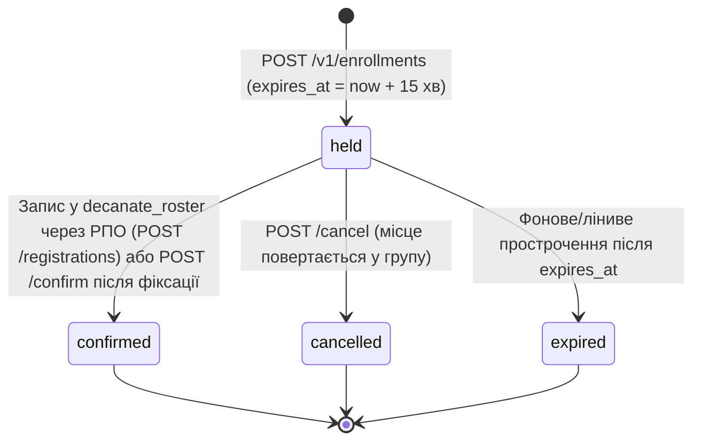
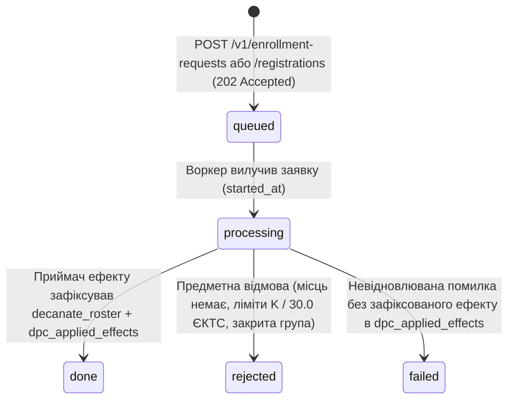
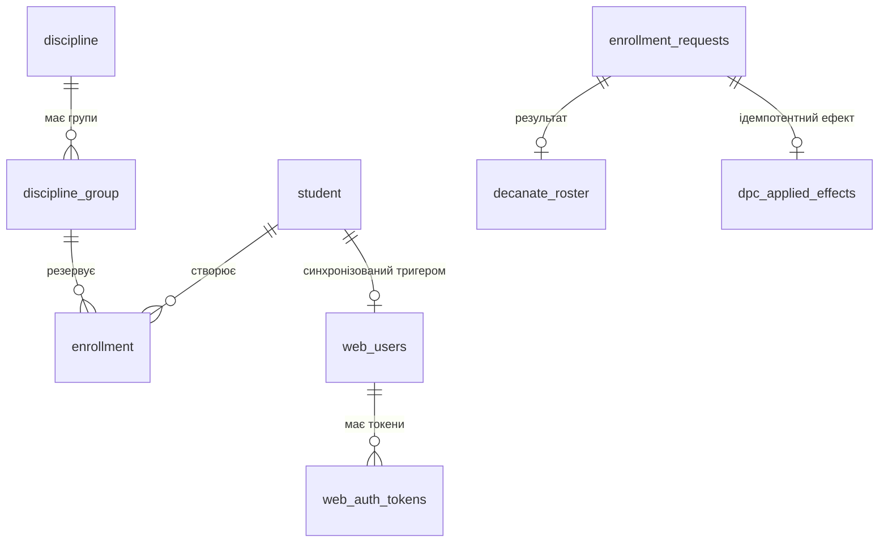

# Детальна архітектура, механізми надійності та протоколи дослідів (C10, ЛР1–ЛР3)

Цей документ є технічним додатком до основного [README.md](../README.md) і містить розгорнуті схеми, опис внутрішніх механізмів синхронізації, діаграми станів та повні експериментальні таблиці за лабораторними роботами №1–3.

---

## 1. Модель предметної області С10 та діаграми станів

### 1.1 Життєвий цикл Web-запису (`enrollment`, О1.1 Web)

| Початковий стан | Подія (HTTP-запит) | Кінцевий стан | Версія | Вплив на `available` і ліміти |
| :--- | :--- | :--- | :--- | :--- |
| *(новий)* | `POST /v1/enrollments` | `held` | `v = 1` | `available - 1`, `active_count + 1`, `active_ects + ects` |
| `held` (у відомості `decanate_roster`) | `POST /v1/enrollments/{id}/confirm` | `confirmed` | `v + 1` | Без змін; без запису в `decanate_roster` повертає `409 roster_registration_required` |
| `held` | `POST /v1/enrollments/{id}/registrations` | `confirmed` | `v + 1` | Без змін; РПО створює запис у `decanate_roster` і сповіщає Web |
| `held` | `PATCH /v1/enrollments/{id}` (`If-Match`) | `held` | `v + 1` | Переносить бронь у нову групу, перевіряє ліміти та коригує `active_ects` |
| `held` | `POST /v1/enrollments/{id}/cancel` | `cancelled` | `v + 1` | `available + 1`, `active_count - 1`, `active_ects - ects` |
| `held` ($t > \text{expires\_at}$) | Таймер (2 с) / звернення | `expired` | `v + 1` | `available + 1`, `active_count - 1`, `active_ects - ects` |
| `confirmed` | `POST /confirm` | `confirmed` | Без змін | Ідемпотентно `200 OK` |
| `confirmed` | `POST /cancel` або `/registrations` | `confirmed` | Без змін | Відмова `409 Conflict` |

### 1.2 Життєвий цикл заявки РПО (`enrollment_requests`, О1.1 РПО)

### 1.3 Розмежування Web та РПО і надійна узгодженість (§1.10)

1. **Автономний стенд РПО (`POST /v1/enrollment-requests`)**: доступний лише для груп із `dpc_sandbox_enabled = true` (`DISC-DPC-01`, `DISC-TEST-SAFE`). Інші групи повертають `422 dpc_sandbox_disabled`.
2. **Спільна наскрізна реєстрація (`POST /v1/enrollments/{id}/registrations`)**:
   - Web-контур створює `held` (резервує місце і ліміти), після чого заявка передається у чергу РПО.
   - Воркер РПО не змінює напряму таблицю `enrollment` і **не виконує повторного декременту `available`**.
   - Після коміту у `decanate_roster` і `dpc_applied_effects` викликається `IWebEnrollmentNotifier.NotifyRosterRecordedAsync` (до 3 спроб з експоненційним відступом 50 мс і 100 мс), а фонова служба `HeldEnrollmentExpirationBackgroundService` кожні 2 с звіряє `held`-записи з `decanate_roster` (з фільтром `dr.created_at < NOW() - INTERVAL '2 seconds'` для усунення перегонів із миттєвими перевірками).
   - `ExpireStaleHeldEnrollmentsAsync` виключає будь-які `enrollment`, що вже присутні у `decanate_roster`.
   - `HasActiveEnrollmentForDisciplineAsync` виконує `UNION ALL` по таблицях `enrollment` (`held`, `confirmed`) та `decanate_roster`.

---

## 2. Схема бази даних, міграції та цілісність

- **Контрольована денормалізація і композитні FK (`005_composite_foreign_keys.sql`)**: атрибут `discipline_id` дублюється в `enrollment` та `decanate_roster` для часткового індексу `idx_enrollment_active_student_discipline(student_id, discipline_id) WHERE status IN ('held', 'confirmed')` і захищається складеним `FOREIGN KEY (group_id, discipline_id) REFERENCES discipline_group(id, discipline_id)`.
- **Незмінність міграцій**: `DatabaseInitializer` звіряє SHA-256 кожного SQL-файлу (`001`–`012`) із таблицею `schema_migrations`. Проблема індексу `003` vs `004` виправлена за правилом roll-forward у `006_global_unique_idempotency_key.sql`.
- **Точні величини та час**: ЄКТС зберігаються у `NUMERIC(3,1)` і обчислюються через `decimal`; часові мітки у `TIMESTAMPTZ` (UTC); часове вікно вибору $[opens\_at, closes\_at)$ перевіряється чистою функцією `EnrollmentDomainRules.IsWithinEnrollmentWindow`.

---

## 3. Внутрішні механізми контуру Web (ЛР1–ЛР3)

### 3.1 Конкурентність і блокування (`POST /v1/enrollments`, О2.1)
1. Транзакційний advisory-замок за ключем ідемпотентності: `pg_try_advisory_xact_lock(202610, hashtext(@idempotencyKey))` (повертає `409 idempotency_key_in_progress` для одночасного дублю).
2. Блокування рядків у канонічному порядку `student -> discipline_group` (`FOR UPDATE`), що виключає взаємні блокування (deadlocks) між `app-a` та `app-b`.
3. Умовний декремент `UPDATE discipline_group SET available = available - 1 WHERE id = @groupId AND available > 0`.

### 3.2 Ідемпотентність Web О2.2 та керований збій О2.3–О2.4
- Міграція `011_web_idempotency_lr2.sql` зберігає `idempotency_operation`, `idempotency_key` (глобально унікальний індекс), канонічний SHA-256 відбиток `request_payload_hash` (`ComputeWebEnrollmentFingerprint`), `idempotency_state`, початкову відповідь (`201`, JSON-тіло, `Location`) та `idempotency_expires_at`.
- За відсутності `Idempotency-Key` — `400 missing_idempotency_key`; за іншого тіла/користувача з тим самим ключем — `422 idempotency_key_payload_mismatch`.
- Фонове очищення `CleanupExpiredIdempotencyKeysBatchAsync` очищує лише прострочені метадані пачками по 100 записів (`FOR UPDATE SKIP LOCKED`) без видалення `enrollment`.
- **Fault O2.3 (`FaultInjector.cs`)**: при `FAULTS=on` і наявності `/faults/after_commit_before_response` прапорець атомарно переміщується/видаляється після `tx.CommitAsync()`, логується `fault.hit`, і процес завершується з кодом `137` до надсилання HTTP-відповіді.
- **Повтори клієнта О2.4 (`client/api.js`)**: один `Idempotency-Key` на операцію, `maxAttempts = 4`, `attemptTimeoutMs = 3500`, `totalBudgetMs = 8000` через `AbortController` (включаючи читання тіла відповіді), експоненційний відступ із джитером і дотриманням $\text{delay} \ge \text{Retry-After}$; постійні помилки (`400`, `401`, `403`, `404`, `422`, предметні `409`) не повторюються; при вичерпанні бюджету виводиться **«Результат невідомий»**.

### 3.3 Серверна автентифікація, об'єктний доступ і CORS (Web ЛР3: О3.1–О3.4)
- **Непрозорі токени (О3.1)**: таблиці `web_users` (`PBKDF2-SHA256`, 100 000 ітерацій з сіллю) та `web_auth_tokens` (SHA-256 хеш токена `wbt_...`, `expires_at`, `revoked_at`). Перевіряються у `RequestIdentityMiddleware` для обох вузлів `app-a` і `app-b`. Заголовок `X-User-Id` повністю ігнорується. Служебний `API_AUTH_TOKEN` РПО та користувацькі Web-токени суворо ізольовані (`401` при перехресному використанні).
- **Доступ до об'єктів та RBAC (О3.2)**: списки `/v1/enrollments` та `/v1/students` фільтруються за поточним автентифікованим користувачем; читання/зміна/підтвердження/скасування чужого чи відсутнього `enrollmentId` однаково повертають `404`; `PATCH /v1/enrollments/{id}` перевіряє заголовок `If-Match` за його наявності (`409` при конфлікті версії) та оновлює `ETag`; поля власника/статусу/версії в тілі заборонені (`422`); `POST /v1/groups/{id}/close` дозволено лише для `staff` (`403` для `user`, `401` без токена).
- **CORS (О3.3)**: у `Program.cs` задано явний білий список `CORS_ALLOWED_ORIGINS` (`http://localhost:3000`, `http://127.0.0.1:3000`), методи `GET, POST, PATCH, OPTIONS` та дозволені заголовки; сторонній `Origin` не отримує `Access-Control-Allow-Origin` (і ніколи `*`).

---

## 4. Внутрішні механізми контуру РПО та Ray (ЛР1–ЛР3)

### 4.1 Обмежена черга, моделі виконання та Graceful Shutdown (О1.2, Д1.1, Д1.3, Д1.4)
- `MonitorRequestQueue` використовує `lock (_syncRoot)` + пасивне очікування без Busy-Waiting (`Monitor.Wait`/`Monitor.PulseAll` для `dedicated_threads` та `TaskCompletionSource` для `async_tasks`). Альтернатива `ChannelRequestQueue` — на `System.Threading.Channels`.
- `TryReserveSlot()` миттєво відсікає перевантаження черги (`QUEUE_CAPACITY = 100`) статусом `429 Too Many Requests` (`Retry-After: 1`) без навантаження БД, тоді як ідемпотентні повтори за `Idempotency-Key` обслуговуються з БД до резервування слота черги.
- При `SIGTERM` (`PosixSignalRegistration`) нові мутуючі запити отримують `503` із `X-Request-ID`, воркери та приймач `/v1/internal/ray-effect-receiver` завершують дренаж усіх прийнятих заявок (при перевищенні ємності пам'яті дозавантажуючи решту `queued` із PostgreSQL).

### 4.2 Часові мітки $t_1 \le t_2 \le t_3 \le t_4$ і закон Літтла (О1.5, Д1.2)
- Вимірювання здійснюються монотонним годинником `Stopwatch.GetTimestamp()` на кільцевій вибірці до 500 завершених заявок (`O(1)` пам'яті, `_trackedItems` обмежено до 2000 записів).
- $t_1$ — прийом `POST /v1/enrollment-requests`, $t_2$ — старт обробки (`started_at`), $t_3$ — коміт рішення (`finished_at`), $t_4$ — перше читання термінального стану клієнтом (`first_read_at`, атомарний `UPDATE` лише коли `status IN ('done','rejected','failed') AND first_read_at IS NULL`).
- При оцінці закону Літтла $L = \lambda \cdot W$ `MetricsCollector` обчислює точний часовий інтеграл $\frac{1}{T}\int Q(t)dt$ та незалежну 100 мс вибірку.

### 4.3 Кластер Ray, `IN_FLIGHT_LIMIT`, приймач ефекту та відновлення (РПО ЛР3: О3.1–О3.4)
1. **Захищений диспетчер Ray (`ray_worker/app.py`)**:
   - Головний вузол `ray-head` запускається з `--num-cpus=0` (координатор кластера та FastAPI-диспетчер `/dispatch`), а окремий контейнер `ray-worker` виділяє `--num-cpus=4` для фактичного виконання `@ray.remote`-задач. Порт `8266` у `compose.yaml` публікується лише на `127.0.0.1:8266:8266`; контейнер `app-a` очікує `ray-head: service_healthy`.
   - `POST /dispatch` перевіряє `Authorization: Bearer <API_AUTH_TOKEN>` (`401`) та `X-Ray-Internal-Secret` (`403`) через `hmac.compare_digest`, обмежує параметри (`slow_min_ms`/`slow_max_ms <= 5000`, `max_retries <= 5`), а `execute_dpc_enrollment_task` використовує виключно конфігурацію `INTERNAL_RECEIVER_URL`, `API_AUTH_TOKEN` і `INTERNAL_RECEIVER_SECRET` зі змінних оточення Ray-контейнера.
2. **Обмежувач незавершених задач (`IN_FLIGHT_LIMIT`, О3.2)**:
   - В `EnrollmentWorkerPool` дозвіл на незавершену задачу (`WaitForInFlightSlotAsync`/`WaitForInFlightSlotBlocking`) під захистом `_dequeueGate` (`SemaphoreSlim(1, 1)`) береться **до** вилучення заявки з обмеженої черги. Звільнення слота виконується в `finally` одразу після завершення задачі незалежно від порядку фінішу.
3. **Атомарний приймач і дедуплікація (`RayEffectReceiverService`, О3.3)**:
   - Повільна перевірка (200–700 мс) виконується у віддаленому Ray-воркері поза транзакцією БД, після чого Ray викликає `POST /v1/internal/ray-effect-receiver`.
   - У межах однієї транзакції PostgreSQL під `pg_advisory_xact_lock(202633, hashtext(request_id))` приймач перевіряє `dpc_applied_effects`: якщо рішення вже зафіксовано, інкрементується `delivery_count` і повертається збережене рішення без повторної зміни `decanate_roster` чи `discipline_group.available`.
4. **Відмова після ефекту (`after_effect_before_ack`, О3.4) і захист від порчі статусу**:
   - За `FAULTS=on` і наявності файлу `/faults/after_effect_before_ack` Ray-воркер після отримання `200 OK` від приймача атомарно захоплює і видаляє прапорець, пише JSON-подію `fault.hit` і аварійно завершується (`os._exit(137)`). Ray автоматично виконує retry задачі, а приймач ідемптотентно повертає збережений ефект (`delivery_count >= 2`).
   - Якщо HTTP-відповідь диспетчера Ray втрачена після запису `done` або `rejected` у `dpc_applied_effects`, `EnrollmentRequestRepository.UpdateStatusAsync` блокує перезапис уже зафіксованих термінальних станів (`NOT IN ('done', 'rejected')` і `NOT EXISTS` у `dpc_applied_effects`), а `EnrollmentRequestProcessor` перед записом `failed` виконує звірку з `dpc_applied_effects` (`GetAppliedEffectDecisionAsync`), зберігаючи істинний статус `done` або `rejected`.

---

## 5. Повні експериментальні результати ЛР1 та ЛР2

*(Тестовий стенд: AMD Ryzen 7 5700X3D, 32 ГБ DDR4, Windows 11 Pro / Docker Desktop WSL2, `.NET 8.0 Release`).*

### 5.1 Досліди ЛР1 (5 прогонів та вибірка $N=500$)
- **О1.2 (50 паралельних клієнтів, 8 с, `QUEUE_CAPACITY=100`, `WORKERS=3`)**: 155–160 відповідей `202`, ~8320–8365 `429 Retry-After: 1` без навантаження на БД, пікова черга `100/100`; затримка `/health` (Nginx): p50 = `1.05–1.30` мс, **p95 = `4.8–6.7` мс** ($\le 100$ мс); `/health-app-a`: **p95 = `2.0–2.7` мс**.
- **О1.4 (SAFE vs UNSAFE на `DISC-TEST-SAFE`, 5 місць, 20 клієнтів)**: SAFE — `5 done / 15 rejected`, `roster_count = 5`, `invariant_holds = true`; UNSAFE — `7–11 done`, `roster_count = 7–11 > 5`, `invariant_holds = false`.
- **Д1.2 (Закон Літтла, 30 запитів у `DISC-DPC-01`)**: розбіжність $L_{\text{theor}}$ та інтегралу $\int Q(t)dt$ становить `0.15–0.25%` ($\le 10\%$), з 100 мс семплером — `0.10–1.30%` ($\le 15\%$), 0 порушень монотонності.
- **Д1.3 та Д1.1 (пакет 20 запитів)**: `custom_monitor` (`processing` p50 `420–480` мс) vs `system_channel` (`385–500` мс); `async_tasks` (`390–565` мс) vs `dedicated_threads` (`415–505` мс).
- **Д1.4 (`SIGTERM`, 10 заявок)**: новий запит отримує `503` з `X-Request-ID`, 10/10 заявок доведено до `done` за ~1.56–2.20 с.
- **О1.5 (Емпірична вибірка $N=500$, `scripts/empirical_metrics_500.json`)**: `done=150`, `rejected=350`, `failed=0`, `monotonic_order_violations=0`; час відповіді `POST 202`: медіана `3.2` мс (p95 `79.6` мс, p99 `85.5` мс при 50 потоках), тоді як `full_domain_execution_ms`: p50 `7654.1` мс, p95 `8136.9` мс (`queue_wait_ms` p50 `7203.4` мс, `processing_time_ms` p50 `464.0` мс, `delivery_wait_ms` p50 `57.1` мс).

### 5.2 Досліди РПО ЛР2 (`POST /v1/compute`, `scripts/measure_compute.ps1`)
- **Точність (О2.2, інтервал $[0, 60]$, еталон $I_{\text{ref}} = 798.7606239117$)**: при подвоєнні $n$ (`100 -> 200 -> 400 -> 800 -> 1600 -> 3200 -> 20000 -> 200000`) похибка падає рівно в `4.0000` раза (`O(h^2)`): від `1.4962e-1` при $n=100$ до `3.7405e-8` при $n=200\,000$.
- **Прискорення й профілювання (`bench_n = 250\,000\,000`, О2.3)**:
  - Медіани часу (3 прогони без профайлера): $T_1 = 1.5289\text{ с}$, $T_2 = 0.8658\text{ с}$ ($S=1.766$, $E=88.3\%$), $T_4 = 0.4911\text{ с}$ ($S=3.113$, $E=77.8\%$).
  - Послідовна інфраструктурна фаза `spawn+IPC` ($n=100$): `0.0648 с` ($p=1$), `0.0821 с` ($p=2$), `0.0883 с` ($p=4$ — `17.98%` загального часу, теоретична межа Амдала $S_{\text{theor}}(4) = 3.365$, залишок конкуренції за пам'ять/all-core boost `0.0368 с`).
  - `dotnet-trace` `Exclusive CPU` на циклі інтегрування: `98.76%` (`naive`) та `96.68%` (`composite`). Заміна параметра ядра `naive -> composite` (скорочення викликів `Math.Exp` із $2n$ до $n+p$): при $p=1$ прискорення `2.165x` (`3.1916 с -> 1.4743 с`), при $p=4$ — `1.931x` (`0.9988 с -> 0.5171 с`) зі збереженням точності ($|I_{\text{comp}} - I_{\text{naive}}| < 3 \times 10^{-10}$).
- **Режими пам'яті (`n = 10\,000\,000` у `measure_compute.ps1`, О2.4)**: при $p=4$ режим `none` втрачає ~73.3% суми (`212.938614`, похибка `585.82`), `lock` точний (`abs_err = 9.05e-11`), але триває `0.6729 с` (у 7.14 раза повільніше за `local` `0.0943 с` з `abs_err = 1.66e-11`). У швидкій перевірці `verify_all.ps1` при `n = 2\,000\,000` похибка `none` становить ~`500–552`.
